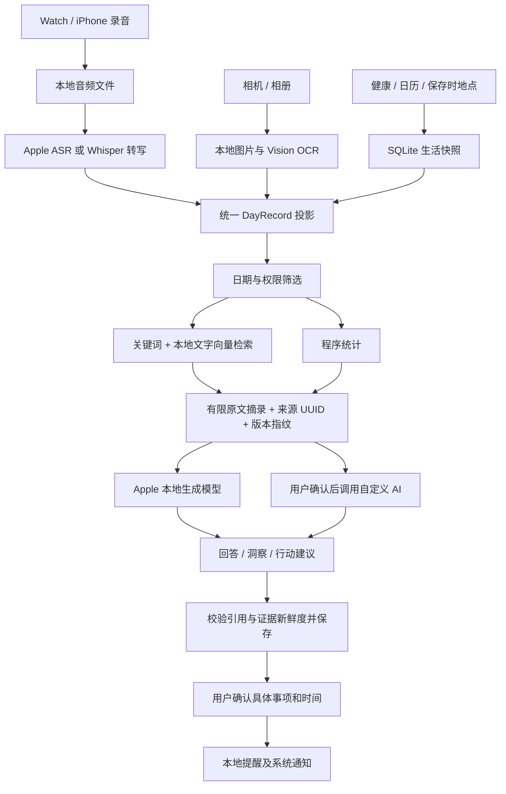

# WiseLife 数据、存储、检索与 AI 架构梳理

日期：2026-10-20。范围：`apps/wrist-notes` 当前工作区 Swift 源码，包含尚未提交的开发代码。

> 同日实施更新：本文保留第一阶段之前的架构核查快照。第一、第二阶段现已完成：录音、图片与提醒主元数据迁入 SQLite；全文关键词及完整原文分段索引已接入，支持分批续建和取消。当前规则见 [local-storage-and-retrieval.md](local-storage-and-retrieval.md)，验证记录见 [第一阶段](2026-10-20-metadata-sqlite-migration.md) 和 [第二阶段](2026-10-20-fulltext-and-chunk-indexing.md)。下文 JSON 主存储、未接入 FTS5 和前 1,800 字等描述均为历史状态；昨日回顾与跨日记忆仍属后续阶段。

本文核查的是实现结构，没有读取用户实际录音、照片、数据库或密钥，也没有在本次重新进行真机验证。代码存在不等于当前 TestFlight 版本已包含或真机效果已验证。

## 1. 总体结论

当前是本地混合存储架构：**媒体文件 + JSON 元数据 + SQLite 结构化数据和派生索引 + UserDefaults 设置 + Keychain 密钥**。

SQLite 已用于生活数据、对话、洞察和文字语义索引；录音、图片、提醒的主元数据仍使用 JSON。`DayRecord` 是统一展示和检索的内存投影，不是一个覆盖所有数据的 SQLite 主表。

建议保持大媒体文件独立保存，逐步把业务元数据统一到 SQLite。检索采用结构化条件、全文关键词和语义向量的组合；模型负责归纳表达，原始记录负责提供事实，统计由程序计算。

## 2. 当前的数据类型

| 数据类型 | 内容与来源 | 当前持久化 | 检索及 AI 用法 |
|---|---|---|---|
| 语音记录、闪念 | UUID、开始时间、时长、标题、长录音/闪念类型、来源、处理状态、音频 | iPhone：`Documents/VoiceNotes/Audio/<UUID>.m4a`；元数据为同目录上层 `notes.json` | 按 UUID 打开音频；按日期/类型筛选；转写后文字参与关键词、语义检索、单条总结及问 AI |
| 转写与说话人 | 全文、带开始/结束时间的文本段、speakerID、用户命名、识别为“我”的 speakerID、转写版本 | 作为 `VoiceNote` 字段进入 `notes.json` | 可回看分段和说话人；当前 `DayRecord` 仍只取合并全文，没有把说话人和时间段作为独立检索字段 |
| 图片记录 | 一条记录含 1–6 张图、备注、每图 OCR、识别错误 | `Documents/PhotoMoments/Images/<UUID>.jpg` + `moments.json` | 备注和 OCR 合并为可检索文字；当前没有图片向量或画面理解模型 |
| 健康数据 | HealthKit 当天累计步数；睡眠区间及合并后的时长 | SQLite `life_records`、`life_snapshots` | 日期/类型/数值用于展示；允许 AI 读取后，文字投影可作为证据。没有接入心率、HRV、体重等更多指标 |
| 日历数据 | EventKit 日程标题、所属日历、时间、地点 | 同上，按来源及日期保存快照 | 日程文字参与检索。日历记录是计划，不能当作已出席证明；当前读取，不向系统日历写入 |
| 保存时地点 | 前台保存记录时的一次定位、精度、关联记录 ID | 同上；当前坐标等主要写入 `text` | 能作为文字证据；不是持续轨迹，也不是导入录音或照片的历史地点；尚无独立经纬度列和空间索引 |
| 单条 AI 总结 | 一条语音记录的总结及处理状态 | 仍在 `notes.json` | 详情展示；普通资料关键词搜索会匹配总结。AI 事实检索和文字向量索引使用原文，不以总结替代原文 |
| 问 AI 对话 | 问题、回答、模型提供方、来源 UUID、摘录、范围、证据指纹、追问引用 | SQLite `conversations`、`conversation_turns` | 按日期恢复会话；最近 3 轮同日对话用于理解追问，不作为新增事实来源 |
| 每日洞察 | observation、nextAction、引用来源、语言、生成版本、失败状态、忽略状态、自动尝试次数 | SQLite `insight_entries`、`insight_budgets` | 生成一条跨至少两条记录的观察和一个行动建议；当前生成服务只使用 Apple 本地模型 |
| 回顾线索卡 | 已展示 UUID、内容指纹、稍后看、今日收起 | UserDefaults 中的小型 JSON 状态 | 规则选取当天记录供回顾；这类卡本身不代表模型已生成洞察 |
| 提醒事项 | 标题、时间、关联记录 UUID、状态、系统通知 ID | `Documents/DaybookReminders/reminders.json` + 系统本地通知队列 | 用户确认后创建；可完成、取消、删除、核对系统队列。尚未接入 AI 检索证据或统一 SQLite 事务 |
| 文字语义索引 | 原文投影、切块、内容指纹、模型标识、向量 | SQLite `semantic_records`、`semantic_chunks`，向量为 BLOB | Apple 本地 embedding + SQLite Vector 余弦距离检索；是可重建的派生数据 |
| “我的声音”档案 | 登记时间、模型版本、多个 256 维声纹向量 | `Application Support/WristNotes/PrivateVoiceIdentity/profile.json` | 对录音中的声音进行相似度比对；不进入文字语义库，不上传给总结服务。代码显式设置完整文件保护并排除备份 |
| 设置和密钥 | ASR 引擎/语言、AI 地址/模型/协议、外观、读取权限、安静时间等 | 普通配置：UserDefaults；采集来源开关：SQLite `life_settings`；API Key：Keychain | 配置决定采集、处理和对外发送方式；密钥不属于可检索内容 |
| 模型资源 | Whisper、说话人分离、声纹、Apple ASR 和语义资源 | 下载模型为 Application Support 下文件；Apple 资源由系统管理 | 是运行算法的资源，不是用户记忆。Whisper 的多语言权重与所选识别语言分开；ASR、embedding、生成模型资源也相互独立 |
| 传输与恢复状态 | Watch 待上传记录、已保存确认、iPhone 接收暂存 | Watch `Documents/Recordings/*.m4a` + `pending.json`；iPhone `VoiceNotes/Inbox` 音频及 JSON sidecar | 按 UUID 去重和恢复。iPhone 落盘后才发确认；Watch 收到确认后标记已上传，当前不会因此自动删除 Watch 音频 |

当前 `Config/BuildFeatures.json` 为 `eurekaRing: false`，Ring 接入不参与默认编译；已有 Ring 来源记录字段和处理分支仍保留。不能把它算成当前启用的数据入口。

### 统一的数据投影

`DayRecord.Kind` 当前有 7 类：`voice`、`thought`、`image`、`activity`、`sleep`、`calendar`、`location`。

共同字段包括 UUID、时间、类型、标题、原文、总结、时长、可选数值和区间。主界面把录音、照片和生活快照映射成此类型，再合并排序。提醒、聊天、洞察和声音档案不在这 7 类中。

## 3. 存储分工与当前限制

### 文件与 JSON

- 音频、图片保留为文件，避免把大媒体作为 SQLite BLOB；通过 UUID 和文件名关联。
- 录音、图片和提醒的 JSON 索引采用原子写入，仓库层负责写失败时的恢复或回滚。
- 录音/照片主索引启动时加载到内存；更新仍会重写 JSON。随着全天记录量增长，这部分值得迁移。
- 模型文件采用独立下载、校验和安装流程；不应与用户数据共用删除或备份策略。

### SQLite

主库位置：`Application Support/WristNotes/Database/daybook.sqlite3`。

已配置 WAL、外键、事务、绑定参数、5 秒 busy timeout、`synchronous=FULL`，并对数据库目录及 DB/WAL/SHM 设置 iOS 完整文件保护。SQLite 的部分复杂字段使用 JSON 编码的 BLOB，例如对话引用、证据快照、睡眠区间；这与把整个领域继续保存成 JSON 文件不同。

现有上层 store 仍会加载集合到内存：**已用 SQLite 持久化，不代表所有列表、统计和查询已下推到 SQL 或支持分页**。

当前对话保存最多 30 个日期会话、每会话最近 20 轮，并有约 12 MB 序列化上限；这是数量上限，不是“30 天内必定完整保留”。洞察保存最多 30 个条目及 30 个日期预算。

### 权限与删除

有三个不同控制点：

1. iOS 是否允许读取 HealthKit、日历、定位等系统数据。
2. App 是否继续采集/刷新该来源；暂停采集不会自动删除已经保存的快照。
3. App 是否允许 AI 使用音频文字、图片文字、健康、日历、地点。音频/图片默认允许，后三者默认关闭。

修改、删除原文或撤销 AI 来源权限，会触发语义索引失效以及对话/洞察证据校验。当前对话证据按整日允许的记录集合计算指纹，因此新增或修改当日记录也可能使旧对话失效，后续可以细化到具体引用版本。

从 App 删除生活快照不会修改 HealthKit 或系统日历原件；`life_suppression` 防止该条记录在刷新时立即重新出现。

当前未见 App 自建的 CloudKit/自有云存储同步实现。普通本机数据是否随 iOS 系统备份保存，还取决于系统设置和文件备份策略；“保存在本机”与“完全排除系统云备份”应分别说明。

## 4. 当前如何检索

### 4.1 日期、类型和统计

先确定自然日范围，再过滤允许的类型。当前 `DaybookRetrieval` 的主路径在 Swift 内存集合上完成筛选和录音数量/时长等统计；语义候选通过 SQL 限定日期、类型和模型空间。

“昨天录了几条、共多久”可以由程序直接回答，不必让大模型计算。照片记录条数和实际图片张数不同：首页计算实际张数，当前 AI 统计会说明其计数单位为图片记录。

### 4.2 关键词

- 资料列表：对标题、原文、总结做字符串匹配，范围仍是所选日期。
- 问 AI：抽取词项，对标题和原文评分，再融合语义结果及追问引用。
- 当前未见 FTS5 全文索引；关键词全文匹配仍在内存执行。
- 普通本地资料浏览可以看到用户保存但未授权 AI 读取的记录；语义补充和 AI 上下文遵守 AI 来源权限。

### 4.3 SQLite Vector

当前并非每条数据都向量化。只对允许参与 AI 的文字建立索引，照片使用备注/OCR，数值保留结构化值和文字投影，音频先转写。

流程：Apple NaturalLanguage 生成向量 → 归一化 → SQLite 保存切块及向量 → SQL 筛选 → 在临时内存 SQLite 候选表调用 SQLite Vector 精确余弦扫描 → 按原记录 UUID 合并 → 与关键词结果融合。

当前约束：

- 使用所选语言空间：简体中文、繁体中文、英语、日语，依设备资源可用性回退到关键词；不承诺跨语言召回。
- 每条仅取原文前 1,800 字，最多 3 段、每段 600 字；标题最多 128 字。
- 每轮最多补建 128 条；全局最多缓存 1,365 条投影 / 4,095 个块。
- 当前调用通常取 20 条候选，底层上限 40；不是把全部候选都交给模型。
- 语义搜索主要按查询触发并防抖，不是持续后台索引任务。

因此长录音后半段可能没有语义索引，模型窗口也可能使覆盖进一步变小；关键词仍可以匹配完整文字。当前索引适合有限规模的单日检索，不能表述成已经完整覆盖长期个人记忆。

## 5. AI 如何结合这些数据

### 三类模型职责分开

| 模型 | 输入 → 输出 | 当前实现 |
|---|---|---|
| 转写模型 ASR | 音频 → 文字/时间段 | Apple 系统语音模型或 Whisper，端上运行 |
| 检索 embedding | 文字 → 语义向量 | Apple NaturalLanguage；SQLite Vector 执行相似度搜索 |
| 生成模型 LLM | 原文证据 → 总结、回答、洞察 | Apple Foundation Models；部分主动操作可选自定义 OpenAI/Anthropic 兼容接口 |

说话人分离与声纹匹配是另外的音频处理链；声纹向量不与文本向量混用。当前“我的声音”可帮助显示“我”的标签，但 `NotesModel.summarize` 和 `DaybookView` 仍传入完整 transcript，尚未实现“仅根据我的发言总结/问答”的数据通路。

### 单条录音总结

读取该条转写全文；长文本分段压缩后归纳。当前本地总结以中文提示词执行。自定义 AI 总结需要用户在详情页确认发送转写全文；原始音频不进入该请求。结果写回该条记录。

### 问 AI

1. 确定查询日期和授权来源，先处理可直接统计的问题。
2. 关键词与向量召回，加入追问明确引用的原记录。
3. 默认最多 5 条原文证据，每条最多 200 字，证据上下文约 1,400 字；之后另附有界历史，所以不是整个请求总长仅 1,400 字。
4. 本地模型直接处理；自定义服务先展示目的地和待发送内容，用户确认后才读取 Keychain 密钥发出请求。
5. 回答必须使用有效编号引用；保存问题、回答、模型信息、摘录、原记录 UUID 和证据指纹。

有效引用编号只能证明引用格式和范围有效，不能自动证明模型每句话都正确。现在支持单日查询和同日追问，跨一周/月的问题有明确能力边界。

### 主动洞察与提醒

每日洞察服务只接入 Apple 本地模型，没有远程配置或密钥入口。至少需要两条可用来源，前台、非录制状态、非安静时段且未超过每日自动尝试次数才自动生成；不是 24 小时后台模型分析。手动刷新也走本地模型。

洞察的建议文本与提醒对象分开保存；用户确认事项和未来时间之后，提醒协调器才落盘并安排本地通知。聊天模型本身不具有自动创建提醒或写系统日历的工具。

原型的 Yesterday’s recap 与现有原生 daily insight 仍有差异：原生自动洞察按今天/所选日期生成；没有独立的 `daily_recaps` 持久化领域，也没有完整接通“首页固定回顾昨天”的归档链。

## 6. 建议的演进顺序（尚未实施）

### 第一优先：统一业务元数据，保留媒体文件和 UUID

逐步迁移录音、图片、提醒 JSON 到 SQLite，保留当前仓库接口和接收确认语义。建议新增或规范以下关系：

| 领域 | 关键字段/关系 |
|---|---|
| records | UUID、类型、来源、发生时间/保存时间、时区、标题、内容版本、删除状态 |
| attachments | 原记录 ID、相对文件路径、媒体类型、大小、校验值 |
| transcript_segments | 原记录 ID、版本、开始/结束时间、文字、speakerID、归属依据 |
| observations | 指标、数值、单位、区间、系统来源、刷新时间、过期状态 |
| record_relations | 保存地点、附件、来源等显式关系，避免只在文字内嵌 ID |
| reminders | 内容、时间、状态、原记录 ID、通知 ID |

数据库事务不能和媒体文件操作或系统通知组成同一个原子事务；仍需暂存、提交、失败补偿和启动恢复。迁移需要校验记录数与引用、保证幂等、保留可恢复旧数据，再切换读取路径。

### 第二优先：全文检索与完整分段索引

- 加入 FTS5 或适合中文的本地全文索引方案；先验证中文分词/子串检索效果。
- 时间、类型、来源、权限等条件由 SQL 执行，再组合关键词和向量排名。
- 长录音按时间段/语义段建立分批索引，保存覆盖进度，避免永久只覆盖前 1,800 字。
- 向量仍是可删除重建的缓存，模型版本、维度和语言不同必须分开处理。

### 第三优先：跨日回顾和可追溯个人记忆

- 新增昨日回顾/周回顾领域：范围、覆盖度、内容版本、模型版本、原始来源引用。
- 回答跨日问题时先用日期和指标 SQL 聚合，再召回关联原文；每日摘要帮助定位，最终事实仍回到原文核查。
- 细化对话失效逻辑：记录具体引用版本；有历史版本时可标记“基于旧版本”，没有版本时不能继续当成当前事实。
- 将说话人、手工更正、声音匹配依据接到检索层，才可以准确提供“我的发言”范围。
- 待办、目标、习惯、偏好作为用户可确认的结构化数据，不直接把模型推测固化为个人事实。

### 第四优先：数据生命周期与可选同步

统一管理导出、删除、缓存重建、系统备份排除和未来可选自有云同步。删除媒体或撤销 AI 权限时，需要明确原件、转写、OCR、向量、摘要、对话引用、提醒关联及备份副本分别如何处理。当前已实现部分失效保护，还不等于完整的跨存储删除与同步系统。

## 7. 代码核查入口

- 主模型与媒体：[`VoiceNote.swift`](../Sources/Shared/VoiceNote.swift)、[`NoteRepository.swift`](../Sources/iPhone/NoteRepository.swift)、[`PhotoRepository.swift`](../Sources/iPhone/PhotoRepository.swift)、[`PhotoLibraryModel.swift`](../Sources/iPhone/PhotoLibraryModel.swift)
- 统一投影：[`DayRecord.swift`](../Sources/iPhone/DayRecord.swift)、[`DaybookView.swift`](../Sources/iPhone/DaybookView.swift)
- SQLite 与生活来源：[`DaybookDatabase.swift`](../Sources/iPhone/DaybookDatabase.swift)、[`LifeSourceReader.swift`](../Sources/iPhone/LifeSourceReader.swift)、[`LifeSourceStore.swift`](../Sources/iPhone/LifeSourceStore.swift)、[`LifeSourceModel.swift`](../Sources/iPhone/LifeSourceModel.swift)
- 检索：[`DaybookRetrieval.swift`](../Sources/iPhone/DaybookRetrieval.swift)、[`DaybookSemanticIndex.swift`](../Sources/iPhone/DaybookSemanticIndex.swift)、[`AppleDaybookEmbedding.swift`](../Sources/iPhone/AppleDaybookEmbedding.swift)
- 回答与对话：[`DaybookAssistantModel.swift`](../Sources/iPhone/DaybookAssistantModel.swift)、[`DaybookAnswerService.swift`](../Sources/iPhone/DaybookAnswerService.swift)、[`DaybookConversationStore.swift`](../Sources/iPhone/DaybookConversationStore.swift)
- 总结：[`NotesModel.swift`](../Sources/iPhone/NotesModel.swift)、[`OnDeviceSummarizer.swift`](../Sources/iPhone/OnDeviceSummarizer.swift)、[`CustomAISummarizer.swift`](../Sources/iPhone/CustomAISummarizer.swift)
- 洞察与提醒：[`DaybookInsightModel.swift`](../Sources/iPhone/DaybookInsightModel.swift)、[`DaybookInsightService.swift`](../Sources/iPhone/DaybookInsightService.swift)、[`DaybookInsightStore.swift`](../Sources/iPhone/DaybookInsightStore.swift)、[`DaybookSuggestionStore.swift`](../Sources/iPhone/DaybookSuggestionStore.swift)、[`DaybookReminderPersistence.swift`](../Sources/iPhone/DaybookReminderPersistence.swift)
- 声音档案：[`VoiceIdentity.swift`](../Sources/iPhone/VoiceIdentity.swift)、[`MyVoiceProfileModel.swift`](../Sources/iPhone/MyVoiceProfileModel.swift)
- 传输与配置：[`WatchRecorder.swift`](../Sources/Watch/WatchRecorder.swift)、[`PhoneConnectivity.swift`](../Sources/iPhone/PhoneConnectivity.swift)、[`AppSettings.swift`](../Sources/iPhone/AppSettings.swift)、[`DaybookPreferences.swift`](../Sources/iPhone/DaybookPreferences.swift)
