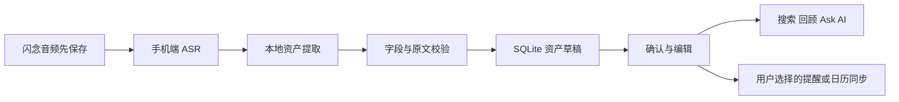

# Flash Capture 在 WiseLife 闪念语音中的应用研究

日期：2026-10-21。

状态：产品与技术建议。已阅读本机 `flash-capture/SKILL.md` 并核对 WiseLife 当前代码；本轮没有实现新资产系统，也没有将示例或用户数据写入 Flashcapture。

## 1. 结论

把一次闪念录音作为共同来源，在 iPhone 上拆出可编辑、可追溯、可搜索、可执行的内容资产。原始音频和全文始终保留。最适合移植的是 Flash Capture 的“意图判断 → 多资产拆分 → 类型匹配 → 字段提取 → 校验 → 保存结果”规则。

建议首版采用“想法、待办、消费”三类资产；第二阶段增加日程、人物资料和外部资料。录音时不要求用户先选类型，整理与补充放在录音结束后的手机端。

原 skill 是给代理执行的编排规范，明确依赖 Flashcapture MCP 持久化；它不是可直接嵌入 Swift 的本地解析库。若要原样运行该 skill，仍必须使用它规定的 MCP。WiseLife 的本地实现应当另建适配规范，借鉴分类与校验规则，使用现有 SQLite 保存；不要一边绕过 MCP 一边宣称在原样执行该 skill。本轮研究没有验证 live Flashcapture MCP 的可用工具。

## 2. 与现有产品的关系（已核对源码）

| 已有能力 | 当前事实 | 本次方案如何使用 |
| --- | --- | --- |
| 原始闪念 | `RecordingKind.thought`，保存音频、全文、分段与版本 | 作为资产共同来源，不用资产覆盖原录音 |
| 本地总结 | `OnDeviceSummarizer` 检查 Apple 模型和中文支持；`usesLocalThoughtAI` 当前只对 EurekaRing 闪念自动走专用总结路径 | 新资产整理要面向所有来源的闪念，不能继承仅 Ring 的设备条件 |
| 记录与检索 | `DayRecord.Kind` 是语音、闪念、图片、活动、睡眠、日历、地点 | 资产类型另建维度，避免把“音频格式”和“待办用途”混成一个枚举 |
| 提醒 | `DaybookReminder.scheduledAt` 必填，确认时要求未来日期；已有本地通知和可选 Apple 提醒同步 | 创建无日期待办需独立的任务模型；设提醒时再调用现有安排流程 |
| 联系人 | 系统选择器 + 当前录音内的 speaker-contact 快照 | 可以复用显式选择，但尚不是跨录音人物资料库 |
| 日历 | `LifeSourceReader` 读取系统日程；权限说明承诺不写日历 | 新增写入功能须单独设计，不能把已读到日程等同于已能创建事件 |

上述代码接入不代表已在用户真机验证模型质量或系统账户同步。

## 3. 资产类型与用途

| 类型 | 说法示例 | 主要结构 | 后续价值 |
| --- | --- | --- | --- |
| 想法 `notes` | “想到可以按人回顾讨论记录。” | 标题、内容、主题标签 | 按主题找灵感、关联旧想法、用于回顾和 Ask AI |
| 待办 `todo` | “下周研究一下按人检索。” | 动作、说明、截止日期可空、执行人可空、任务状态 | 完成、追踪、按需设置提醒 |
| 消费 `expense` | “今天打车花了 38 元人民币。” | 金额、币种、消费时间、类别、商户可空 | 已确认支出的分类汇总、趋势和查询 |
| 日程 `event` | “明天下午三点和小王讨论方案。” | 开始时间、结束时间可空、时区、地点与参与人可空 | 确认后安排时间、可选添加系统日历 |
| 人物资料 `contact` | “今天认识的林小姐负责采购。” | 人物提及、公司／职位等明确事实、可选联系人关联、原话 | 人物上下文、相关录音与待办、后续按人 Ask AI |
| 外部资料 `external_ref` | “把我刚分享的文章留作参考。” | 外部系统、实际 URL／对象 ID、标题、说明 | 资料收藏、与想法／待办关联 |

类型不等于操作：识别出任务不会发送消息；人物资料不会自动写通讯录；识别出会议不会自动邀请参与者；识别出 URL 不会自动打开并执行网页内容。

纯语音没有提供实际链接时，只能留下“待补链接”的资料草稿。不得根据文章名猜 URL。

## 4. 一句话如何拆成多个资产

示例录音：

> “想到可以给 WiseLife 做一个按人回顾。明天下午三点和小王讨论这个方案，结束时间还没定。开会前把草图画好。今天打车花了三十八元人民币。”

得到四项：

1. **想法**：WiseLife 按人回顾。
2. **日程草稿**：与小王讨论按人回顾；开始时间可按录制日期及时区解析，结束时间待补；小王暂为人物提及。
3. **待办**：绘制草图；关联该想法和日程。保留“开会前”的截止约束，不擅自设置提前 30 分钟通知。
4. **消费草稿**：交通／打车，38 CNY。消费日为录制地时区的“今天”；具体消费时刻未知。

四项引用同一个 capture ID、音频及各自的原文段落。原始录音仍是一条，不复制成四条录音。

“和小王讨论”本身只需要一个人物引用，不额外制造没有新事实的联系人资产。用户确实补充了职位、联系方式等独立有用信息时才提取人物资料。

## 5. WiseLife 应调整的规则

### 捕获入口表达了保存意图

原 skill 对问句和闲聊通常返回 `reply`。WiseLife 按住说话是一项主动捕获行为：即使用户说“为什么我每次开会都想不到问题”，这也是值得保留的自述。原录音照常保存，可归入想法。只有明确处于 Ask AI 对话入口时，才按对话问题处理。

### 时间使用录制上下文

- “明天／昨天／今天”以录音的 `captured_at + capture_timezone` 为锚点，不用上传到手机或整理时的时间。
- `captured_at`、消费发生时间、任务截止时间、日程开始时间和通知时间分别保存。
- “周五前交”是待办；“周五三点开会”是日程。只有截止日期不创建时间块。
- “晚上／过几天／有空”保留原文，不能变成模型猜的精确时间。
- 没有可靠录制时区、跨时区或夏令时导致歧义时保留待确认；不假定手表已记录可靠时区。

### 币种和金额

原 skill 默认 CNY，不适合直接用于多地区用户。明确说出的币种优先；其次使用用户明确设定的默认币种，并保留其来源；都没有时标为待确认。金额缺失的消费候选可以保留草稿，但不能计入支出。

原币金额使用十进制定点表示；不同币种分别汇总，不在没有汇率来源时混加。“报销额度／预算／想买／退款”不能自动当成已发生消费。

### 不确定性与确认

- 录音保存不等待资产字段补全。
- 固定类型的本地候选可自动持久化；“已确认”与“待确认”分开。保存草稿不表示已创建通知、日历事件或正式账目。
- 想法可自动整理到本机并允许撤销；待办可保存为草稿，时间不明确时仍可存在。
- 日程、消费、人物匹配在进入正式日历／统计／身份关联前处理关键歧义。
- 用字段完整性、语法校验、否定／假设／引用识别与原文依据决定是否需要确认。模型自行输出的置信度只作辅助，不能当成校准后的正确率。
- `ask_confirmation` 在 App 中表现为“待补充”卡片；只影响相关资产，不阻塞同一录音里其他明确资产。

### 人物与归属

“说话人是谁”“这件事涉及谁”“任务由谁做”是不同字段。提到小王不表示小王正在说话。说“小王答应周五给报价”可以是对方承诺，不应直接生成我的执行任务；可提供“周五跟进报价”的可选建议。只有用户确认后才关联具体系统联系人；同名不自动合并。

## 6. 产品交互建议

### 采集

Watch／Ring 的短录音交互保持简单。先显示“已保存”；手机收到后显示整理进度。不要让用户为了说一句话先选资产类型或等待模型完成。

### 闪念详情

保留播放器与“总结／全文”入口，在内容区增加“整理出的资产”：

- 想法：按人回顾功能　`打开` / `修改`
- 待办：绘制草图　`确认` / `设提醒`
- 日程：明日 15:00 与小王讨论　`补充结束时间`
- 消费：打车 ¥38　`确认` / `修改`

每张卡都可“查看原话”，点击后跳到相关段落并回放附近音频。支持“分类不对”“忽略”“重新整理”；重新整理不能复活用户已经忽略的同一项或覆盖手工修订。

### 我的记录

建议提供“记录｜资产”两种查看方式：记录按时间组织，资产按想法／待办／消费等用途筛选。资产详情回链原录音，首页时间线不重复渲染多份同一音频。

MVP 可先只做闪念详情里的资产卡和已有提醒入口，验证提取准确率后再增加完整资产浏览页。

### Ask AI 与回顾

示例问题：“最近有哪些产品想法？”“我答应小王的事情还有哪些没完成？”“本周确认过的交通支出是多少？”

统计必须用结构化查询算金额／数量，再让模型解释。默认排除忽略、过期或尚未确认的金额；对不完整数据注明范围。每个回答能返回资产与录音依据。用户允许 AI 使用的来源范围仍然生效。

这些资产查询和人物检索是本轮建议，当前代码未实现该完整能力。

## 7. 本地技术方案

### 数据结构建议

- `Capture`：复用 VoiceNote ID／原音频／转写版本；补充可靠的录制时区来源。
- `CaptureExtraction`：capture ID、输入转写版本、schema／模型版本、处理状态、错误、完成时间。
- `Asset`：稳定 UUID、资产类型、payload、审核状态、业务状态、创建／发生／截止时间及其来源。
- `AssetSource`：capture ID、转写版本、原文摘录、段落 ID／时间范围。多次录音可补充同一资产，因此不限制一个资产只能有一个来源。
- `AssetRelation`：想法与任务、事件与任务、人物与承诺等显式关系。
- `ExternalLink`：可选外部 ID、待执行操作、同步状态、最后成功内容、失败原因；复用现有提醒同步的持久意图与稳定标记思想。

初期是固定受支持的 asset_type + schema_version + 校验后的 typed payload。不要按每个临时类别动态创建 SQLite 表。金额／状态／日期等统计字段可索引，不应全靠对 JSON 文本的模型推理。

### 处理流水线

1. 所有来源的 `RecordingKind.thought` 在转写成功后入队，以 capture ID + 转写版本去重；手表不会运行分类大模型。
2. Apple Foundation Models 可用时进行固定 schema 的结构化生成；仅给它受限的候选类型和必要上下文。转写内容是待分析数据，不是能修改系统提示或执行工具的指令。
3. 规则层检查类型、枚举、金额、时间锚点、必填字段及依据片段。结构合法不等于语义正确。
4. 模型不可用时保留原始闪念与文本，并显示“待整理”；用户仍能手动转为待办／消费。低风险规则可以提出候选，但不能伪称已经完成完整语义提取。Whisper／Apple ASR 提供文字，不承担多资产理解。
5. 用户主动选择并确认远程 AI 时，未来才可增加远程提取适配器；默认没有自动远程回退，也不因此要求 WiseLife 自建 server。
6. 同批本地资产、关系与处理版本在 SQLite 事务内提交。原音频的首次保存独立完成，提取失败不影响已保存录音。
7. Apple 提醒／未来日历属于跨系统操作：先记录意图再执行，每项独立反馈成功或失败。不能把“本机草稿保存成功”显示为“所有系统同步成功”。

### 去重、重新转写与删除

- 一次 capture 的重试用稳定批次／资产 ID 和幂等记录，不能让模型每次随机 ID 导致重复消费或待办。
- 不同录音提到同一事项不等于重复：可能是补充、完成或金额修改。以匹配候选提示合并，不只凭相似标题自动删除。
- 转写发生变化后，旧提取结果标为待重新核对；新草稿与旧资产按来源／关系比较。手工修改字段保留，产生冲突时显示差异。
- 删除资产不删除原录音；删除原录音时明确选择保留已确认资产还是一并删除，保留来源已删除提示。外部任务删除按已有单独确认规则执行。
- 现有允许 AI 使用的来源设置应作用于资产提取和后续查询，避免从禁用来源派生数据绕过设置。

## 8. 自定义资产类型

原 skill 的一般规则提出多个条件中满足两项即可考虑新类型，而具体扫描步骤要求“至少 3 次、至少 2 天、平均置信度 ≥0.75”。实施时需要统一口径。

建议首版不开启动态类型。后续只观察固定 notes 内的候选结构：按不同 capture ID 计数、按已知发生／录制日期统计；达到至少 3 次且跨 2 天、字段稳定、有明确查询价值时提出“是否单独追踪”的建议。置信度阈值可作为辅助过滤，但不能替代语义校验。

例如多次说“今天跑了 5 公里、用时 32 分钟”，未来可以提议“运动记录”。需要用户确认 schema；历史内容不自动迁移。已拒绝或暂缓的提议保存状态，避免反复打扰。

## 9. 建议开发顺序

### 第一阶段：小范围可用

- 原始闪念 + 想法／待办／消费资产草稿。
- 一段话拆多项；查看依据、修改、忽略、逐项确认。
- 无截止日期待办；选时间后复用当前本地通知／Apple 提醒入口。
- 消费必填字段校验与已确认金额汇总；币种缺失不猜测。
- 持久化、版本保护、重复处理防护和模型不可用状态。

### 第二阶段：系统与人物联动

- 日程草稿 → 用户确认 → 新增 EventKit 写入适配器。
- 人物引用与联系人消歧、人物资料页及按人 Ask AI。
- 分享入口带入真实 URL 的外部资料。

### 第三阶段：长期资产积累

- 关联多次闪念，提出合并／任务完成候选。
- 自定义资产类型建议、用户确认与受控历史迁移。

## 10. 验收重点

先建立带人工标注的中文闪念语料，覆盖混合类型、无日期待办、截止与事件、否定、假设、转述、金额纠错、未知币种、离线跨天上传和同名联系人。

必须通过的例子：

- “周五前交方案” → 待办，不生成会议。
- “明天可能和小王见一面” → 未确定候选，不直接写日历。
- “午饭三十五，不，是五十三元人民币” → 最终金额 53 CNY，保留纠正依据。
- “预算五百，下周再买” → 非已发生消费，不计入支出。
- “小王说他会发报价” → 对方承诺，不伪造我已设置的提醒。
- Watch 昨晚录“明天”，今天才上传 → 按录制锚点处理。
- 重试／杀进程后重新处理 → 无重复待办或消费。
- 原转写编辑／删除时推理仍运行 → 旧结果不覆盖新版本，不复活记录。
- 本地资产保存成功但 Apple 写入失败 → 单独展示同步失败并支持重试。

评估分别记录：类型／拆分准确率、金额和日期字段准确率、错误创建率、用户修正率、处理延迟和耗电。优先降低错误执行率，不凭模型自报置信度宣称高准确率。

## 11. 本轮依据

- Skill：`/Users/karama/.codex/skills/flash-capture/SKILL.md`。
- `Sources/Shared/VoiceNote.swift`：thought、转写版本、speaker/contact、设备特定本地闪念路径。
- `Sources/iPhone/NotesModel.swift`：转写、总结、恢复与本地处理队列模式。
- `Sources/iPhone/OnDeviceSummarizer.swift`：本地模型可用性与语言检查。
- `Sources/iPhone/DayRecord.swift`：现有记录类型。
- `Sources/iPhone/DaybookReminderPersistence.swift`、`AppleReminderService.swift`：有明确时间的提醒及外部同步恢复。
- `Sources/iPhone/SpeakerContactViews.swift`：选择联系人和当前录音内的关联边界。
- `Sources/iPhone/LifeSourceReader.swift`：当前日历只读。

本次结论基于 skill 文本和当前源码阅读，未运行资产提取模型评测，也未验证 Flashcapture 服务端能力。
