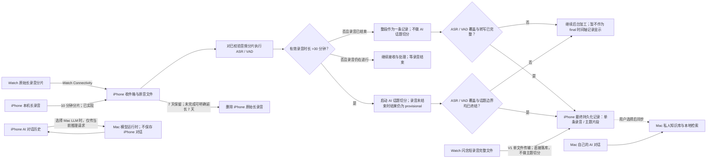

# WiseLife iPhone 与 Apple Watch 数据生命周期及本地结构

更新：2026-10-25。本文先按数据生命周期划分 iPhone/Watch 数据，再列当前代码中的文件和 SQLite 表，供技术评审。数据库版本、文件布局和模型字段以代码为准；未来保留策略、Mac 同步和知识库能力会明确标为“计划”，不代表已实现。主要实现：`Sources/iPhone/DaybookDatabase.swift`、各 Repository/Store、`Sources/Watch/WatchRecorder.swift`、`WatchRecordingSessionStore.swift` 与 `Shared/RecordingChunkProtocol.swift`。

## 数据分为三部分

| 部分 | 内容与责任 | 当前 iPhone 存储 | 生命周期 / Mac Companion 计划 |
| --- | --- | --- | --- |
| **1. 原始长录音** | Watch 采集并分片的长录音；iPhone 本机录制的长录音；iPhone 收件箱校验、接收回执和来源会话信息 | Watch 音频导入后在 `RecordingSessions/Audio/`；新 iPhone 本机长录音先以 10 分钟 M4A 分片和草稿清单落在 `Application Support/WiseLife/RecordingDrafts/`，封口后登记到同一 `RecordingSessions/Audio/` 与 `recording_sessions` / `recording_chunks`。旧单文件草稿仍可恢复 | **计划、尚未实现：**iPhone 上的长录音原音默认保留 7 天。未处理完时提醒用户，可选择删除或再保留 7 天；Watch 本机副本的清理策略独立。Mac 知识库不接收原始音频 |
| **2. 中间过程加工数据** | ASR、VAD、说话人处理、主题边界协调、处理窗口、任务状态与重试/编辑依据 | SQLite 的 processing/content 表；短期导入和分析窗口位于临时目录 | 当前部分中间结果会持久化以支持恢复、重试和显示状态；**还没有统一清理策略**。计划不把这些内部任务表直接同步到 Mac |
| **3. 最终持久化数据** | 可长期使用的文本记录和主题片段、闪念短录音记录、图片及其他用户可见记录 | SQLite 业务表 + 图片、短录音等独立媒体文件 | **计划：**用户选择后复制到 Mac 知识库并建立本地检索索引。iPhone AI 对话历史不复制；Mac 自己的对话单独保存在 Mac |

**短录音路径：**闪念录音不拆成传输分片，也不经过长录音的 AI 主题切分。录音结束后作为一条完整记录写入最终持久化层（`voice_notes` 与其音频文件）；转写、标题和摘要可以作为该记录的字段补充，不会因此生成 `content_segments` 主题片段。它不属于长录音原音的 7 天 TTL。

### 1. 原始长录音：来源文件，不是最终记忆

- Watch 长录音会拆成多个独立 M4A 分片；`recording_sessions` 表示会话，`recording_chunks` 描述分片。一个主题片段不是另一份持久录音文件，而是引用原录音中的一个或多个时间范围。
- **iPhone 本机长录音现状：**新录音按 10 分钟封口为 16 kHz 单声道 AAC 分片，每片含序号、时间偏移、帧数、采样率、字节数和 SHA-256；草稿清单可恢复。封口后幂等登记到共享的 `recording_sessions` / `recording_chunks`，由与 Watch 相同的来源协调器处理 ASR/VAD 和内容切分。旧版单 M4A 草稿仍保留读取与恢复兼容路径；闪念短录音继续走 `voice_notes` 单文件路径。
- Watch 与 iPhone 共用来源、范围和后处理抽象；Watch 的配对、传输回执仍属于 Watch 传输层，不强塞给 iPhone 本机录音。分片边界不等于主题边界，`content_segments` 继续引用原始来源范围。
- iPhone 收到 Watch 分片后，先写入 Inbox，校验协议绑定和 SHA-256，再发布到 `RecordingSessions/Audio/` 并提交 SQLite 元数据；数据库提交后才回传已保存回执。
- 已确认的产品保留规则：iPhone 收到的原始长录音默认保留 7 天；若仍未处理完成，提醒用户选择删除，或明确再保留 7 天继续处理。若未选择，建议遵循默认 7 天期限清理。
- **起算建议待确认：**以音频在 iPhone 正式入库的时间开始计 7 天：Watch 长录音按 iPhone 接收并发布完成时起算，iPhone 本机长录音按录音结束、文件正式保存时起算；这样 Watch 延迟上传不会消耗 iPhone 实际可处理的期限。
- 7 天规则计划适用于 Watch 上传到 iPhone 的长录音副本，以及 iPhone 本机长录音原音；Watch 设备自己的副本独立管理。闪念短录音不纳入长录音 TTL。
- 当前代码没有 7 天 TTL。实现时不能直接调用“删除完整录音”流程：删除 Watch `recording_sessions` 或 iPhone `voice_notes` 会级联移除来源处理和内容片段。TTL 必须只清除原音文件、记录音频已过期状态并保留最终文字/图片等数据；否则会违反“最终内容长期保存”的目标。

### 2. 中间过程：可恢复的加工流水线

- 持久化处理中状态和证据，便于断连、应用重启、资源缺失或任务失败后恢复；ASR/VAD/说话人窗口及分段任务属于这一层。
- `content_segments` 是跨阶段表：其中既可能有尚未 final 的候选片段，也可能有已确认的最终主题片段。必须按 payload 内状态识别，不能把整张表一概当作临时数据或最终数据。
- 按已确认的产品语义，`isFinal == true` 要求音频范围有完整成功的 ASR/VAD 覆盖、边界已关闭且话题边界已作出终态决定。长录音通常由 AI 统一话题；短录音则由直接入时间轴策略确定完整来源范围是唯一边界，不需要 AI 主题切分或内容分类。标题/摘要可后续生成。原音到期前的“处理完成”按 ASR/VAD、话题边界和转写文字已安全保存判断，不因标题/摘要仍待生成而延长原音保留。
- **录音直入与主题拆分规则（已同步代码）：**所有闪念（包括 Watch 按住说话）继续走直接笔记流程，不做内容主题拆分；Watch/iPhone 录制的普通录音，有效时长 `<=30` 分钟时保留为单条内容记录，不做 AI 主题切分。直入项在 ASR/VAD 覆盖完整且有可展示转写后即可置为最终记录，标题/摘要允许后续生成；AI 的 `meaningful` 分类不得阻止直入项显示。只有有效录音时长严格 `>30` 分钟的录音才进入 AI 内容主题拆分流程；完整分片数不再触发拆分。有效时长按真实音频范围计算，不把传输等待或缺口时间算作录音时长。录音仍在进行且时长 `<=30` 分钟时暂不生成最终内容；超过 30 分钟后可以先生成 provisional 主题片段。
- `audio_transcript_spans` 是处理任务生成的带时间戳 ASR spans；`content_segment_presentations.transcript` 是片段展示所读的持久化文字快照。同步到 Mac 时应导出稳定的最终记录格式，而不是照搬这些处理表。
- 临时重采样/分析文件只服务于单次窗口处理，不是片段音频副本。全文和向量索引是可重建索引，不是权威内容，也不应作为 Mac 备份的输入。
- 目前没有确认 ASR/VAD 原始结果、说话人特征、任务日志、草稿片段和编辑历史的统一过期时间；在定义和实现该策略前，文档不承诺它们会随 7 天原音一起删除。

### 3. 最终持久化数据：文本、图片和用户记录

- 长录音处理后长期保留的是有用主题片段的标题、摘要、分类、全文和来源时间信息；短录音/闪念保留其记录文本、标题与摘要。原音过期后，仍可浏览和检索文字，但不能再回听原录音。
- 闪念短录音是直接持久化的一条完整 `VoiceNote`：Watch V1 通过单个完整音频文件和同步账本传输，iPhone 本机短录音也走 `voice_notes`；不使用长录音分片会话，不做 AI 主题切分，直接进入时间轴。普通录音在有效时长 `<=30` 分钟时也作为一条记录直入时间轴；只有 `>30` 分钟的录音产生 AI 主题片段。短录音的音频文件随记录单独保存，保留期限不由 Watch V2 长录音 7 天规则决定。
- 对时间轴上已经持久化的长录音主题片段，用户发起的多选合并、重新生成标题或摘要，都是对最终数据的操作，不是把这些片段退回中间态。合并只接受同一来源中相邻的 `isFinal == true` 片段；成功后形成一个新的 final 片段并删除/墓碑化原条目，撤销依据记录在 `content_segment_edits`。最终片段继续保持 `isFinal == true`，后续自动边界调整不再改写它。
- **当前实现细节：**主题片段合并将原片段的音频 `ranges` 合并为一个范围列表，仍引用原始长录音分片，不另存一份拼接后的 M4A。若产品要求生成独立物理合并音频文件，需要另行定义文件生命周期；这与“合并后的最终片段是持久化记录”是两个不同问题。
- 手动重新生成标题/摘要时，模型调用与暂存结果属于中间加工；接受并写回 `content_segments.payload` 的标题/摘要是最终数据。此操作不改变 `isFinal`，也不触发自动主题边界重算。片段全文快照仍保存在 `content_segment_presentations`。
- 图片记录及 JPEG 附件是独立持久媒体；待办/提醒/日程、每日回顾、洞察及经许可保存的生活数据由各自业务存储负责。
- iPhone 的 AI 对话及追问证据继续只保存在 iPhone。Mac Companion 的知识库同步不包含 `conversations` / `conversation_turns`。
- 未来 Mac 知识库接收用户选择的最终文本、图片和允许的数据类型，不接收原始长录音或中间处理任务表。Mac 端自行建索引；索引可重建，和归档的最终记录分开管理。
- iPhone 选择 Mac LLM 时，当前任务请求文本会在推理期间发给 Mac；Mac 按无状态请求处理并丢弃，不写入 Mac 对话历史或知识库。Mac 自己的 AI 对话是另一套独立历史，可在 Mac 本地检索 Mac 知识库。

### 删除原音的实现约束

当前 `recording_sessions` 及 `audio_processing_sources.session_id`、`content_segments.source_key` 之间存在级联删除；现有 `deleteSession` 面向“删除整条录音及全部派生片段”，不是“到期删除原始音频”。需要新增单独的媒体过期状态/清理路径，至少区分：原音可播放、原音待删除、原音已过期；到期清理保留最终文本和其来源日期/范围，但隐藏播放、波形、回听及依赖原音的编辑入口。实现可在分片媒体清单上保存 `expires_at` / `media_deleted_at`，保留 chunk ID、原始时间范围和来源时间用于文字溯源。Watch 侧源文件生命周期仍单独处理。

## 设备边界

WiseLife 没有自有云端存储。iPhone 与 Watch 分别写入各自 App 沙盒；Watch Connectivity 只负责两端传输和保存确认，不让两端共享同一个数据库文件。未来 Mac Companion 是用户自己的本地知识库节点，不是 WiseLife 云端服务。

| 设备 | 主存储 | 数据类型 | 数据库 |
| --- | --- | --- | --- |
| iPhone | App 沙盒 Documents 与 Application Support | 原始音频、图片、JSON 接收/草稿、结构化业务记录、ASR/VAD/片段结果、回顾/洞察、检索索引 | 一个共享的本地 SQLite 主库；没有服务器数据库 |
| Apple Watch | App 沙盒 Documents/Recordings | AAC/M4A 音频分片、录音清单、分片描述、录音结束状态、位置样本、上传确认及重试账本 | 当前录音和传输流程使用文件与 Codable JSON，不使用 SQLite |
| Mac Companion（计划） | Mac 用户目录中的独立应用数据与模型目录 | 用户选择同步的最终文本/图片、Mac 自有 AI 对话、模型权重、重建式检索索引 | 当前未实现；不视为现有 iPhone/Watch 存储的一部分 |

## iPhone 文件位置与格式

以下路径相对 iPhone App 沙盒。Documents 中的媒体/收件箱与 Application Support 中的结构化数据库是分开的。

| 路径 | 内容 | 用途/生命周期 |
| --- | --- | --- |
| `Application Support/WristNotes/Database/daybook.sqlite3` | 业务主表、处理元数据、同步账本和派生检索表；运行时可能另有 `-wal`、`-shm` | 应用主 SQLite；WAL、外键、FULL synchronous；iOS 下数据库目录及文件使用 complete 文件保护并排除系统备份 |
| `Application Support/WiseLife/RecordingDrafts/<UUID>.m4a` 与同名 `.json` | iPhone 正在录制或尚未提交的录音草稿及其时长/时间/位置 manifest | 提交后转入 VoiceNotes 的正常录音存储；用于录音中断恢复 |
| `Documents/VoiceNotes/Audio/<UUID>.m4a` | 旧版/短录音及 iPhone 录音音频 | `voice_notes.audio_filename` 指向文件；音频本身不写入 SQLite |
| `Documents/VoiceNotes/RecordingSessions/Audio/<sessionUUID>_<ordinal>.m4a` | Watch 长录音导入后的原始分片 | 每个 session 独立；按分片文件名和数据库 descriptor 校验，不在合并或转写时覆盖原音频 |
| `Documents/VoiceNotes/RecordingSessions/Imports/<chunkUUID>_<sha256>/` | 分片导入的私有重试/发布日志及暂存副本 | 文件发布与 SQLite 提交之间崩溃时重试恢复；成功后可回收 |
| `Documents/VoiceNotes/Inbox/RecordingV2/Incoming/<UUID>/` | Watch Connectivity 送达的收件箱分片，内含 `manifest.json` 与 `audio.m4a`；结束/位置消息为 JSON manifest | 先可靠落盘，再交给 session repository；导入成功后可删除收件箱项 |
| `Documents/VoiceNotes/Inbox/RecordingV2/Outgoing/` | 待发送的分片/录音结束/位置确认 JSON 文件 | 网络或对端暂不可达时保留并重试；发送成功后清理 |
| `Documents/VoiceNotes/Inbox/RecordingV2/identity.json` | 手机 UUID、配对映射与能力协商状态 | 协议绑定与接收端身份，不含音频 |
| `Documents/PhotoMoments/Images/<UUID>.jpg` | 导入后的 JPEG 副本 | 图片二进制独立于 SQLite；单条记录最多 6 张 |
| `Application Support/WristNotes/PrivateVoiceIdentity/profile.json` | 本人声纹档案 JSON，含模型 ID、登记时间、录音时长和声纹向量 | 用于本地说话人识别；完整文件保护并排除系统备份，不进入全文/语义索引 |
| `Application Support/WristNotes/Models/`、`Application Support/WristNotes/SpeakerModels/` | 可选 Whisper 转写和说话人识别模型文件 | 端上模型资源；系统 Apple Speech/Foundation Models 资源由 Apple 管理，不一定出现在应用目录 |
| 旧版 JSON 迁移文件（见下方历史清单） | 历史记录/快照归档 | 只在对应领域尚未迁移时读取；迁移成功后新写入走 SQLite，不再写回这些 JSON |

设置不进入主业务 SQLite：外观、界面语言、转写/AI 模型配置等非密钥偏好保存在 `UserDefaults`（结构化模型以 JSON `Data` 保存）；自定义 AI API Key 与 ChatGPT 凭证保存在 Keychain。实际键名/版本由 AppSettings 与对应存储实现管理。

### 历史文件与一次性迁移源

下面这些归档只作为旧版本数据的迁移输入；不是当前新增数据的目标存储。成功迁移后，新写入进入右侧 SQLite 表。为便于故障恢复，部分 JSON 原文件可能继续留在沙盒中，运行时不持续双写。

| 历史文件/键 | 迁移标记 | 新写入目标 | 当前状态 |
| --- | --- | --- | --- |
| `Documents/VoiceNotes/notes.json` | `storage_migrations.domain = voice_notes` | `voice_notes` | 历史迁移输入；迁移后新录音通过 `NoteRepository` 写 SQLite 与 M4A 文件。 |
| `Documents/PhotoMoments/moments.json` | `photo_moments` | `photo_moments`、`photo_attachments` | 历史迁移输入；新图片记录直接写 SQLite 与 Images JPEG。 |
| `Documents/DaybookReminders/reminders.json` | `daybook_reminders` | `daybook_reminders`、`reminder_apple_links` | 历史迁移输入；新提醒仍使用这些 SQLite 表，不写回 JSON。 |
| `Application Support/WristNotes/LifeSources/snapshots.json` | `life` | `life_settings`、`life_snapshots`、`life_records`、`life_suppression` | 历史生活快照输入；当前刷新直接更新 SQLite。 |
| `Application Support/WristNotes/Conversations/history.json` | `conversations` | `conversations`、`conversation_turns` | 历史对话输入；新问题/回答直接写 SQLite。 |
| `UserDefaults` 键 `daybook.insights.v1` | `insights` | `insight_entries`、`insight_budgets` | 历史洞察归档；成功导入后代码移除此旧键，新洞察直接写 SQLite。 |

`storage_migrations` 保存“某个导入域已完成”的技术标记，不保存历史笔记正文。代码没有发现只供旧业务记录查询、且已停止接收新行的 SQLite 主表：历史记录迁入后与该领域的新记录共用活动表。SQLite 的早期 schema version 也不代表旧表；它们都是同一数据库的增量迁移版本。

数据库主路径由 `DaybookDatabase.applicationURL` 决定。真实 App 的 `VoiceNotes`、`PhotoMoments`、`DaybookReminders` 存储入口映射到同一主库；任意测试/归档根目录则各用自己的 `metadata.sqlite3`。

## SQLite 基本类型与版本

- 当前主库 `PRAGMA user_version = 13`；应用拒绝打开高于 13 的数据库。v1–v13 是递增迁移，不是 13 个独立数据库。
- `TEXT` 保存 UUID 字符串、枚举、文本与日期键；`INTEGER` 保存序号、布尔标志、版本和计数；`REAL` 保存日期、时间偏移、时长与度量；`BLOB` 保存 Codable 快照、JSON 编码、二进制向量或特征。
- SQLite 日期字段统一为自 Swift reference date（2001-01-01 00:00:00 UTC）起的秒数。每日回顾使用 `YYYY-MM-DD` 文本日期键。
- `payload` / `descriptor` / `origin` 等 BLOB 通常由 `JSONEncoder` 编码对应 Codable 类型；`semantic_chunks.vector` 是向量二进制，不能按 JSON 文本读取。
- 主表主键多为 UUID 字符串。外键启用；删除相关父记录时按定义级联。时间索引和内容索引是存储实现的一部分，见表定义。
- v1 建立生活数据/对话/洞察；v2 增加录音笔记、图片和提醒；v3 增加图片捕获元数据；v4 增加 Apple 提醒关联；v5 增加长录音 session/chunk/receipt；v6–v7 增加音频处理、ASR/VAD 与说话人数据；v8–v10 增加主题片段、编辑/补全缓存和语义签名；v11–v12 增加录音位置与地址；v13 将处理后的片段转写单独持久化。同步、回顾、行动和检索表由对应 Store/Index 首次使用时按领域迁移创建。

## SQLite 表结构

下表按领域列出当前主库内的持久表，三类生命周期与表的对应关系如下。这里分类的是数据实体，不是用户对数据执行的操作：用户对最终记录发起合并或重生成，仍是最终数据操作；执行过程中临时产生的任务状态、模型草稿和分析文件才属于中间加工数据。一个表可能同时承载中间状态和最终内容；需按行状态/字段识别，不能仅凭表名决定备份或清理。

| 生命周期 | 主要表 / 文件 | 说明 |
| --- | --- | --- |
| 1. 原始长录音 | Watch/iPhone：`recording_sessions`、`recording_chunks` + `RecordingSessions/Audio/*.m4a`；Watch 另有 `recording_gaps`、`recording_receipts`、`recording_end_receipts`；iPhone 录制中草稿：`Application Support/WiseLife/RecordingDrafts/<session>/chunk-NNNN.m4a` + manifest | 新 iPhone 本机长录音在封口后登记为 session/chunk；Watch 传输回执仍仅属于 Watch 路径。`voice_notes(kind=long)` 与 `VoiceNotes/Audio/<UUID>.m4a` 保留旧版本/兼容数据，不是新长录音的目标存储。 |
| 2. 中间加工 | `audio_processing_*`、`audio_transcript_spans`、`audio_activity_intervals`、`audio_speaker_mappings`、`content_segment_sources`、`content_segment_suppression`、`content_topic_decisions`、`content_enrichment_checkpoints`；`content_segments` 中 `isFinal != true` 的行 | 任务输入/状态、ASR/VAD/说话人证据、话题协调过程和草稿片段。它们支持处理恢复/重试，当前没有统一过期策略。 |
| 3. 最终持久化 | 闪念短录音的 `voice_notes` + 独立音频文件；长录音 `content_segments` 中的 final 片段 + `content_segment_presentations` 中的片段全文；`photo_moments` / `photo_attachments` + JPEG；行动、回顾、洞察等业务表 | 这是用户长期查看、编辑和检索的内容。闪念短录音不进入主题切分流水线。Mac 知识库未来只接收用户允许的稳定内容格式，不复制 iPhone 数据库表；AI 对话历史除外。 |
| 跨层支持 / 操作记录 / 可重建派生 | `storage_migrations`、删除 tombstones、Watch 同步账本、`content_segment_edits`、`fulltext_*`、`semantic_*` | 迁移/可靠删除/传输状态、最终数据编辑的撤销依据或可重建索引；这些支持记录不取代最终内容本身。 |

`?` 表示可空；未标 `?` 的列在创建语句中为 NOT NULL。`PK` 是主键，`FK` 是外键。表名保留代码中的拼写。

**历史存储边界：**目前未确认有只供历史记录查询、已停止新增写入的 SQLite 业务主表。旧 JSON 文件/旧 UserDefaults 键属于迁移输入；`voice_notes` 与部分 V1 Watch 同步表仍是新数据兼容路径，不能标成纯历史表。各文件的迁移状态见“历史文件与一次性迁移源”。

### 录音、转写与片段

| 表 | 列与类型 | 用途 |
| --- | --- | --- |
| `voice_notes` | `id TEXT PK`, `captured_at REAL`, `kind TEXT`, `title TEXT`, `transcript TEXT`, `summary TEXT`, `duration REAL`, `audio_filename TEXT UNIQUE`, `payload BLOB` | **活动兼容表，不是历史专用表。**承接旧 JSON 导入、Watch 短录音/闪念和 iPhone 录音；短录音作为完整记录直接持久化，不拆分片、不做主题切分。保存可查询摘要列 + 完整 `VoiceNote` Codable 快照。ASR 状态、时间戳片段、说话人、来源设备、位置、合并来源、标题版本等扩展字段在 payload；音频文件独立存放。Watch V2 长录音则写 `recording_sessions` / `recording_chunks`。 |
| `recording_sessions` | `id TEXT PK`, `started_at REAL?`, `time_zone_identifier TEXT?`, `origin BLOB?`, `ended_at REAL?`, `interrupted INTEGER`, `final_ordinal INTEGER?`, `end_revision INTEGER?`, `end_payload BLOB?`, `legacy_note_id TEXT UNIQUE?`, `created_at REAL` | **当前 Watch V2 长录音主表。**origin/end payload 是 Codable 快照；`legacy_note_id` 是可空兼容关联字段，新 V2 session 以自己的 ID 为主。 |
| `recording_chunks` | `id TEXT PK`, `session_id TEXT FK`, `ordinal INTEGER`, `filename TEXT UNIQUE`, `captured_at REAL`, `session_start_offset REAL`, `frame_count INTEGER`, `sample_rate REAL`, `byte_count INTEGER`, `sha256 TEXT`, `payload BLOB` | 会话分片描述与音频文件索引；`(session_id, ordinal)` 唯一。payload 是 `RecordingChunkDescriptor` 快照。 |
| `recording_gaps` | `session_id TEXT FK`, `gap_key TEXT`, `kind TEXT`, `first_ordinal INTEGER?`, `last_ordinal INTEGER?`, `start_offset REAL?`, `end_offset REAL?`; PK `(session_id,gap_key)` | 分片之间的缺失或中断区间。 |
| `recording_receipts` | `pairing_id TEXT`, `chunk_id TEXT FK`, `session_id TEXT`, `ordinal INTEGER`, `sha256 TEXT`, `saved_at REAL`; PK `(pairing_id,chunk_id)` | iPhone 已持久保存的分片回执；校验分片身份、序号和摘要。 |
| `recording_end_receipts` | `pairing_id TEXT`, `session_id TEXT FK`, `revision INTEGER`, `payload BLOB`, `saved_at REAL`; PK `(pairing_id,session_id)` | 对端收到的会话结束描述回执。 |
| `recording_session_tombstones` | `session_id TEXT PK`, `deleted_at REAL` | 防止已经删除的录音会话被迟到重传重新创建。 |
| `recording_file_cleanup` | `filename TEXT PK`, `session_id TEXT`, `deleted_at REAL` | 数据库删除已提交但音频文件清理尚待重试的标记。 |
| `audio_source_tombstones` | `source_key TEXT PK`, `deleted_at REAL` | 防止被删除的音频来源处理任务复活。 |
| `audio_processing_sources` | `source_key TEXT PK`, `kind TEXT`, `source_id TEXT`, `session_id TEXT FK?`, `note_id TEXT FK?`, `descriptor BLOB`, `fingerprint TEXT`, `configuration_key TEXT`, `revision INTEGER`, `cancelled INTEGER` | ASR/VAD/说话人/切分任务的来源、输入指纹、处理配置和修订号。kind 为 `session` 或 `legacyNote`，且只能关联对应来源。 |
| `audio_processing_jobs` | `id TEXT PK`, `source_key TEXT FK`, `configuration_key TEXT`, `core_start REAL`, `core_end REAL`, `window BLOB`, `state TEXT`, `active INTEGER`, `lease TEXT?`, `message TEXT?`, `result BLOB?`, `result_hash TEXT?` | 按音频时间范围划分的处理作业、窗口及状态；state 约束为 pending/running/completed/missingResource/cancelled/failed。 |
| `audio_transcript_spans` | `job_id TEXT FK`, `position INTEGER`, `start REAL`, `end REAL`, `text TEXT`, `speaker_id TEXT?`; PK `(job_id,position)` | ASR 识别文本及时间范围、说话人标识。 |
| `audio_activity_intervals` | `job_id TEXT FK`, `position INTEGER`, `start REAL`, `end REAL`, `kind TEXT`; PK `(job_id,position)` | VAD 语音/无语音/不确定区间，kind 为 speech/noSpeech/uncertain。 |
| `audio_speaker_mappings` | `job_id TEXT FK`, `local_id TEXT`, `canonical_id TEXT?`, `feature BLOB`; PK `(job_id,local_id)` | 分段说话人本地 ID 到规范 ID 映射及声学特征。 |
| `audio_processing_stage_requests` | `job_id TEXT PK/FK`, `stages INTEGER` | 任务要求执行的处理阶段位掩码。 |
| `content_segment_sources` | `source_key TEXT PK/FK`, `signature TEXT`, `state TEXT`, `epoch INTEGER`, `semantic_signature TEXT?` | 一个音频来源的主题边界计算版本、状态和 epoch；semantic_signature 用于比较内容而忽略定位器变化。 |
| `content_segments` | `id TEXT PK`, `source_key TEXT FK`, `start REAL`, `revision INTEGER`, `deleted INTEGER`, `payload BLOB` | **跨加工/最终两层。**完整 `ContentSegment` 快照含来源、边界、标题、摘要、isFinal、boundaryReady 和分类；非 final 行是中间候选，达到产品 final 条件的行是用户可见主题片段。 |
| `content_segment_ranges` | `segment_id TEXT FK`, `position INTEGER`, `start REAL`, `end REAL`, `payload BLOB`; PK `(segment_id,position)` | 片段关联的一个或多个音频时间范围及其来源定位信息。 |
| `content_segment_suppression` | `id INTEGER PK`, `source_key TEXT FK`, `start REAL`, `end REAL` | 用户隐藏或抑制自动生成片段的时间范围。 |
| `content_segment_tombstones` | `id TEXT PK`, `source_key TEXT`, `revision INTEGER` | 已删除片段标记，防止重算时复活。 |
| `content_segment_edits` | `sequence INTEGER PK AUTOINCREMENT`, `source_key TEXT FK`, `kind TEXT`, `before_payload BLOB`, `after_epoch INTEGER`, `undone INTEGER` | 手工边界编辑/合并/撤销所需的变更记录。 |
| `content_enrichment_checkpoints` | `cache_key TEXT`, `unit TEXT`, `source_key TEXT FK`, `segment_id TEXT?`, `text TEXT`, `accepted_revision INTEGER?`; PK `(cache_key,unit)` | 标题/摘要等内容补全的增量检查点，避免重复处理已接受结果。 |
| `content_topic_decisions` | `source_key TEXT FK`, `signature TEXT`, `position REAL`, `decision TEXT`, `model_key TEXT`; PK `(source_key,signature,position)` | 对主题边界的模型决策缓存。 |
| `content_segment_presentations` | `segment_id TEXT PK/FK`, `content_signature TEXT`, `transcript BLOB` | 与 ASR 原始 spans 分开的片段全文快照；当前时间轴/详情读取它作为用户可见转写。虽可由加工结果重建，在用户数据生命周期中仍属于需要保留/导出的最终文本，不应跟随原音 TTL 删除。 |
| `recording_location_samples` | `id TEXT PK`, `session_id TEXT FK`, `session_offset REAL`, `requested_at REAL`, `payload BLOB` | 长录音期间与音频偏移相关联的位置观测；完整样本 Codable 快照。 |
| `recording_location_addresses` | `sample_id TEXT PK/FK`, `payload BLOB` | 对位置样本反向地理解析后的地址信息快照。 |

### 闪念、图片、行动、回顾与洞察

| 表 | 列与类型 | 用途 |
| --- | --- | --- |
| `photo_moments` | `id TEXT PK`, `captured_at REAL`, `caption TEXT`, `recognized_text TEXT`, `imported_at REAL?` | 图片记录的时间、备注和聚合 OCR 文本。 |
| `photo_attachments` | `id TEXT PK`, `moment_id TEXT FK`, `position INTEGER`, `filename TEXT UNIQUE`, `recognized_text TEXT`, `recognition_error TEXT?`, `capture BLOB?` | 图片顺序、独立 OCR 状态与捕获元数据；每条记录位置 0–5；JPEG 在 `PhotoMoments/Images`。 |
| `daybook_actions` | `id TEXT PK`, `revision INTEGER`, `dedup_key TEXT UNIQUE?`, `payload BLOB` | 待办、提醒、日程的完整 `ActionItem` 快照，含状态、时间、来源引用、Apple 系统链接及同步状态。 |
| `daybook_reminders` | `id TEXT PK`, `title TEXT`, `scheduled_at REAL`, `source_id TEXT?`, `status TEXT`, `notification_id TEXT UNIQUE`, `created_at REAL`, `updated_at REAL` | **活动提醒表，不是历史专用表。**新 ActionStore 提醒仍经 DaybookReminderStore 写此表；旧提醒 JSON 只负责一次性导入。 |
| `reminder_apple_links` | `reminder_id TEXT PK/FK`, `payload BLOB` | 提醒事项与 Apple Reminders 的关联、同步/失败状态快照。 |
| `media_tombstones` | `kind TEXT`, `id TEXT`, `filename TEXT`, `deleted_at REAL`; PK `(kind,id)` | 媒体文件删除与重试账本，防止孤儿恢复重新导入已删除项。 |
| `daily_recaps` | `day TEXT PK`, `payload BLOB` | 按日保存的回顾条目快照，含回顾文本、来源引用、覆盖范围、生成状态等；不存模型密钥。 |
| `daily_recap_attempts` | `day TEXT PK`, `started_at REAL` | 每日回顾自动生成的幂等尝试标记；手动刷新仍可另行触发。 |
| `conversations` | `day REAL PK`, `updated_at REAL` | 按日期分组的 AI 对话线程。 |
| `conversation_turns` | `id TEXT PK`, `day REAL FK`, `position INTEGER`, `question TEXT`, `text TEXT`, `generated INTEGER`, `provider TEXT`, `evidence BLOB`, `sources BLOB`, `scope TEXT`, `question_references BLOB?` | 问题、回答、提供方、证据/来源与检索范围；每日位置唯一。 |
| `insight_entries` | `id TEXT PK`, `position INTEGER UNIQUE`, `day REAL`, `language TEXT`, `generation_version INTEGER`, `evidence BLOB`, `updated_at REAL`, `result BLOB?`, `message TEXT?`, `dismissed INTEGER` | 洞察与建议结果、证据和忽略状态。 |
| `insight_budgets` | `day REAL PK`, `attempts INTEGER`, `position INTEGER UNIQUE` | 每日自动洞察生成次数及排序标记。 |

### 生活数据与同步账本

| 表 | 列与类型 | 用途 |
| --- | --- | --- |
| `life_settings` | `source TEXT PK`, `enabled INTEGER` | 用户对健康/日历/地点等来源的本地启用状态。 |
| `life_snapshots` | `source TEXT`, `day REAL`, `status TEXT`, `refreshed_at REAL?`, `message TEXT?`, `stale INTEGER`; PK `(source,day)` | 某来源某日读取状态、最近刷新时间及过期标志。 |
| `life_records` | `id TEXT PK`, `source TEXT`, `day REAL`, `captured_at REAL`, `kind TEXT`, `title TEXT`, `text TEXT`, `summary TEXT`, `duration REAL`, `metric REAL?`, `intervals BLOB?`; FK `(source,day)` | 经同意读取后缓存的健康、日历、地点等本地事实；intervals 是 Codable 时间段数组。父 snapshot 删除时级联。 |
| `life_moment_metadata` | `record_id TEXT PK/FK`, `payload BLOB` | 生活记录专用补充元数据，例如步数、睡眠阶段或移动信息。 |
| `life_suppression` | `id TEXT PK` | 用户隐藏的生活记录标识。 |
| `storage_migrations` | `domain TEXT PK`, `imported_at REAL` | 每个数据领域的旧 JSON 导入完成标记。 |
| `watch_sync_snapshots` | `pairing_id TEXT PK`, `updated_at REAL` | **V1 兼容活跃账本。**用于 Watch 短录音/闪念的同步状态，不是 V2 长录音的分片账本。 |
| `watch_sync_pending` | `pairing_id TEXT FK`, `id TEXT`; PK `(pairing_id,id)` | **V1 兼容活跃账本。**等待 iPhone 保存的短录音 ID。 |
| `watch_sync_receipts` | `pairing_id TEXT`, `id TEXT`, `saved_at REAL`; PK `(pairing_id,id)` | **V1 兼容活跃回执。**确认短录音已保存。 |
| `watch_sync_failures` | `pairing_id TEXT`, `id TEXT`, `reason TEXT`; PK `(pairing_id,id)`, FK 到 pending | **V1 兼容活跃状态。**短录音传输/保存失败信息。 |
| `watch_session_sync_snapshot` | `counterpart TEXT PK`, `updated_at REAL`, `payload TEXT` | V2 对端最近上报的录音状态快照（JSON 文本）。 |
| `watch_session_sync_chunk` | `counterpart TEXT`, `session_id TEXT`, `chunk_id TEXT`, `ordinal INTEGER`, `saved_at REAL`; PK `(counterpart,chunk_id)`, `UNIQUE(counterpart,session_id,ordinal)` | V2 每个 Watch 分片在 iPhone 的持久保存证明。 |
| `watch_session_sync_end` | `counterpart TEXT`, `session_id TEXT`, `payload TEXT`; PK `(counterpart,session_id)` | Watch 结束消息快照，帮助展示录音完整度与同步阶段。 |

### 可重建检索索引

| 表 | 列与类型 | 用途 |
| --- | --- | --- |
| `fulltext_records` | `id TEXT PK`, `captured_at REAL`, `kind TEXT`, `fingerprint TEXT`, `title TEXT`, `original TEXT`, `summary TEXT` | 从允许检索的业务记录生成的全文投影；可删除并重建，不是原始记录主表。 |
| `fulltext_fts` | FTS5 虚拟表：`title`, `original`, `summary` | SQLite FTS5 trigram 加速全文检索；不可用时回退受范围限制的 SQL 子串检索。 |
| `semantic_records` | `id TEXT PK`, `captured_at REAL`, `kind TEXT`, `fingerprint TEXT`, `model_key TEXT`, `title TEXT`, `total INTEGER`, `indexed_at REAL` | 语义索引记录清单与模型/内容版本。 |
| `semantic_chunks` | `id INTEGER PK`, `record_id TEXT FK`, `ordinal INTEGER`, `model_key TEXT`, `start_offset INTEGER`, `end_offset INTEGER`, `snippet TEXT`, `state TEXT`, `vector BLOB?`; `UNIQUE(record_id,ordinal)` | 文本分块和本地向量；state 为 pending/ready/unavailable，ready 时必须有 vector。业务记录是权威数据，向量可重建。 |

语义索引执行距离扫描时，还会在内存 SQLite 连接中临时创建 `candidates` 表；查询结束后随连接销毁，不属于设备上的持久数据。

## 本轮评审待确认

- **7 天起算点：**建议从音频在 iPhone 正式入库的时间算起；Watch 延迟上传不会缩短 iPhone 的处理期，iPhone 本机长录音在录音结束并保存后起算。
- **到期未处理：**第 7 天提示删除或再保留 7 天；若用户不作选择，建议按默认期限删除。是否允许用户连续多次延长，尚未定义。
- **范围：**7 天原音 TTL 计划覆盖 Watch 上传的长录音副本和 iPhone 本机长录音；旧版短录音及闪念不纳入。iPhone 本机长录音分片方向已确认，具体分片协议和数据迁移待设计。
- **短长录音/分片门槛：**新 iPhone 长录音仍按 10 分钟分片并接入共享会话处理。分片数不再决定是否主题切分：有效录音时长 `<=30` 分钟时，结束并完成 ASR/VAD 后作为单条内容；有效时长 `>30` 分钟时进入 AI 话题切分，录音仍在进行时输出可以 provisional。单条策略本身是终态边界决定。
- **Mac 初始知识库范围：**建议先包括最终主题片段/文本记录及图片；健康、地点、日历等敏感快照逐类明确授权。iPhone 对话历史不复制，Mac 自有对话不回传 iPhone。
- **实现状态：**闪念直入、普通录音按 30 分钟有效时长保留单条或启动话题切分、时间轴直入项不受 `meaningful` 分类拦截，均已接入代码。7 天原音清理、未处理提示、Mac 知识库同步、索引及独立对话尚未实现。本轮 Simulator 构建受现有 Watch/widget target 问题阻断：`WatchRecordingWidget.swift` 的 iOS target 使用了仅 watchOS 可用的 `accessoryCorner`，Watch 资源目录还缺少有效 `AppIcon`；本轮未运行测试。

## Watch 文件结构

Watch 当前录音存储根目录为 App 沙盒 Documents/Recordings。录音与传输状态都在 Watch 本机持久化；当前 Watch 同步模型只有录音 kind、捕获时间、时长、位置与上传状态，没有从 iPhone 接收标题/摘要的字段。长录音的内容标题和摘要由 iPhone 处理产生。

| 路径/文件 | 类型 | 保存内容 |
| --- | --- | --- |
| `Recordings/<recordingUUID>.m4a` | AAC/M4A | **V1 兼容活跃格式。**Watch 新录制的短录音/闪念仍写这里；不要标为历史文件。 |
| `Recordings/pending.json` | `[PendingRecording]` JSON | **V1 兼容活跃索引。**Watch 新短录音的 UUID、kind、时间、时长、位置和上传状态仍写这里。 |
| `Recordings/<recordingUUID>.capture.json` | `PendingRecording` JSON | **V1 兼容活跃恢复 sidecar。**用于短录音发布/异常恢复，不是只读历史归档。 |
| `Recordings/SessionsV2/<sessionUUID>/<sessionUUID>_<ordinal>.m4a` | AAC/M4A，16 kHz，最长约 10 分钟一片 | 长录音的封口音频分片；每片独立文件，按 ordinal 排序。 |
| 同目录 `<chunk>.m4a.json` / `<chunk>.m4a.seal.json` | `RecordingChunkDescriptor` JSON | 分片身份、session、ordinal、起止时间/时区、音频偏移、帧数、采样率、字节数、SHA-256、来源设备和可选位置。seal 是崩溃恢复发布意图。 |
| 同目录 `<chunk>.m4a.receipt.json` | `RecordingChunkReceipt` JSON | iPhone 已持久保存该片的确认；包含 session ID、chunk ID、ordinal 和 SHA-256。 |
| 同目录 `end.json` | `RecordingSessionEnd` JSON | 录音结束时间、最终 ordinal、是否中断及版本号。 |
| 同目录 `manifest.json` | `WatchRecordingSessionManifest` JSON | session 状态、final ordinal、分片描述和已确认回执的聚合索引，可从 sidecar 重建。 |
| 同目录 `location_<UUID>.json` | `RecordingLocationSample` JSON | 音频偏移点对应的位置观测及设备来源。 |
| 同目录 `interruption.json` | JSON 文本/值 | 中断原因辅助信息。 |
| `.partial.m4a`、`.capture.json`、`.publishing.m4a`、`.recovering.m4a`、`.recovered.m4a` | 临时音频与恢复 sidecar | 尚未封口或崩溃恢复中的文件；启动恢复验证后决定封口/保留，不能当成已上传。 |
| `Recordings/TransferV2/<counterpart>/` | JSON 账本 | 已保存的 chunk/end/location 确认，以及指数退避重试次数/时间；不拥有音频源文件。 |

Watch 生成的传输描述不直接包含文件路径；iPhone 仅按已校验的 UUID、配对绑定和 hash 在本地解析文件。旧协议 `pending.json` / `Recordings/<UUID>.m4a` 与 V2 `SessionsV2` 并存，是因为前者仍承担新短录音/闪念的兼容通道，后者承载长录音；不是单纯为了读取历史录音，也不代表长录音重复落库。

## 两端保存/确认顺序

1. Watch 先写入分片 M4A 和可恢复的 JSON 描述/封口意图，随后将分片排入 Watch Connectivity。
2. iPhone 把到达的文件及 manifest 放入 `Inbox/RecordingV2/Incoming`，再验证协议绑定、描述和 SHA-256。
3. iPhone 将音频发布到 `RecordingSessions/Audio`，在 SQLite 事务中登记 session/chunk 与保存回执；失败时保留可重试输入。
4. 只有数据库事务提交后，iPhone 才发回 saved receipt。Watch 将 receipt 落到 `.receipt.json` 并更新 manifest；若回执丢失，会按原 chunk ID 幂等重传。
5. 录音结束消息单独保存；录音已停止和分片已全部收到是两个独立状态。长录音所有预期 ordinal 均保存且结束消息匹配后，才视为同步完成。

这个顺序允许断连后恢复，也解释了为什么 Watch 上可能暂时仍显示待同步：iPhone 收到传输事件不等于已完成音频和元数据的持久化。

## 主要 Codable 业务对象

- `VoiceNote`：短录音或 iPhone 本地录音条目，包含 id、类型、时间、时长、音频文件名、标题、全文、摘要、转写/摘要状态、源设备、位置、ASR 时间片段、说话人映射、合并来源和标题修订信息。
- `RecordingChunkDescriptor` / `RecordingSessionEnd`：Watch 长录音的原始文件身份/校验信息和会话结束状态。
- `ContentSegment`：一个源录音中的主题片段，包含边界 ranges、标题/摘要、修订、isFinal、boundaryReady、是否有文字、算法/配置来源及 editorial 分类；保存在 content_segments.payload。展示用转写快照另存到 content_segment_presentations，原始识别时间片段在 audio_transcript_spans。
- `ActionItem`：待办、提醒、日程的类型、标题、备注、状态、时间/时区、来源录音、Apple 链接及本地同步状态；存于 daybook_actions.payload。
- `PhotoMoment` / `PhotoAttachment`：图片记录、时间、说明、JPEG 文件名、OCR、捕获元数据和识别错误；二进制图片不在 SQLite。
- `DaybookRecapEntry`、对话轮次和洞察对象：保留来源引用、范围、模型提供方/语言或状态；密钥不写入这些对象。

## 隐私与非主数据

- 录音、转写、图片 OCR、位置和生活数据都是敏感的个人内容，均保存在设备 App 沙盒或经用户授权的 Apple 系统数据源；Watch 传输只走 Watch Connectivity。
- 数据库主库及其 WAL/SHM 排除 iOS 系统备份；Documents 中的录音/图片使用其各自文件保护和系统备份策略，不要把数据库备份策略推断成所有 Documents 媒体都不备份。
- 模型/API 密钥放在 Keychain；不在 SQLite、Watch 文件、日志或全文/语义索引里保存密钥。模型配置及非敏感偏好由 App 设置存储。
- Apple Health、Calendar、通知及 Keychain 是各自系统服务的存储，不是本应用 SQLite 的副本；本地表只缓存 WiseLife 展示/检索所需的允许数据和链接元数据。
- 如果用户选择自定义 AI 或 ChatGPT，且按当前流程确认发送，选定的文字摘录会发送给对应第三方模型服务；WiseLife 仍把本地记录与生成结果保存在设备上，这不等于将数据同步到 WiseLife 自有服务器。
- `DayRecord` 是聚合多个存储源的内存/检索投影，不是单一持久化主表。

## 代码位置

- 主库和迁移：`Sources/iPhone/DaybookDatabase.swift`
- 录音导入/恢复：`Sources/iPhone/RecordingSessionRepository.swift`、`RecordingChunkReceiver.swift`
- ASR/VAD/片段：`Sources/iPhone/AudioProcessingModel.swift`、`ContentSegmentation.swift`
- 旧录音、照片、行动、回顾、同步和索引：对应 `Sources/iPhone/NoteRepository.swift`、`PhotoRepository.swift`、`ActionItem.swift`、`DaybookRecapStore.swift`、`WatchSyncStore.swift`、`DaybookFullTextIndex.swift`、`DaybookSemanticIndex.swift`
- Watch 文件与传输：`Sources/Watch/WatchRecorder.swift`、`WatchRecordingSessionStore.swift`、`WatchChunkTransferQueue.swift`
- 两端分片协议：`Sources/Shared/RecordingChunkProtocol.swift`
