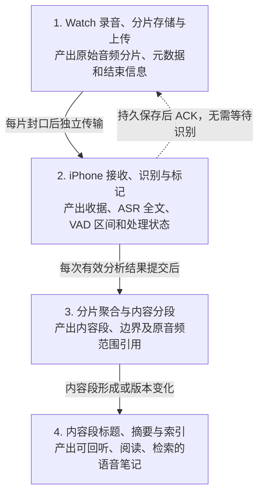
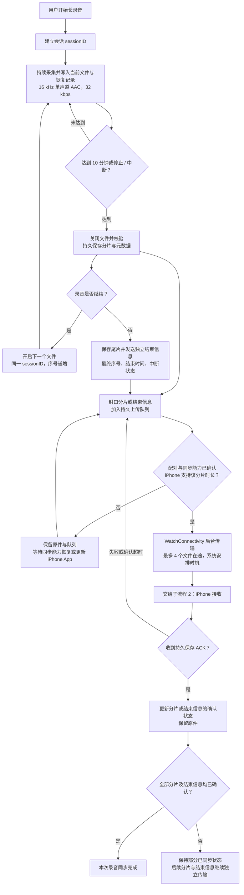
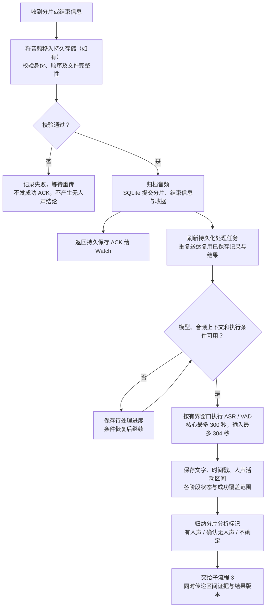
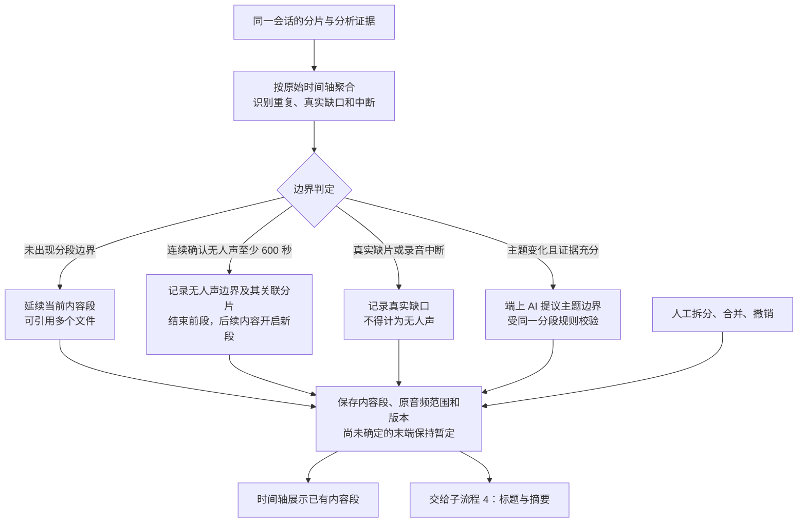
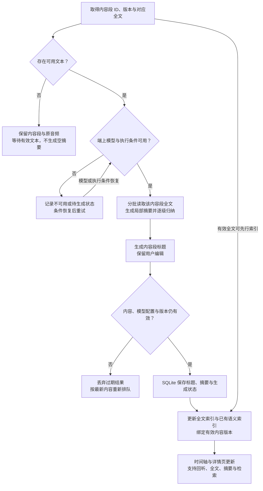
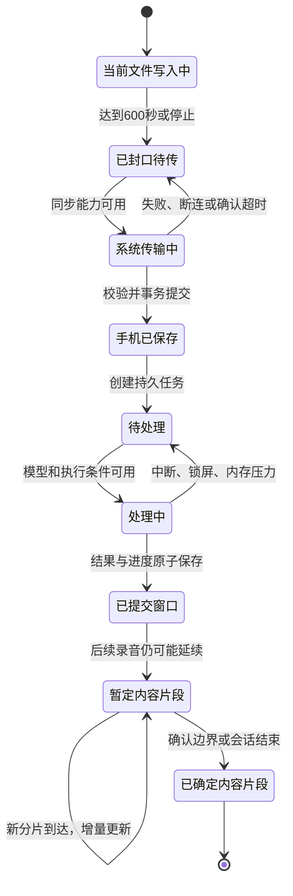

# WiseLife：切片录音、上传、处理与内容分段全流程

创建：2026-10-22；更新：2026-10-23。按四个子流程组织设计。已实现的能力、待实现的分片级标记和真机验收分别记录，流程图不代表全部能力均已实现或通过真机验收。

## 2026-10-23 内容策略更新：待 review

详细方案见 **[内容分段策略 v2：统一 preview 与 iPhone](2026-10-23-content-segmentation-v2-review.md)**。

用户已认可“3 分钟空白候选 + 约 30 分钟分章 + 大模型相同主题整理”的方向。最新核验发现 preview 与手机的 VAD 输入、空白验证、章内拆分、摘要输入和完成状态不一致，因此本次先补充可评审策略，批准后再统一实现。

四个子流程维持不变，v2 对第 3、4 步的细化为：

| 子流程 | v2 待评审策略 |
| --- | --- |
| 1. Watch 分片与上传 | 仍为 600 秒一片，保存时间、设备和可用定位；逐片上传 |
| 2. iPhone 接收与识别 | ASR/VAD 分别记录覆盖、成功和失败；复用已完成结果 |
| 3. 内容分段 | 完整文字块 → 3 分钟空白候选及 VAD 比例验证 → 约 30 分钟候选章 → 章内主题拆分 → 相邻同主题归并（最多 40 分钟）→ 有意义内容分类 |
| 4. 标题、摘要和展示 | 按最终段全文及实际模型预算生成，校验证据后存 SQLite；主时间轴只读有意义内容；本段状态与原始录音整体状态分开 |

下文保留此前已确认的方案与实施记录，其中“600 秒严格无人声”在 v2 中作为更强的边界证据继续保留；它不再是内容分段的唯一入口。两份文档若有语义分段差异，以上链接为本次待批准的后续方案，不能将其视为已经部署。

## 总流程：四个子流程逐片推进

这四个子流程构成增量流水线：Watch 录下一片时，iPhone 可以接收和处理前一片。无需等整次录音结束，也无需等所有分片识别完成才显示已有内容。传输和处理由系统执行条件决定，不承诺实时到达或锁屏持续推理。

| 子流程 | 主要职责 | 交给下一流程的数据 |
| --- | --- | --- |
| 1. Watch 录音、分片存储与上传 | 安全保存音频、封口入队、重试、跟踪收据 | 原始文件、会话与分片身份、顺序、有效时长、结束信息 |
| 2. iPhone 接收、识别与标记 | 持久接收并确认，执行 ASR/VAD，记录分析证据 | 文字与时间戳、人声/无人声区间、成功覆盖范围、分片处理状态 |
| 3. 分片聚合与内容分段 | 沿会话时间轴聚合证据，确定边界与内容归属 | 内容段 ID、原音频范围、分段原因、暂定/确定状态、内容版本 |
| 4. 内容段标题、摘要与索引 | 基于每个内容段生成可阅读信息，更新检索 | 标题、摘要、全文、处理状态、全文和语义索引 |

职责约定：流程 2 记录“识别到了什么、哪些范围已可靠分析”；流程 3 决定“在哪里分段、哪些音频属于同一内容段”。标题和摘要依据内容段生成，不按每个物理文件各生成一份。

## 三种边界，各自负责什么

| 层次 | 本轮规则 | 用途 |
| --- | --- | --- |
| 物理音频文件 | 新长录音每 600 秒封口，停止时保存不足 600 秒的尾片 | 限制单文件大小、逐片保存、恢复与传输 |
| 模型处理窗口 | 核心范围最多 300 秒，前后上下文各最多 2 秒 | 控制 ASR/VAD 内存，与文件数量无关 |
| 时间轴内容片段 | 连续、成功分析的 VAD 无人声达到 600 秒可形成边界；主题变化仅作有依据的建议 | 形成可回听、可总结、可检索的生活内容 |

将两处阈值都设为 10 分钟不会使边界自动对齐。例如无人声从文件 A 的第 8 分钟开始，到文件 B 的第 8 分钟才达到 10 分钟。必须跨文件累计；ASR 没有文字、文件没收到、模型失败都不能直接计为无人声。

## 子流程 1：Watch 录音、分片存储与上传

**输入与触发：**用户开始长录音；当前文件达到 600 秒；用户停止或录音中断；同步能力恢复或重试到期。

**输出：**已封口的原始文件、分片元数据、独立结束信息，以及各分片是否已获 iPhone 持久保存确认。

系统传输完成回调不等于 iPhone 已保存。只有持久保存后的 ACK 才更新已同步状态；无需等 ASR/VAD 完成。录音尚未结束时，即使当前所有已封口文件均已确认，也只显示录音中的部分同步进度。

## 子流程 2：iPhone 分片接收、ASR/VAD 与分析标记

**输入与触发：**新分片或结束信息到达；模型与执行条件恢复；失败任务重试。

**输出：**接收收据、分片处理状态、带时间戳的 ASR 文本、VAD 区间与成功分析覆盖范围。新增的分片级分析标记属于待实现设计。

分片的处理状态和内容结论分别保存，不能用“文本为空”同时表示两者：

| 类型 | 含义 | 能否据此判定无人声边界 |
| --- | --- | --- |
| 待处理 / 处理中 / 失败 | 分析未完成，或尚有缺失覆盖 | 不能 |
| 有人声 | ASR 有文字或 VAD 检测到人声 | 对应范围不能计为无人声 |
| 确认无人声 | 对应范围的 ASR/VAD 均成功，ASR 无文本，VAD 确认无人声 | 可交给流程 3 累计时长 |
| 不确定 | 证据不足或 ASR/VAD 结论冲突 | 不能，保留结果以便重试或复核 |

标记必须关联实际时间范围和分析版本。整片标为“确认无人声”要求覆盖整片；只确认一部分时保留区间证据，不能外推到整片。窗口为边界上下文等待后续分片或结束信息时，该部分保持待处理。

ASR/VAD 原始区间与派生标记存 SQLite；音频继续以文件保存。结束信息用于确认会话范围并释放末端待处理窗口，不替代缺失分片或分析结果。

## 子流程 3：分片聚合与内容分段策略

**输入与触发：**新的分析结果或标记提交；分片补齐；会话结束；人工拆分、合并或撤销。

**输出：**内容段、边界原因、关联分片与原音频范围、暂定/确定状态、版本。分片与边界的显式关联属于本次确认的待实现设计。

### 无人声分片作为内容分段标记

一个完整的 600 秒分片被可靠确认为无人声时，将它关联为内容分段标记。前后的有内容分片分别属于两个内容段，每个内容段都可以包含多个物理文件。

| 物理分片 | 分析结果 | 内容归属 |
| --- | --- | --- |
| `_0000`、`_0001` | 有内容，无其他分段边界 | 内容段 A |
| `_0002` | 整片连续 600 秒确认无人声 | 无人声分隔区间，原件保留 |
| `_0003`、`_0004` | 有内容，无其他分段边界 | 内容段 B |

- 多个连续无人声分片合为一个分隔区间；只形成前后边界，不生成多个空白内容段。
- 跨分片连续无人声也累计：前片末尾 6 分钟加后片开头 4 分钟，仍形成边界，关联两个文件中的实际范围。
- 分隔区间位于录音开头、末尾，或整次录音均无人声时，只保留实际存在的内容段，不补造前段或后段。
- 边界两侧可保留当前策略的最多 2 秒回听缓冲；无人声原件完整保留，默认不生成独立空白笔记。
- SQLite 中的边界关联需要包含会话、涉及的分片与起止范围、分段原因、来源分析版本；标记归属 iPhone 的派生数据，不改写 Watch 原始文件或其传输哈希。
- 识别重试、内容修订或版本变化后重新校验自动边界；自动处理不得覆盖人工拆分、合并等编辑。

“完整录音合并”采用逻辑聚合与跨文件播放，不生成一份巨大的新音频。一个内容段可以引用多个文件，一个文件也可以提供多个内容段的范围。自动处理限定同一录音会话；内容相似本身不能跨真实缺口强行合并，跨午夜按各日实际交叠范围投影。

主题边界属于流程 3 的决策职责。当前实现的主题推理与标题、摘要共用 `ContentEnrichmentService`，其结果仍经分段仓库校验；本次文档按职责划分流程，不声称已拆成四个独立服务。

## 子流程 4：内容段标题、摘要与索引

**输入与触发：**新内容段形成；内容段全文或版本变化；AI 条件恢复或用户重试。

**输出：**与当前内容段匹配的标题、摘要、全文和检索索引，以及生成进度或失败状态。该流程失败不阻塞音频保存、全文查看与内容段回听。

- 对已确定内容段生成稳定标题和摘要；暂定内容段如提前生成，后续追加内容必须按新版本更新，不能把旧摘要当最终结果。
- 长文本按有界批次处理并持久保存中间结果；不一次载入整次长录音或全部文本。
- 默认使用可用端上模型。不因模型不可用而自动下载或转用云端；用户自定义 AI 的使用继续遵守显式配置与内容发送授权。
- 全文索引可随有效转写与内容段更新，不必等待摘要完成；语义索引依赖嵌入模型可用，也不能阻塞保存和回听。

## 附录：状态、完成条件与异常恢复

录音中断时恢复已封口文件及可验证的 partial 前缀；损坏或无法确认的原件保留并报告，不能保证最后未封口的 10 分钟全部可恢复。资源缺失等待下载或用户配置；不自动下载，不自动调用云端模型。旧 5 分钟分片及旧单文件录音继续可读。

四个子流程分别记录进度：“已同步”只表示原始音频和结束信息已可靠收到，“已识别”表示相关范围已成功分析，“内容段已确定”表示边界已确定，“摘要已完成”表示对应版本的 AI 结果已保存。任一后续阶段失败，都不能把前面的已保存数据改成未保存。

## 本轮实施与验收范围

- 新增长录音默认走 600 秒持续采集，闪念保持按住说话流程；不再依赖 DEBUG 启动参数才生成分片。
- 能力协商增加可接收分片时长。旧 iPhone 未声明能力时按 300 秒处理；600 秒文件保留并提示更新，避免反复发送必定拒收的数据。旧 Watch 与新 iPhone 兼容。
- 使用已有持久传输、逐片 ACK、增量 ASR/VAD/内容索引与版本保护，补足贯通测试和录音中同步进度展示。
- ASR/VAD 已成功提交的窗口在追加、结束、重启和重复送达时复用。为跨边界上下文保留的末端窗口在后续音频或结束信息到达后补处理。
- SQLite 存元数据、收据、任务、转写时间段、内容范围与索引；音频以文件保存，不以巨大 BLOB 写入 SQLite。
- 本轮不改变长录音说话人资源保护、不启用环境声音分类、不新增云端服务。
- 发布代码与实际设备安装分别验收；手表未上传原件未备份前不安装、不重启、不卸载。真机录音由用户手动开始。

### 2026-10-23 确认的文档调整与待开发项

- 本次按四个子流程重组说明与流程图，没有修改 Swift 代码、数据库结构或设备安装。
- 已有代码按成功 ASR/VAD 的无人声时间区间执行 600 秒阈值分段，支持跨物理文件累计。
- 待开发：将分片级分析标记、无人声分段标记与分片/范围的显式关联保存到 SQLite，并供界面展示与回溯。原有 ASR/VAD 结果和内容段范围已持久化；新增的是显式派生标记。
- 待开发标记的验收覆盖：整片 600 秒、跨片 6+4 分钟、连续多个无人声文件、首尾或全程无人声、失败/待处理/冲突不误判、重试后标记更新，以及人工边界保护。

## 2026-10-22 实现与设备证据

本设计的 600 秒默认采集、兼容能力协商与录音中同步进度已实现。合成 AAC 的真实文件 / SQLite 贯通验证证明：第一片到达后、停止前可提交稳定 ASR/VAD 窗口；追加、重复送达与处理器重开复用已提交结果；尾片与结束信息必须齐全；跨文件连续 600 秒可靠无人声只拆分一次，缺失 / 失败覆盖不算无人声。最后窗口会等待右侧上下文或会话结束，不承诺每片到达时立刻分析完全部音频。

完整命令、源码版本、结果及限制见 [streaming-recording 验证报告](../../../verification/streaming-recording.md)。macOS fixture 注入系统送达和端上模型推理，原生 `AudioProcessingModel` 外观层仅由 workspace 构建验证。未进行真机安装、重启、录音或备份；先备份未同步手表原件，再由用户开始至少 21 分钟的真机验收，确认停止前收据、重连重放、最终计数 / 时长与原件保留。
