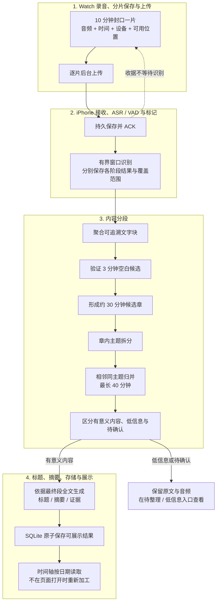

# WiseLife 内容分段策略 v2：统一 preview 与 iPhone

日期：2026-10-23。**状态：共享核心已完成模拟器试验，生产自动调度与真机接入待实施。** 下文的原手机差异保留为当时核验记录；本次模拟器结果见第 13 节，不代表真机已升级。

## 先看结论

保留已经认可的主策略：**3 分钟空白候选 + 约 30 分钟分章 + 大模型整理同主题内容**。

建议统一执行顺序：

**完整带时间转写 → 空白候选验证 → 约 30 分钟候选章 → 章内主题拆分 → 相邻同主题归并 → 有效内容分类 → 最终全文生成标题与摘要 → SQLite 保存 → 时间轴读取。**

这次需要补齐的核心是：把 preview 的整套内容编辑流程迁移为可恢复、可验证的产品流程。下文用“现状”说明已查实的代码和设备行为，用“v2 规则”说明本次待评审的改动。

## 1. 为什么 preview 效果好，手机没有达到同样效果

**此前没有完整对齐 preview 与手机的输入、算法、模型输入和验收。手机实现了其中一部分，并采用了不同的约束与文本处理方式。这个交付差距需要修正。**

手机数据取自本日 20:51 与 21:10 的实际设备快照；模型加工可能继续推进，以下数字是核验时状态。

| 环节 | Mac preview 实际执行 | iPhone 当前实现 / 已核验证据 | 影响 |
| --- | --- | --- | --- |
| 输入证据 | 复用 81 个成功 ASR 窗口，另行修复并重跑 VAD，81/81 成功 | ASR 81/81 成功；VAD 25 成功、56 个旧失败；来源保留取消标记 | 两边输入状态不同；手机未补齐必要证据 |
| 3 分钟空白 | 8 个 ASR 空白候选，结合完整 VAD 覆盖和比例，接受 5 个 | 成功 ASR 空白 ≥180 秒直接作为低信息分隔，不要求同一套 VAD 比例 | 候选章的起点和数量已不同 |
| 文字组织 | 69,706 条原始转写聚合成 254 个可追溯文字块；全部文字参与 | 主题判断只读取边界两侧各最多 650 字 | 模型看不到完整讨论的结构 |
| 主题拆分 | 16 个候选章分别做章内主题分析，产生 34 个初步小段，再归并 | 自动主题入口只比较已存在的相邻章边界，没有等价的章内主题拆分流程 | 一章内的不同事情可能混在一起，分错的边界也难以纠正 |
| 主题归并前提 | 输入已完整成功；按区域、邻接和 40 分钟上限校验 | 候选两段覆盖范围须 ASR/VAD 双成功，旧失败使候选被跳过 | 已核对的手机副本没有主题决策记录；已有 26 段不能当作 AI 主题整理结果 |
| 标题摘要 | 每个最终段的完整原文重新进入模型，结构化返回标题、摘要、要点、证据 | 每 650 字生成短摘要，再逐级压缩，最后另取标题；自定义模型也受同样限制 | 请求多、上下文碎，信息可能在多次压缩中丢失；质量差异尚需相同输入对测 |
| 有意义内容 | 最终分为 15 个内容段、5 个低信息段，另有 5 个长空白区间 | 时间轴目前主要按转写非空筛选，26 段中 18 段有文字 | “有文字”与“值得展示”没有等价 |
| 完成状态 | 离线跑完并校验后生成报告 | 切章后继承大范围的 `isFinal`；片段页使用整条来源的进度 | 本段已经识别、已出摘要，仍可能显示整条录音失败或处理中 |

还有一个结构性限制：两个约 30 分钟的章直接合并通常超过 40 分钟上限。因此即使 VAD 补齐，“只比较现有章的边界”也难以替代“先章内拆分，再对小段归并”。

### Preview 自身也有需要明确的边界

- 最终有 **20 个带文字区间 = 15 个内容段 + 5 个低信息段**，不是 20 个都应进入主时间轴。
- “从机场打车到公司”来自用户补充后的本地修订。初始模型只看了转写，不能算作模型独立结合 GPS 推断成功。
- 极短片段 `A25` 在实验脚本中有专门的低信息修正。产品不能硬编码这个样本 ID，必须使用通用分类与人工确认规则。
- 模型曾遗漏章尾、提出跨长空白或超 40 分钟的合并；实验进行了重做和程序约束修正。产品也需要这些校验与恢复步骤。
- 最终报告的证据块引用均通过归属校验，但章分析阶段有非逐字一致的引文问题；不能把任意模型引文直接当作可靠证据。
- Preview 调用了 42 次模型（含重做）；它是效果基准和工程输入，不是已经落地的真机性能证明。

## 2. 采用哪种实现路径

| 方案 | 优点 | 代价 / 限制 | 本次建议 |
| --- | --- | --- | --- |
| A. 共用内容分段核心，按模型能力适配输入，保留 preview 的完整处理步骤 | 可对照重放；完整主题上下文；支持端上与自定义模型 | 需补文字块、章内拆分、验证器与任务状态 | **推荐** |
| B. 保持当前简化切章与 650 字递归摘要，只调整 UI | 工作量小 | 不能解决主题质量与 preview 不一致 | 不作为本轮目标 |
| C. 整条 6 小时录音全文一次交给模型 | 编排简单 | 上下文、输出遗漏、费用和中断恢复难控制 | 不采用 |

“同一套策略”指边界规则、输入归属、任务阶段、输出校验和持久化行为相同。不同模型的语言能力不同，不能保证端上小模型与豆包逐字同样，也不能把换模型当作默认降级。

本文的“v2”是设计版本，不等同于现有代码中带 `v2` 的派生或提示词标识；实施时必须分配新的执行版本，不能误用旧检查点。

## 3. 总流程：保留四大子流程

四个子流程增量推进。上传成功、识别成功、分段确定、摘要完成分别记录，不共用一个“已处理”状态。

## 4. 参数与基本约束

| 项目 | v2 规则 | 作用 |
| --- | --- | --- |
| Watch 原始文件 | 600 秒一片，尾片可短于 600 秒 | 保存和传输单位，不是语义边界 |
| ASR/VAD 输入 | 核心最多 300 秒，前后各最多 2 秒上下文 | 控制音频推理资源；与文本模型输入预算无关 |
| ASR 空白候选 | 连续至少 180 秒，无非空转写，且 ASR 成功覆盖 | 提出候选，尚不能称为无人声 |
| 候选成为长空白分隔 | 候选范围 ASR/VAD 成功覆盖完整；VAD 无人声 ≥90%、人声 ≤5%、不确定 ≤10% | 与 preview 的比例规则一致；仍不声称绝对静音 |
| 严格无人声边界 | 连续至少 600 秒、ASR/VAD 双成功且确认无人声 | 保留原有更强证据；不要求对齐物理文件 |
| 文字块 | 通常 1–2 分钟，优先真实停顿与句末 | 聚合单字级转写，保留逐条映射 |
| 候选章 | 目标约 1800 秒 | 模型分析单元，允许内部再拆分 |
| 自动生成的最终段 | 最长 2400 秒 | 防止同主题合并回数小时巨段 |
| 章内拆分 | 默认 1 段，明显转折通常拆成 1–3 段，单次最多 5 段 | 避免按插话、例子、子问题切碎 |
| 非相邻同主题 | 只建立主题组，不合并时间区间 | 保留真实时间线 |

边界按原始时间、音频帧和文字块 ID 保存；显示时才取整秒。内容归属使用不重叠的区间，回听缓冲另存，不能让同一 ASR 行归属两段。人工边界、真实缺片和录音中断优先于自动主题建议。

## 5. 子流程 2 / 3：逐步执行规则

### SEG-01：输入与文字块

1. 只读取当前有效配置、实际来源对应的持久化 ASR；同文件重传或沙盒路径改变复用已有结果。
2. 原始转写行不删除、不修改；聚合块保存其原始行 ID、时间范围、全文、内容散列。文字块不是摘要，不能抽样或省略中间文字。
3. 参考 preview：45 秒后遇到 ≥3 秒停顿可收块；75 秒后优先句末；90 秒后遇到 ≥0.8 秒停顿可收块；约 120 秒处寻找合法转写边界。具体边界选择成为有版本的共享规则。
4. 转写区间重叠或个别行过长时，不截断原文以凑时长；保留映射并标为需要边界修复。若无法合法满足 40 分钟限制，不能发布为正常已定稿内容段。
5. 缺片、ASR 失败、尚未处理分别标记；不能通过没有文字反推为无内容。

### SEG-02：3 分钟空白候选与内容区域

- 先寻找 ASR 空白 ≥180 秒，再验证候选范围的 VAD 覆盖和比例。比例按区间并集计算，重叠证据优先级为人声 > 不确定 > 无人声，不能重复累计。
- 符合比例规则时保存一个长空白分隔区间，前后形成不同内容区域；模型不得自动跨越它合并。
- 若 VAD 检测到较多人声，该空白不能作为已确认的长空白分隔。它可能是漏识别、背景音或难懂语音，保留“未识别出文字”的事实，允许在同一区域内继续主题分析。
- 若 VAD 缺失或失败，保留“候选待验证”。与候选相邻的段可暂定；不阻塞其他已具备证据区域的主题分析和摘要。
- 一般主题分析依据完整 ASR 及合法边界，不再额外要求两章所有 VAD 都成功。只有依赖声学结论的边界等待对应 VAD；绝不能借此跨过真实缺口或待验证的长空白候选。
- 首尾空白只产生已有内容一侧的边界；连续空白合并成一个区间，不创建空白笔记。完整原音频保留。

### SEG-03：约 30 分钟候选章

- 在同一连续内容区域内，依据文字块边界划章。30 分钟是目标长度，不是固定截断点，也不是最终主题边界。
- 对已结束、证据完整的录音，第一轮对齐 preview 的方式：按区域时长确定接近 30 分钟的章数，将目标切点对齐最近的合法文字块边界，再校验自动段 40 分钟上限。
- 对正在录音的尾部先保存候选；约 30 分钟可开始分析已闭合文字块，不能等待整场录音结束。尚缺右侧边界证据时显示暂定。
- 已发布的确定边界作为后续规划约束；新增尾部只处理受影响邻域。存在人工编辑或已固定边界的重放，必须把这些边界也作为输入，不能重新均分整场录音。

### SEG-04：章内主题分析

模型输入包括：本章完整文字块、块 ID、原始时间，以及允许使用的设备/位置/用户补充证据。模型输出包含：

| 字段 | 要求 |
| --- | --- |
| 首块、末块 | 必须来自输入；按原顺序完整覆盖，不重叠、不遗漏 |
| 主题与归属原因 | 具体事件或议题，不能泛写“工作讨论” |
| 内容类型 | 讨论、导航、媒体、零散语句、混合等；不等同于用户本人行为 |
| 理解置信度 | 高 / 中 / 低，反映原文是否可理解 |
| 证据块 | 指向本段原始块 ID；展示引文由程序从原文提取 |

一个主题中的举例、插话、定价和素材安排通常保留在同段。明显更换会议、活动、对象或核心议题才拆开。模型只能选择合法块边界，不能自由生成音频时间。

### SEG-05：相邻同主题归并与跨时间分组

- 先取得各章的主题计划，再判断相邻小段是否延续同一件事；按具体事件判断，不能只因都谈“产品”或“工作”就合并。
- 自动合并须同一录音、时间相邻、同一连续区域、没有人工边界或缺口，并且合并后 ≤40 分钟。
- 同主题超过 40 分钟时保留多个章，建立共同主题组；隔很久再次出现的议题也只归组。
- 跨章判断可读取结构化主题计划、来源证据和必要全文；不能仅依靠边界两侧 650 字做最终判断。
- 跨区域或超长的模型提案由程序拒绝或拆回合法范围，再重新验证覆盖，不能直接照单保存。

### SEG-06：哪些片段进入主时间轴

| 分类 | 判定 | 展示 |
| --- | --- | --- |
| 有意义内容 | 有可理解的事件、讨论、想法、决定、问题或可追溯场景 | 持久化后进入主时间轴；摘要可随后补齐 |
| 低信息 | 只有应答、碎语、难以可靠解释的文字，无法形成有依据的内容 | 保存到“低信息 / 待回听”；不占主时间轴 |
| 无转写 | 成功识别无文字，或原文确实为空 | 原音频与声学证据保留；不生成空白卡片 |
| 待确认 | 分析失败、分类结果无效或证据尚未就绪 | 进入待整理入口，显示原因；不能伪装成低信息 |

分类不能只按非空、字数或时长判断。35 秒的明确想法可有价值；几十分钟零散噪声转写也可能低信息。用户可以将低信息段标为有用并进入时间轴；人工选择受保护。模型不可用时仍能在待整理入口查看全文和回听，主时间轴不回退展示原始数小时录音。

## 6. 子流程 4：标题、摘要与模型输入

### SEG-07：先确定内容范围，再生成最终文本

最终标题、摘要依据最终段的全部转写重新生成。章分析中的临时摘要用于组织结构，不直接冒充最终摘要。

输出建议沿用 preview：标题约 12–28 字、摘要约 80–160 字、简要摘要约 45–75 字、0–5 个要点、理解置信度、不确定性说明、1–4 个原文证据块。内容很少时允许更短，不填充事实。

当前片段已有有效范围与分类时，即使摘要失败也能显示全文；只将“摘要”阶段标为失败。模型响应若为空或结构无效，记录失败而非保存“已完成”。

### SEG-08：按模型能力组织完整输入

| 模型路径 | 输入方式 | 约束 |
| --- | --- | --- |
| 用户配置的豆包等自定义模型 | 候选章或最终段全文能装入预算时，一次结构化处理 | 与 preview 对齐的优先路径；遵守现有发送授权，只发送授权文本与上下文 |
| 端上模型 | 在实际可用上下文内分批阅读全部块，保存结构化事实、主题候选和证据引用，再合并 | 不承诺与豆包同等效果；保留同一覆盖、边界、输出校验合同 |
| 任一模型预算不足 | 按合法块边界拆为带上下文的阅读批次，保留每块覆盖清单，再归并计划 | 不能静默截断全文，也不能只让后层看到不断缩短的无引用摘要 |

文本预算独立于 300 秒音频窗口。按实际模型配置的上下文上限预留指令、输出与上下文空间；未知预算使用保守配置并记录，超限时拆批。不同模型的预算适配和提示词版本都进入执行记录。切到云端、下载资源、扩大内容发送范围均遵守现有用户设置，不能自动代替用户选择。

### SEG-09：模型结果校验与失败处理

- 先验证 JSON、输入 ID、顺序、完整覆盖、范围、时长、分类、证据归属，再发布；原文引用由程序提取，避免模型拼接引文。
- 结构或覆盖不合法时，携带明确问题最多修复 1 次；仍失败则保留原候选和失败原因，等待手动重试，不无限重跑。
- 网络或资源不可用保存检查点和具体状态，不将 HTTP 成功当作内容加工成功；本轮不新增无限后台重试。
- 每个成功单元立即存 SQLite。恢复时复用同一输入和模型版本的成功结果，不能因为 App 重开或页面刷新重新发送。
- 实际数据变更只重做受影响的单元及其依赖，不重跑成功 ASR；人工编辑不被自动结果覆盖。

## 7. 地点与硬件信息如何参与

Watch 每次封口可附带当时可用的坐标、采样时间、精度和设备来源；iPhone 接收时单独保存。定位失败保持缺失，不编造、不阻塞音频封口或上传。图片保留已授权的拍摄元数据及来源设备。

分段与摘要使用**本段时间范围内的观察及必要的边界邻近证据**。地址异步补充，原始坐标保留；未获取地点时按现有要求不显示占位。

- 导航文字支持“录音包含导航播报”；单个坐标通常不能证明整段路线、出发地、目的地、乘车方式或到达公司。
- 若用户补充“这是机场打车到公司的行程”，作为独立用户注释保存，带来源标识并受人工编辑保护。
- 位置可能支持主题边界或场景解释，但不因换了一个 GPS 采样点就自动切段。
- 地址解析与设备状态更新不重跑 ASR。是否需要更新片段摘要由对应事实输入版本判断；**不得触发已有每日回顾自动再生成**。

## 8. 独立完成状态与真机页面

### SEG-10：按当前片段依赖判断完成

当前片段完成条件：它的音频范围已保存、相关 ASR 覆盖完整、采用的边界有足够证据、主题与分类计划通过校验。标题与摘要另有独立阶段。

- 不能继承切章前整条大范围的 `isFinal`。后 5 小时的失败不能直接令前 17 分钟永远未完成。
- 也不能因为本段 ASR 成功就忽略其右侧仍待验证的空白边界。边界依赖的证据范围必须明确保存。
- VAD 只阻塞依赖它的声学判断；其他已确定区域可先完成。VAD 仍失败时明确标为“人声检测失败”，不能把来源总体状态说成全部完成。
- 正在录音的尾段允许暂定；已完整的前段可以完成并发布。

页面分两层：

| 本片段 | 原始录音整体任务（单独区域） |
| --- | --- |
| 本段相关转写进度，例如 4/4 | 全录音转写，例如 81/81 |
| 本段人声检测及边界依赖 | 全录音人声检测成功 / 失败数 |
| 主题、分类、标题、摘要各自状态 | 内容段总数、摘要完成段数 |
| 本段失败阶段重试 | 明确标注“重试整条录音失败阶段” |

“81/81 个窗口有结果”不能显示为所有分析成功。说话人识别的资源限制也要说明它作用于原始录音；本轮不改变长录音说话人保护策略。全局 AI 正在处理其他段时，已完成片段应显示自己的已完成结果。

## 9. SQLite、任务恢复与检索合同

既有 SQLite 继续保存事实和派生结果，音频仍为文件。以下为逻辑数据要求，具体迁移结构在批准后的实现方案中确认：

| 数据 | 必须保存的信息 |
| --- | --- |
| 文字块 | 原始 ASR 行映射、范围、全文、输入散列 |
| 边界证据 | 空白候选、VAD 比例与覆盖、边界原因、所依赖范围、验证状态 |
| 候选章与主题计划 | 输入块顺序、章内拆分、归并提案、拒绝原因、策略 / 提示词版本 |
| 最终内容段 | 稳定 ID、音频范围、文字归属、分类、人工编辑保护、各阶段状态 |
| 标题摘要 | 输入版本、模型配置标识、输出、证据块、完成时间 |
| 任务与检查点 | 目标段/章、阶段、输入散列、已完成单元、失败码、暂停与取消原因 |
| 展示与索引 | 已准备的片段全文、标题摘要、日期、设备与地点；关联有效版本 |

处理器在页面之外准备可展示结果；推理和大范围读取不占用 SQLite 写事务。写入时短事务校验输入版本并原子发布，随后通知 UI。打开日期、切换 Tab、展开片段、重启 App 只读取已保存结果及任务状态，不隐式触发重算。

检查点身份包含实际依赖的内容散列、范围、规则版本、模型/提示词版本及授权上下文；不包含沙盒绝对路径、纯进度计数或无关日期数据。不同阶段的输入版本分别管理，避免完成一个摘要就使其他段任务失效。

全文检索使用已存在的全文索引；SQLite Vector 服务于语义查找和主题关联候选。向量相似度不直接决定音频边界，也不能替代证据与模型判断。

已生成的今日、昨日、历史回顾保持“后续仅手动生成/更新”的独立规则。分段升级、VAD 补跑、摘要新增和索引更新不恢复回顾的自动次数。

## 10. 用 10 月 22 日录音做一致性验收

### SEG-11：先对齐输入，再谈结果

基准录音有效时长 24,129.276 秒；同一代 ASR 有 69,706 行、74,513 个文本字符。参考 preview 的中间产物为：

**8 个空白候选 → 5 个接受分隔 → 254 个文字块 → 16 个候选章 → 34 个主题小段 → 20 个最终文字区间，其中 15 个内容段、5 个低信息段。**

这是一份具体样本的参考输出，不能把这些数量硬编码成通用策略。

验收分两层：

1. **确定性重放：**同一 ASR/VAD、边界约束、策略版本及冻结模型响应，Mac 工具与 iPhone 核心必须输出一致的归属、时间范围、分类与状态。用户注释及实验人工修正作为单独、显式的输入，不掩盖成模型输出。
2. **真实模型执行：**在手机上使用用户配置的豆包，执行完整步骤，逐段对比主题与证据。允许措辞和少量合理主题边界差异；遗漏原文、跨已确认空白合并、全局失败拖住已完成片段均不能通过。低信息分类也要在去掉 `A25` 特例后重新验收。

Mac preview 工具后续调用产品共用的 Swift 规则与验证器，UI 只负责呈现；不再独立维护一套 Python 策略再用不同逻辑“翻译”到手机。模型适配器可不同，输入与输出合同必须相同。

### SEG-12：旧数据迁移与执行次序

1. 先用私有数据库副本验证规则和映射；完整保存原音频、原转写、人工编辑、旧有效摘要及回顾次数。
2. 为旧失败 VAD 建立明确的恢复任务，只补失败阶段，不重跑 81 个成功 ASR。若来源保留用户取消状态，不能在升级时静默恢复；需要明确恢复操作。
3. 新策略先写候选版本，通过完整性验证后原子切换展示；失败时旧有效版本仍可读取。
4. 第一项真机验收就是这条已结束的 6 小时 42 分录音，然后验收逐片到达、暂停/重启、断网和尾片结束。不能以只通过合成数据测试宣布实际效果达标。
5. 记录每阶段调用数、输入输出量、耗时、峰值内存与缓存命中；preview 的 42 次调用用于对照，不能把原实验耗时当成 iPhone 承诺。

## 11. 验收用例

| ID | 条件与动作 | 必须观察到的结果 |
| --- | --- | --- |
| AC-01 | 同输入及冻结模型响应在 Mac/iPhone 重放 | 文字归属、范围、边界原因、分类相同；原始 ASR 每行恰好归属一次 |
| AC-02 | ASR 空白 179 / 180 / 181 秒 | 仅后两者成为候选；不是直接认定无人声 |
| AC-03 | ≥180 秒候选的 VAD 覆盖完整且比例在阈值边界；或有缺失/失败 | 合法比例才确认分隔；缺失/失败保持待验证 |
| AC-04 | 单章内部先讨论事件 A，再明确切换 B | 能按合法块边界拆开；同主题举例不被碎切 |
| AC-05 | 相邻同主题合并接近/达到/超过 2400 秒 | ≤2400 秒可合法归并；超过则分章；不丢失任何原文 |
| AC-06 | 同主题跨长空白、真实缺口、午夜或非相邻时间复现 | 不跨空白/缺口合并；非相邻只归组；跨午夜按各日实际范围展示且不重复统计 |
| AC-07 | “好的”等碎语与短而明确的待办/想法 | 前者可低信息，后者可有意义；无样本 ID 特例 |
| AC-08 | 模型漏块、乱序、无效引用或越界 | 校验拒绝；最多修复 1 次；仍失败保留候选和可见原因 |
| AC-09 | 当前段完成，后段 VAD 失败或 AI 未完成 | 当前段状态准确；只等待真正依赖的边界；其他范围失败不全局传播 |
| AC-10 | 摘要完成后重启、切日期、打开详情 | 直接读 SQLite；没有新模型调用；已生成每日回顾不自动更新 |
| AC-11 | 新分片到达、旧分片重复到达、沙盒路径变化 | 已成功 ASR/摘要复用；仅受影响尾部或依赖范围重做；原音频不改变 |
| AC-12 | 网络断开、端上模型不可用、来源已取消、重新授权 | 各自明确状态；不无限重试，不偷换模型，不清除用户取消；显式恢复从检查点继续 |
| AC-13 | 用户修改标题、拆分/合并、隐藏片段后升级策略 | 人工决策保留；自动计划不能复活隐藏片段或覆盖用户标题 |
| AC-14 | 原始长录音、空白段、分类未就绪和已确认有用段同时存在 | 主时间轴只显示有用内容；其他数据通过原始录音/待整理入口可访问 |
| AC-15 | 长时间文字区间重叠，找不到合法 ≤40 分钟切点 | 不裁掉、重复或错配原文；显示需要边界修复，不冒充正常完成 |

## 12. 本次 review 重点

建议确认以下四点后，再编写实现计划：

1. **空白分隔采用 preview 的 ASR + VAD 比例验证**；VAD 失败只阻塞相关边界，不拖住整场内容整理。
2. **补齐章内拆分与相邻归并两步**；30 分钟为目标，自动段 40 分钟封顶，非相邻相同主题只归组。
3. **“有意义内容”独立分类**；低信息与待处理不进入主时间轴，但保留可回听、可人工标记的入口。
4. **优先用同一条真实录音、同一豆包配置验收**；手机与 preview 共用规则和校验器，端上模型再按相同合同单独验证效果。

本次文档 review 后仍需就共享引擎、持久化迁移和任务调度做一次实现设计审查。没有新增服务器要求。

## 13. 2026-10-23 模拟器试验结果

按用户要求，将真实的 **6 小时 42 分 9.276 秒**录音复制到独立 `WiseLife Content Lab`，使用共享 Swift 核心和该模拟器已配置的 `Doubao-Seed-2.0-mini` 优化策略。ASR 复用成功的真机结果，VAD 复用 Mac 修复后的结果；本轮没有重跑语音识别。

- 同样的输入形成 **254 个文字块、16 个候选章、5 个确认长空白**。
- 首轮实际模型输出为 26 个有效内容段 + 6 个低信息段。优化后为 **19 个有效内容段 + 12 个低信息段**；数量来自本次结果，不是算法目标。
- 连续导航不再按高速/出高速等路线阶段过度拆分。对话管理语（等待、交接发言、邀请提问）在没有实际问题或事件内容时归为低信息；人名和代号本身不能证明内容有意义。短而完整的具体问题仍可有效。
- 31 段都保存到正常 SQLite 内容表，时间轴读取其中 19 段；69,706 条原始转写完整归属。低信息仍可在录音库查看。
- 实际读取暴露并修复了两处日期/音频边界浮点问题：完整片段被误判为截断导致标题摘要清空，以及极小端点误差漏掉转写行。
- 本轮通过显式开发 runner 执行新核心，再由原生 App 读取保存结果。生产自动任务、逐片到达后的局部重算、端上模型适配、真机验收仍是后续工作。
- 原生界面自动化工具启动失败，点击、滚动和回听的视觉验收未完成；数据库读取、构建、媒体解码等证据单独记录，不替代 UI 验收。

详细证据与限制见 [模拟器试验验证记录](../../../verification/2026-10-23-simulator-content-v2.md)。完整私有结果在 `/Users/karama/Documents/WiseLife-Reports/2026-10-23-simulator-content-v2/`；音频、原文及模型请求不放入代码仓库。

## 证据与关联文档

- [原四子流程总设计](2026-10-22-streaming-recording-design.md)。
- [当前原生分章实现与测试边界](../../../verification/2026-10-23-content-chapters-implementation.md)。
- [VAD 数值错误与 Mac 实际重跑](../../../verification/2026-10-23-real-recording-mac-audit.md)。
- [真机片段页与来源状态混用核验](../../../verification/2026-10-23-segment-processing-ui.md)。
- [SQLite 呈现与每日回顾修复](../../../verification/2026-10-23-persisted-timeline-recap-refresh.md)。
- 私有 preview 证据：`/Users/karama/Documents/WiseLife-Reports/2026-10-23-6h42m-segmentation/` 下的 `分段结果.md`、`verification.json` 及 `run-evidence/prepare_experiment.py`、`prepare_merge.py`、`prepare_final.py`、`build_report.py`。转写、模型请求、响应和音频不复制进代码仓库。
- 原生差异入口：`ContentSegmentation.swift`、`ContentSegmentRepository.swift`、`ContentEnrichmentService.swift`、`ConfiguredContentTextModel.swift`、`ContentSegmentDetailView.swift`。
