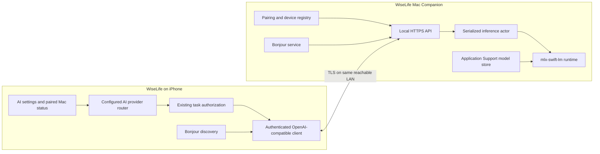

# WiseLife Mac Companion + MLX Local LLM

- **Status:** Proposed for review
- **Date:** 2026-10-23
- **Starting hardware:** MacBook Air M3, 16 GB unified memory
- **Scope:** Native macOS companion that serves local text-generation requests to WiseLife on a nearby iPhone.

## Decision summary

Build a separate native SwiftUI macOS app that owns the MLX model lifecycle and exposes a small, authenticated, OpenAI-compatible HTTP API on the local network. WiseLife iPhone discovers the Mac with Bonjour; the user does not enter an IP address or port. The first model to benchmark is `mlx-community/Qwen3-4B-4bit`, with a smaller quantized model as a fallback if the M3 Air's memory pressure, response time, or Chinese task quality is not acceptable.

The M3 Air / 16 GB is the first acceptance machine, not evidence that every Apple silicon Mac or every model size is supported. The model, MLX package versions, macOS minimum, and memory/context caps are pinned only after the first-device benchmark. Mac sleep, a different network, or Wi-Fi client isolation can make the provider unavailable; the iPhone must report this clearly and must not silently send the request to a cloud provider.

## Current app facts

- `AIConfiguration.Mode` currently has `local`, `chatgpt`, and `custom`. `CustomAISummarizer` already implements non-streaming OpenAI Chat Completions and Anthropic Messages requests.
- Provider routing is explicit in several places: `DaybookRecapService`, `DaybookInsightService`, `DaybookAnswerService`, `NotesModel`, and `ConfiguredContentTextModel`. Adding a provider therefore needs a shared routing change, not just a settings row.
- AI settings currently control note summaries, cross-record recaps, question answering, daily insights, titles, and configured content enrichment. External-provider confirmation defaults on. `isRemote` currently treats every non-Apple provider as remote.
- iOS already has `NSLocalNetworkUsageDescription` and `NSAllowsLocalNetworking`; `NSBonjourServices` is not declared. Bonjour discovery will require the exact service declaration and a clearer local-network explanation.
- The existing AI network client has a 120-second request resource timeout and sends `stream: false`, so a non-streaming API is sufficient for the first end-to-end implementation.

## Compared approaches

| Approach | Advantages | Costs and risks | Decision |
|---|---|---|---|
| SwiftUI macOS app + `mlx-swift-lm` + SwiftNIO/NIOSSL API | Native model lifecycle, no Python environment, direct control over pairing, TLS and memory; one managed app for the user | More initial engineering; Swift package and macOS SDK compatibility must be proven before pinning | **Recommended** |
| SwiftUI shell that launches a bundled `mlx-lm` Python server | Quick inference prototype; MLX Python has a mature model workflow | Bundled Python/runtime and child-process lifecycle, environment updates, signing/notarization, and service security become product work | Use only for a time-boxed engineering spike if native inference blocks progress |
| Connect WiseLife to a separately installed model server | Fastest personal experiment | User must install/configure another product and may need to manage endpoints and keys; does not deliver the companion-app experience | Not the product design |

## User flow

1. The user installs and opens WiseLife Mac Companion. The first launch explains that inference runs on this Mac. After the user chooses a supported model, the app downloads it from its listed upstream source and shows progress, model license, storage use, and readiness; it does not download weights silently.
2. On Mac, the user opens **Pair iPhone**. The Mac displays a short-lived QR code containing a pairing nonce and certificate fingerprint; it contains no model prompt, note, or long-lived credential.
3. In iPhone **Settings → AI model**, the user selects **Nearby Mac** and scans the QR. WiseLife requests Local Network access, discovers the corresponding Bonjour service, verifies the certificate fingerprint, and completes pairing. No address is entered.
4. Both apps show the paired device and model readiness. The iPhone sends text only when the Mac provider is selected and the existing per-task authorization allows that request.
5. If the Mac is asleep, the app is stopped, Wi-Fi blocks peer traffic, or the model is loading, WiseLife shows a retryable status. It does not fall back to ChatGPT or another cloud service without a separate user action.

## Proposed architecture

### macOS companion

- Create an independent project under `apps/wiselife-mac/`; do not add the Mac target to the existing iOS/Watch Xcode project. Use SwiftUI for the setup window and status item. Keep the model engine and HTTP server behind small protocols so model runtime tests do not need to load multi-gigabyte weights.
- Use `mlx-swift-lm` for loading and generating with supported MLX models. Use a `ModelRuntime` actor to serialize generation, create a fresh one-shot chat session for each request, and clear the session after completion. The upstream `ChatSession` API is explicitly not thread-safe.
- Use SwiftNIO HTTP/1.1 plus NIOSSL for the local service. The macOS app advertises `_wiselife-llm._tcp` through Bonjour and binds only to local network interfaces. It should not create a public listener, UPnP mapping, or port-forwarding instruction.
- Keep model weights outside the app bundle in the app's Application Support directory. Download to a staging directory, verify repository/revision and file integrity, then promote the complete model atomically. The app does not execute model-repository Python code. Show the model's upstream license and pinned revision before download.
- Expose an app window with model download/load state, server state, paired iPhones, active generation, and a **Revoke device** action. Advertise the service while the user has opened pairing or enabled availability. Before pairing, only pairing is available; inference endpoints require a paired device and a ready model. Launch at login can be an opt-in follow-up; do not prevent system sleep indefinitely.
- The model service must stop accepting requests during shutdown, cancel queued work, and leave a retryable state for the iPhone. During an active request, the app may request a short-lived power assertion; it must release it on success, failure, cancellation, and timeout.

### Initial model and memory policy

- First benchmark: `mlx-community/Qwen3-4B-4bit`, a model currently listed by `mlx-swift-lm` and marked Apache-2.0 in its model card. Pin a specific repository revision and re-check its license and file hashes when implementing download. The model name is a starting candidate, not a final product promise.
- Compare it on the exact M3 Air against one smaller Qwen 3 quantized candidate. Do not load two models at once. Offer only model versions in the app's tested compatibility catalog in the initial release.
- Start with a single active generation, a short bounded queue, and a maximum context setting of 8K tokens as a benchmark ceiling. Clamp generated output to 2,048 tokens. If the device shows sustained memory pressure or the Chinese task suite fails, lower the context ceiling or use the smaller model. Do not infer runtime memory from the compressed weight-file size.
- Record model load time, peak process memory, system memory-pressure state, prompt length, time to first token, total latency, tokens generated, and thermal behavior. Establish numeric product thresholds from the first real M3 run rather than inventing them in advance.
- Unload the model after an idle timeout (initial proposal: 10 minutes) and on memory-pressure warnings. Provide an explicit **Unload model** control. Reloading may take time and is shown as a state, not represented as an error.

### Local API contract

Use a deliberately small OpenAI-compatible surface so the iPhone's existing protocol code can be reused:

| Route | Purpose |
|---|---|
| `GET /health` | Readiness only: service version, model load state, queue state. No prompt or user data. |
| `GET /v1/models` | Return the one model currently loaded/selected. Requires pairing authorization. |
| `POST /v1/chat/completions` | Accept one system message and one user message with `stream: false`; return a standard OpenAI `choices[0].message.content` and `finish_reason`. Requires pairing authorization. |

The first version rejects streaming, images, audio, tool calls, embeddings, unknown models, oversized bodies, and unsupported generation settings. Keep request bodies bounded (initial proposal: 1 MiB) and use the selected Mac model ID from `/v1/models`, never a user-entered model string. Tokenize the full prompt on Mac before generation and return an explicit context-limit error; never silently truncate input. Return stable HTTP status codes for unauthorized, busy/queue-full, model-not-ready, oversized, cancelled, and inference failure. Do not expose raw runtime errors or prompts in responses.

### Bonjour, pairing and transport security

- iPhone uses `NWBrowser` for `_wiselife-llm._tcp`; the service record advertises only protocol version and opaque service identity. It must not advertise the pair token or any note text.
- Add `_wiselife-llm._tcp` under the iPhone app's `NSBonjourServices`. Keep and update the existing `NSLocalNetworkUsageDescription` so it says WiseLife discovers and sends approved text to the user's paired Mac AI. Add the matching macOS local-network explanation and required server/client sandbox entitlements if the Mac app is sandboxed.
- The Mac creates a local TLS identity and the QR binds the first iPhone pairing to its certificate fingerprint and a single-use 256-bit random pairing secret that expires quickly. Use TLS for every request. The iPhone pins that identity; do not add a global ATS exception or trust arbitrary local certificates.
- After the first verified exchange, generate a high-entropy per-iPhone bearer token. Store it in iPhone Keychain and store its verifier/credential in Mac Keychain. Redact it from logs. Pairing nonces expire quickly and are single-use. Revoke removes the Mac credential and iPhone Keychain item; a re-pair is required afterward.
- Bind service access to a paired client; rate-limit pairing attempts; reject stale nonces, invalid tokens, replayed pairing exchanges, redirects, and cleartext requests. The Mac firewall may ask for permission to accept local connections.
- The app may resolve the Bonjour endpoint to an address internally, but no IP, port, router setting, or API key is shown to the user.

### iPhone integration and privacy

- Add a `nearbyMac` provider and a paired-Mac registry. Persist only provider selection, opaque Mac/service identifier, model identifier, and non-secret display status in preferences. Keep the bearer token and pinned certificate identity in Keychain.
- Extract a common text-generation interface used by the existing providers. Route summary, recording title, daily recap, daily insight, Daybook Q&A, and configured content enrichment through the same interface. Preserve each task's prompt, source validation, cancellation, stale-result checks, citations, and output schema.
- Preserve the existing remote-confirmation default and re-check authorization immediately before reading the paired credential and before sending. Treat a Mac request as data leaving the iPhone even though the inference engine is local to the user's LAN. Settings and confirmation copy must identify the paired Mac as the recipient. The initial pair flow must explain this data flow and require explicit user action.
- Only send the text already selected for that task. Audio files, photos, health records, calendars, and unrelated notes are not sent. The Mac stores model weights and pairing metadata, not prompts, transcripts, summaries, or responses. Do not log request/response bodies; diagnostic logs may contain request ID, model ID, sizes, timing, and sanitized status codes only.
- Keep on-iPhone transcription, note storage, and the Apple local model as available choices. Choosing Nearby Mac must not silently change the ASR provider or upload recordings.
- Update the product privacy wording before release: the default Apple-local path remains on iPhone; when the user selects Nearby Mac, approved text travels over the local network to their paired Mac and is processed there. WiseLife's own server is not involved.

## Failure behavior

| Condition | iPhone behavior | Mac behavior |
|---|---|---|
| Local Network permission denied | Explain how to enable it in Settings; offer retry | Continue working locally; do not repeatedly trigger discovery |
| No Bonjour device found | Show “Mac unavailable” and last-seen time; allow retry | Show whether server is advertising |
| Same Wi-Fi but peer isolation | Explain that the router/hotspot may block device-to-device traffic; no manual IP workaround in MVP | Show server listening, not a false connected state |
| Mac app stopped/asleep | Keep task retryable; do not switch provider | Re-advertise on app resume and reload only when requested |
| Model missing/loading | Show model-specific readiness | Present download/load progress and available disk space |
| Queue full or generation timeout | Return a clear retryable task error | Reject new work with a stable status and retain no prompt |
| Invalid/revoked pairing | Do not send prompt; ask user to pair again | Reject request and offer device revocation/re-pair |

## Implementation sequence

1. **Compatibility spike on the M3 Air:** record macOS/Xcode versions; build `mlx-swift-lm` for a separate macOS target; load the proposed 4B Q4 model and smaller fallback; run Chinese summary, title, citation, insight-JSON, and content-decision samples; measure cold load, latency, memory pressure, and 30-minute repeated use. Set supported OS and numeric memory/performance gates from this evidence.
2. **Mac runtime and model manager:** create the independent app, model catalog/download flow, staged verification, serialized inference actor, and local API contract. Add deterministic runtime stubs for tests.
3. **Secure discovery and pairing:** add Bonjour advertisement/browser, Info.plist and entitlements, one-time QR pairing, TLS pinning, Keychain credentials, device revocation, and network failure states. Test on the actual iPhone and M3 Air, including hotspot/client-isolation cases.
4. **iPhone provider routing:** add Nearby Mac settings/status, common provider routing, per-task authorization, test connection, exact request/response contract tests, and no-cloud-fallback behavior across every LLM call site.
5. **End-to-end acceptance and release:** run all text task paths through the real M3 model; verify iPhone UI status and cancellation; run memory/thermal soak; sign and notarize a separate Mac app. Keep release notes and privacy wording aligned with the selected provider.

## Acceptance checks

- With the Mac app running on the M3 Air and the iPhone on a reachable Wi-Fi network, iPhone discovers the Mac without the user entering an IP or API key, pairs once, and reaches model-ready state.
- All listed WiseLife text-generation tasks work through the Mac provider and preserve their existing output validation and cancellation behavior.
- The iPhone sends only authorized text; no raw audio or unrelated data reaches the Mac; request bodies and credentials do not appear in app logs.
- Unpaired/revoked clients, invalid TLS pins, expired pair codes, oversized requests, unsupported streaming, model-not-ready, queue-full, cancellation, and Mac sleep produce safe, testable outcomes.
- The 4B candidate and smaller fallback pass the Chinese task suite on the exact M3 Air without sustained critical memory pressure. Report measured latency, memory, model revision/license, and limits; do not claim a passing result before device testing.
- No request is transparently retried against ChatGPT, a custom cloud endpoint, or WiseLife infrastructure when the Mac is unavailable.

## Dependencies and references

- [MLX Swift](https://github.com/ml-explore/mlx-swift) and its [macOS-capable examples](https://github.com/ml-explore/mlx-swift-examples)
- [mlx-swift-lm integration guide](https://github.com/ml-explore/mlx-swift-lm/blob/main/Libraries/MLXLMCommon/Documentation.docc/using.md) and [supported model registry](https://github.com/ml-explore/mlx-swift-lm/blob/main/skills/mlx-swift-lm/references/supported-models.md)
- [Qwen3-4B MLX model card and license](https://huggingface.co/mlx-community/Qwen3-4B-4bit)
- [Apple NWBrowser documentation](https://developer.apple.com/documentation/network/nwbrowser) and [NSLocalNetworkUsageDescription](https://developer.apple.com/documentation/BundleResources/Information-Property-List/NSLocalNetworkUsageDescription)
- [SwiftNIO](https://github.com/apple/swift-nio), [SwiftNIO TLS support](https://github.com/apple/swift-nio-ssl), and [Swift X.509 certificates](https://github.com/apple/swift-certificates)

## Review notes

- This document is a design proposal, not implementation or hardware verification. The M3 Air / 16 GB remains the only named acceptance configuration until another device is tested.
- The main release risk is not Bonjour discovery; it is keeping a useful Chinese model responsive without causing unacceptable memory pressure or heat on a fanless 16 GB MacBook Air. Step 1 is a go/no-go gate before building the full companion UI.
- Model licenses and MLX compatibility change independently of this app. Pin model revisions and Swift package versions, retain license attribution, and verify both during implementation and release.
