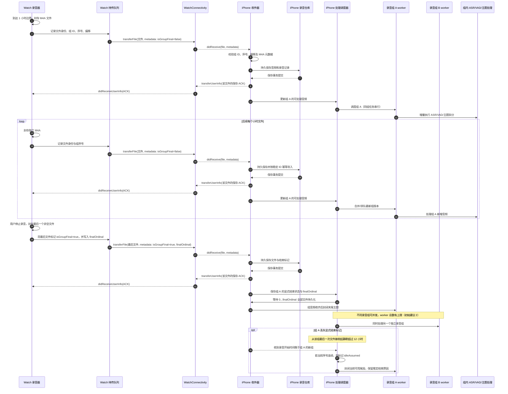

# Watch → iPhone 小时录音文件传输时序

## 录音、封存与传输

## 约定

- 不延迟文件封存，也不延迟传输入队。每个小时文件封存后即可通过 `transferFile(file, metadata)` 发送。
- 普通小时文件的 metadata 标记 `isGroupFinal=false`。用户停止录音时封存的最后一个文件标记 `isGroupFinal=true`，并附 `finalOrdinal`。
- 按本方案范围，忽略“满一小时封存与用户停止录音恰好同时发生”的极特殊竞态。
- iPhone 收到文件保存 ACK 后，只表示该文件已可靠存入录音仓库；ASR、VAD、主题拆分、标题和摘要是否成功不影响此 ACK。
- 录音组的结束标记随最后一个文件的 metadata 到达，并随 iPhone 的录音记录持久化。文件乱序到达和组完整性对账不在本次内容拆分改动范围内。
- 单文件重复到达仍按稳定录音 ID 幂等导入。
- 若 Watch 在结束标记发送前异常退出，iPhone 不应推断录音组正常结束；保留为结束状态未确认，由 Watch 恢复或用户重试处理。

## iPhone 分组处理策略（已确认，已实现，待设备验收）

- **分组身份：**每次 Watch 长录音使用独立 `recordingGroupID`；组内小时文件按 ordinal 排序，不能与其他组混合。
- **跨组调度：**不同录音组可并发处理，worker 数量必须有上限，初始建议 2。调度器按组隔离任务和状态。
- **组内调度：**同一组的更新串行处理。小时文件到达后，重新发现组内连续可用音频；合并尚未开始的旧版本任务，只运行最新输入版本，避免同组并发提交互相覆盖。
- **增量主题：**ASR/VAD 覆盖及主题边界足以确认的片段可定稿并进入时间轴；组尾尚未确定的主题保持为开放尾段。下一小时文件到达后，只把开放尾段与新增音频一起继续分析。已定稿的 `isFinal` 片段不参与自动边界调整。
- **处理中追加（2026-11-01 修正）：**主题任务冻结本轮窗口证据；后续 ASR 提交和新文件不会让原输入失效或启动同组第二个主题 worker。既有证据变化、人工编辑、来源删除及配置变化仍撤销旧结果；首个未完成窗口之后保持暂定。定稿内容使用相同的语义签名供发布和后续 reconcile 校验，避免进度更新清空标题和分类。当前代码与验证状态见[专项记录](../verification/progressive-recording-2026-11-01.md)。
- **逐段发布与恢复（2026-11-02 修正）：**边界计划通过后，各段分类结果独立保存和展示，不再等整轮全部成功。未完成轮次持久保存冻结输入；重开后复用已保存的结果，只请求缺失单元。乱序完成只锁定对应范围，不跳过更早的失败或暂定段。
- **显式结束：**`isGroupFinal=true` 表示 Watch 已停止该组录音，`finalOrdinal` 表示最后文件序号。仅当 `0...finalOrdinal` 每个文件均已持久化后，iPhone 才确认传输完整并封闭开放尾段。录音已结束与 iPhone 文件已收齐是分开的状态。
- **静默兜底：**从 iPhone 最后一次收到该组文件起超过 12 小时没有新文件，且收到录音开始时间晚于该组的新组时，可将该组标为 `idleAssumed`。仅在当前已收 ordinal 连续时，才封闭当前可用尾段；不能把它显示为显式确认结束。
- **迟到文件：**`idleAssumed` 后若又收到旧组文件，撤销当前的推定封闭并重新打开该组；已有 `isFinal` 片段保持不变，只更新尚未定稿的尾段。之后再满足静默条件时可重新推定封闭，收到显式结束 metadata 后则以显式结束为准。

## 实现状态

- **已接入：**Watch 最后文件通过 `transferFile` metadata 发送 `isGroupFinal` 与 `finalOrdinal`；iPhone 解码并把 `finalOrdinal` 随录音记录持久化。
- **已实现：**iPhone 按已持久化 ordinal 连续性与 `finalOrdinal` 判定显式完整；超过 12 小时无新收件、且出现录音开始时间更晚的新组时，连续的旧组可标为 `idleAssumed`。迟到文件会重开该组；完成原因、组 ID 与音频输入身份纳入处理快照。
- **已实现：**音频分析和文本主题/字段生成分别限制为最多 2 个不同来源并发，同一 `AudioSourceID` 同时最多一个任务。新到文件使旧输入租约失效，之后只处理当前发现的输入。
- **已实现：**主题分析只接收最后一个已定稿片段之后的开放尾段；V2 发布保留所有 `isFinal` 片段，不再自动删除或改动它们。若已没有开放尾段，则仍可为已有片段补生成标题与摘要。
- **待设备验收：**真实 Watch 文件的乱序、延迟与重复到达；12 小时跨日边界；大组增量处理后的时间轴展示和模型输出质量。本轮只完成代码构建检查，尚未做设备/E2E验收。

## 当前实现差异

Watch 的正常停止封存文件携带 `isGroupFinal=true` 和 `finalOrdinal`，普通轮转文件携带 `isGroupFinal=false`；iPhone 将结束序号和接收时间随录音记录持久化。接收完整性、开放尾段拆分、跨组调度与 `isFinal` 保留逻辑已落入实现，设备行为仍需验收。

2026-11-05：采集池的四状态所有权同步改用始终 lock-free 的 C11 int32 原子操作，保持 strong CAS 与 sequential consistency；初始化分配位于实时采集回调外。录音分块、封存、传输协议不变。[验证记录](work/2026-11-05-xcode-warnings/README.md)包含 watchOS 10 双架构编译、并发交接与 TSan 检查，尚未替代 Watch 长时间实机验收。
