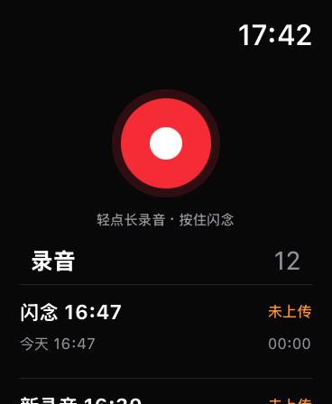
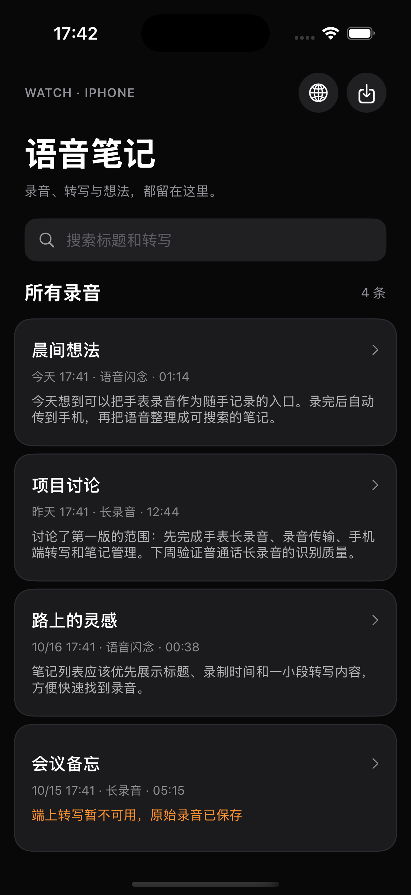
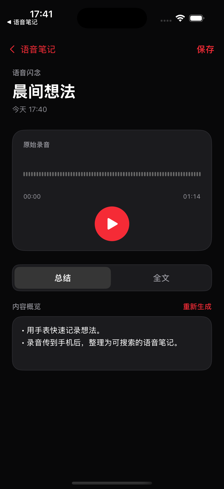
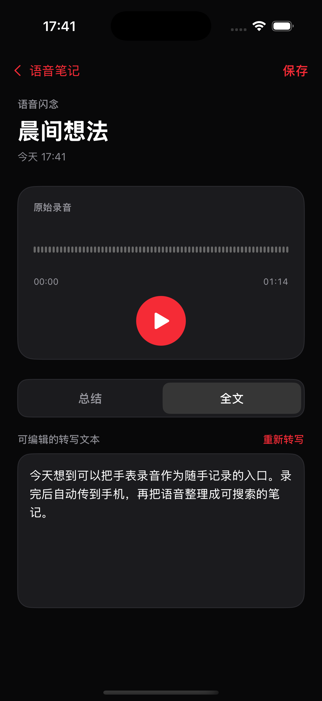

# 原生界面核对 · 2026-10-18

> **本地发言人分段 · 2026-10-19：** 新增按发言人和真实时间范围展示全文、点按回听、筛选、单条录音内改名及自动处理开关。使用固定版本 FluidAudio 0.17.7 Community-1 离线模型；Apple Speech 继续转写。录音不上传，不保存声纹向量，不识别真实身份。模型许可和署名已加入 App 设置。时间轴 schema 4 兼容 schema 1/2/3；文字修改清除旧对齐，标题修改保留。
>
> 本地逻辑测试通过，覆盖发言人切换、跨边界未知、多人与重复区间、文字保留、音频/全文绑定、名称及持久化；原有本地检查通过。iOS 模拟器目标编译通过。使用 Mac 上相同 Core ML 推理代码处理系统合成音频：约 77 秒 Daniel/Samantha 四次轮流发言识别为 2 位、4 个区间，范围均有效；两组中文系统合成音频均被合并为 1 位，记录为区分失败，不能据此声称中文会议准确率已通过。未读取或导出用户录音用于测试。
>
> 独立模拟器预览的 12 项集成检查通过，覆盖取消后保留结果、名称持久化、健康开关互不误删、全文修改清除旧对齐和音频保留。通过 Computer Use 验证 3 个分段卡片、两位发言人颜色、点击第二段后播放位置为 00:25、筛选后只显示对应段落，以及重命名后筛选标签和段落名称同步更新。预览样本均为合成内容，不代表真实会议准确率。
>
> 最终真机签名构建、严格签名校验、Watch 嵌入位置及伴侣 Bundle ID 校验通过；已更新安装并成功启动至 iPhone Air，使用原开发 Bundle ID 保留现有数据。手表源码未变化。用户选择稍后测试真实多人录音；真实中文区分质量、长会议耗时/电量、手机首次下载及离线重试尚待验收。

> **运动上下文与心境扩展 · 2026-10-19：** 已接入心率运动上下文元数据、`HKStateOfMind` 独立只读授权与回填、M 编号证据及综合分析。schema 1/2 → 3 迁移、缺失/未知运动值、仅元数据变更后的分析失效、心境去重/删除、当下感受时间边界、全天心情与具体话语分离、来源信息不外发等逻辑检查通过。
>
> 独立模拟器预览的 32 项集成检查通过，12 次本地 HTTP fixture 请求全部通过；覆盖实际 HealthKit 合成对象的枚举/元数据转换、M 证据进入请求、报告重新读取、心境/心率/HRV 独立关闭、仅心境分析、取消与清理。使用 Computer Use 查看了合成 M 证据及全天背景界面，展开同期原文，并验证点击 M1 后播放位置为 00:12。全部为合成数据，不代表真实模型效果。
>
> 模拟器构建和最终真机签名构建通过，签名及嵌入手表校验通过；新版已更新安装并成功启动至 iPhone Air。手表源码未变化，无需为本次 iPhone 回填功能另行更新。用户选择稍后验证新增心境读取权限；真实心境回填及包含真实心境的 AI 报告尚未验收。未读取或输出真实心境内容，未启动体能训练。

> **HRV 扩展 · 2026-10-19：** 已加入 iPhone 端 HRV SDNN 只读授权及回填、原始窗口/边界标注、V 编号原文证据和综合分析。schema 1 → 2 升级、窗口裁剪而保留原值、毫秒转换、去重/删除、分析失效、单独关闭 HRV 保留心率、总开关清理均已通过本地或模拟器检查。HTTP fixture 的 7 个实际请求全部通过 HRV 窗口/不确定性规则及隐私字段检查，模拟器集成 15 项检查通过；fixture 仅证明数据流，不代表真实模型分析质量。
>
> 最终版已通过真机签名与嵌入校验并更新安装至 iPhone Air。解锁、授权与恢复开发连接后，iPhone Air 和 Apple Watch Series 11 均启动成功，手表进程也已确认运行。约 47 分钟的真实会议录音已完成转写，并在设备文件中验证保存了 11 个心率样本、1 个 HRV SDNN 测量窗口和 186 段时间戳原文；样本来源、时间范围、去重及 HRV 数值有效性检查通过，HRV 窗口可匹配同期原文，没有跨录音边界。本轮不在验证记录中保留原文、具体健康数值或样本标识。
>
> 重连后已再次成功读取手机文件，约 47 分钟录音的时间轴仍没有分析报告。用户随后澄清，之前看到的完整报告属于另一条录音，因此这条录音的生成、持久化及转写/健康数据版本绑定尚待验收，现有证据不能判定保存故障。手表重新查询已确认当前 App 安装，签名构建副本的手表及共享源码与仓库一致；另有一条约 5 分 45 秒的新录音已同步并完成转写，带可靠录制时钟。本轮 HRV 实现没有改动手表采集代码，没有启动体能训练。未进行本轮 HRV 原生截图复查；模拟器集成两轮各 15 项检查通过，14 个 fixture 请求全部通过。真实模型分析质量与情绪解释准确性未作验收。

> **2026-10-19 会议心率与综合分析更新：** 新增只读 HealthKit 心率窗口查询、录音时钟校验、ASR 时间戳、心率点图和综合分析。当前本地逻辑检查全部通过；iOS/watchOS 模拟器与不签名的真机目标构建通过。使用独立预览 App 的模拟数据验证了证据原文展开和点击后播放位置跳至 00:05；HTTP fixture 验证了综合分析请求、隐私范围、结果持久化、取消、内容失效和关闭后清除。没有读取用户真实健康数据，fixture 结果不能代表真实 AI 的分析质量。
>
> 用户恢复开发者账号登录并连接设备后，已重新生成包含 HealthKit 和 background-delivery 的个人开发描述文件，签名校验通过；新版已安装到 iPhone Air（iOS 27.0）和 Apple Watch Series 11（watchOS 26.6），两端 `devicectl` 启动均返回成功。使用原有开发 Bundle ID 更新，不更改仓库的正式 Bundle ID。真实心率读取仍待用户在手机中开启并授权；真实采样间隔、健康同步延迟、长会议录音时钟精度和 Apple 本地综合分析质量仍需会议实测。

会议预览在临时副本构建后使用 `WN_PREVIEW_SCREEN=analysis`、`WN_PREVIEW_HEART=1`（启动 `simctl` 时加 `SIMCTL_CHILD_` 前缀）。全部样本为合成值；副本跳过 HealthKit 查询。集成测试先运行 `python3 apps/wrist-notes/Tests/MeetingFixtureServer.py --report /private/tmp/wristnotes-meeting-fixture-report.json`，再给预览 App 增加 `WN_MEETING_TEST_BASE_URL=http://127.0.0.1:18763/v1`。测试使用内存测试 Key；检查沙盒 `Documents/meeting-integration-result.json` 和服务器 report 的 `ok` 均为 `true`。本地测试需可加载 `xcodeproj` gem 的 Ruby；本机使用 `PATH=/opt/homebrew/opt/ruby/bin:$PATH sh apps/wrist-notes/scripts/test_local.sh`。

> **2026-10-19 更新：** 新的手表状态、设置、AI 模型配置与总结接入见 [settings.md](settings.md)。用户已反馈传输问题修复、真机 ASR 通过；下文传输和 ASR 的未验证说明属于 10 月 18 日的历史记录。

本轮范围：按 `prototype/watch-recorder.html` 和 `prototype/iphone-notes.html` 更新 SwiftUI，并保留本地优先架构。

## 实现

- Watch：单个红色按钮；轻点开始/结束长录音；按住 0.45 秒录闪念、松开保存、上滑取消；少于 0.3 秒的闪念不保存；长录音期间长按不停止。
- Watch：名称、开始时间、时长、未上传/已上传列表；左划显示删除。列表固定在录音控制下方，可滚动。
- Watch：上传确认后保留本地录音；兼容旧 `pending.json`。删除只影响手表副本。
- iPhone：深色卡片列表、搜索、语言菜单、文件导入、左划显示删除。
- iPhone：固定返回/保存栏、可编辑标题、真实音频播放及采样波形；播放器下方“总结 / 全文”标签。
- iPhone：全文编辑、重新转写、生成总结；保存不应提前结束正在进行的转写；更改全文会清除旧总结。

## 原生截图

Watch 使用当前 App 及原有待传列表。iPhone 三张截图来自隔离的临时预览 App，使用原型文案和 74 秒静音音频；其 Bundle ID 为 `com.vessel.wristnotes.preview`，关闭 Watch Connectivity，未接触原 App 数据，核对后已卸载。波形为静音音频的实际采样结果，因此呈直线。

| Watch 主界面 | iPhone 列表 |
| --- | --- |
|  |  |

| 总结 | 全文 |
| --- | --- |
|  |  |

## 已验证

- iOS Simulator + watchOS Simulator 两个 target 编译通过。
- 通用 iOS + watchOS 真机目标编译通过，关闭签名；此项不代表真机运行通过。
- `scripts/test_local.sh` 通过：本地存储、重复导入、丢失音频恢复、旧 Watch 记录读取/上传状态持久化、8 个手势状态场景、5 个编辑场景。
- 已查看上面四张原生截图，检查标题、列表、播放器、标签与文本区域。
- 实际 App 的最新构建已安装到当前配对模拟器。

## 尚未验证

- Computer Use 返回 `Computer Use was not approved to use Simulator`，因此本轮未通过自动点击执行完整手势、左划删除、文件选择器和播放流程。手势状态检查是逻辑测试，不能替代实际触摸验证。
- Watch → iPhone 文件接收与入库仍待排查。之前发现的 Watch App 嵌入目录问题已修正，系统伴侣识别已恢复；尚无端到端成功结论。
- 实体 Apple Watch SE 的触觉、长录音、后台行为，以及 iPhone 16 Pro 的普通话 ASR 与 Apple Intelligence 总结仍需真机验证。

## 重现命令

在仓库根目录：

```sh
sh apps/wrist-notes/scripts/test_local.sh
xcodebuild -project apps/wrist-notes/WristNotes.xcodeproj -scheme WristNotes -configuration Debug -destination 'generic/platform=iOS Simulator' -derivedDataPath /private/tmp/wristnotes-derived CODE_SIGNING_ALLOWED=NO build
sh apps/wrist-notes/Tests/EmbeddedWatchSmoke.sh /private/tmp/wristnotes-derived/Build/Products/Debug-iphonesimulator/WristNotes.app
```

`python3 apps/wrist-notes/scripts/prepare_ui_preview.py` 会创建临时工程副本并输出路径，可用于复查 iPhone 视觉状态。构建安装副本后，使用 `SIMCTL_CHILD_WN_PREVIEW_SCREEN=list|summary|transcript` 环境变量启动。该脚本不会改生产源文件；预览的初始页选择与演示数据只存在于临时副本中。
