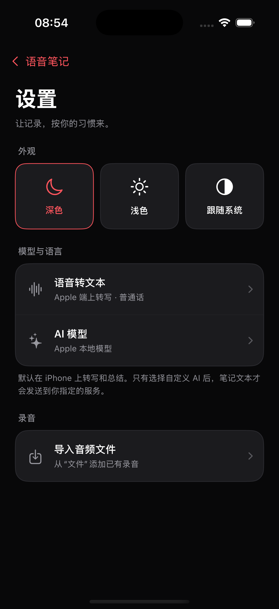
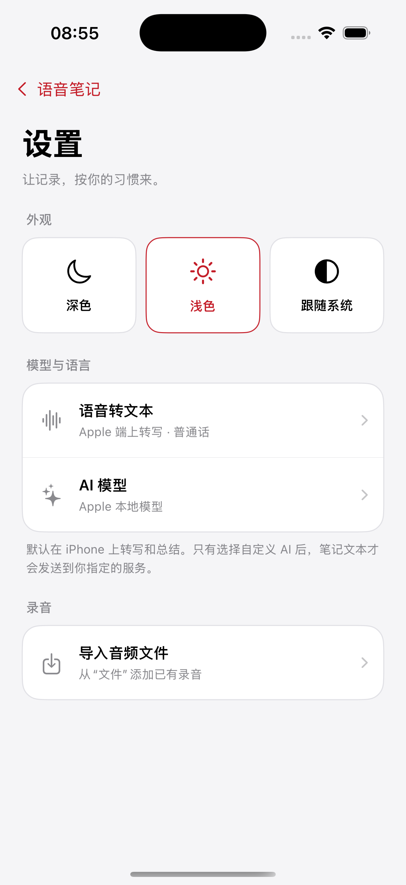
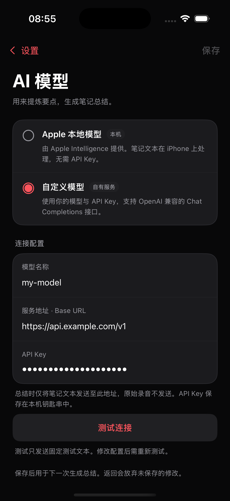
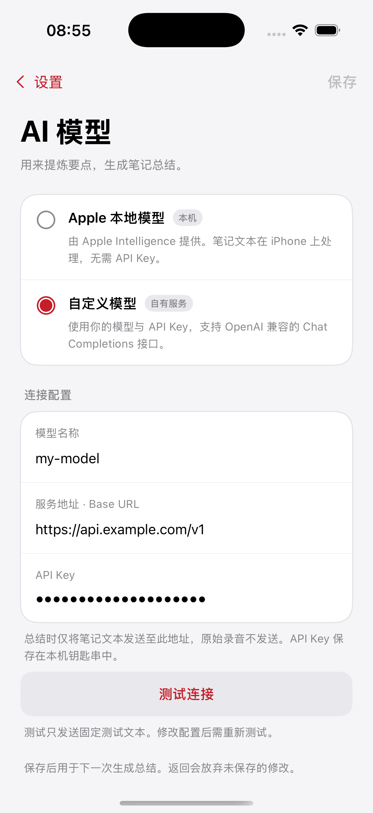

# iPhone 设置与 AI 总结接入 · 2026-10-19

依据：`prototype/iphone-notes.html`、`prototype/settings-design.md`。用户已反馈另一 agent 修复 Watch → iPhone 传输，真机 ASR 已通过；本轮只在现有通信对象上增加状态观察，未改写录音传输或 ASR 实现。

## 已实现

- 首页：Watch 状态按钮与设置入口。状态由 WCSession 的配对、安装、激活、可达性回调更新，App 回到前台时刷新。绿色表示可即时通信；弹出说明明确后台传输由系统安排，连接状态不等于单条录音已上传。
- 设置：深色、浅色、跟随系统；颜色覆盖列表、详情、播放器和设置页面，选择持久化。
- 语音转文本：Apple 端上转写、普通话 / English；保存应用到新的任务，返回放弃语言草稿。Whisper 标记“尚未接入”，不可选。
- 音频导入：移至设置；选定文件后返回列表，复用既有导入与端上 ASR。
- AI：Apple 本地 / 自定义 OpenAI 兼容 Chat Completions。模型 ID、Base URL、API Key 草稿；测试中、成功、失败状态；成功后才可保存。任何修改使旧测试结果失效，返回取消在途测试。
- 密钥：iOS Keychain，`kSecAttrAccessibleWhenUnlockedThisDeviceOnly`，无 iCloud 同步；普通设置独立存 UserDefaults。Keychain 保存失败不会替换已生效的配置。
- 总结：每次生成开始时固定所选模型，结果写回本地笔记。远程模式仅发送所选全文；测试仅固定短文本；长文本不截断，分段压缩再汇总。失败可重试，保留已有总结，不自动降级到其他服务。
- 网络：HTTPS，仅 loopback 可 HTTP；拒绝带账号/查询/锚点或完整 `/chat/completions` 的 Base URL。不跟随重定向，不持久化 Cookie/缓存；错误不回显服务正文。支持常规 `choices[0].message.content` 文本响应。

## 验证证据

### 代码与构建

- `sh apps/wrist-notes/scripts/test_local.sh` 全部通过：本地仓储、Watch 状态/分片、8 个录音手势场景、5 个笔记编辑场景、工程源文件/图标/Debug idle timer，以及新增配置/服务检查。
- 新增检查覆盖：URL/Key 约束、设置重载、Key 不进入普通配置、凭据保存失败原子性、模型/消息/请求头、固定测试文本、长文本完整分段、HTTP 401/429/500、空/不完整响应、断网、修改配置和 Key 后失效、异步旧结果、切回本地、Watch 可达性与配对的区别。
- iOS + watchOS 模拟器构建通过；generic iOS + watchOS 未签名真机构建通过。真机构建不代表新增设置已在实体设备验收。
- `Tests/EmbeddedWatchSmoke.sh` 通过；保留现有签名团队、Watch 图标和工程配置，增量加入 iPhone 源文件。
- 全量构建仍有已有的 Watch `AccentColor` 资源警告，不影响构建。
- 独立只读审查未发现 Critical / Important 问题，复跑本地检查通过。
- 最终版本已安装并启动到现有 iPhone 模拟器；预览副本已卸载，本地测试服务已停止。

### iOS 模拟器集成

使用独立 `com.vessel.wristnotes.preview`、虚构 Key、示例笔记及 `localhost` HTTP 测试服务，调用生产 `AISettingsModel`、`AppSettings`、`KeychainSecretStore`、`NotesModel.summarize`、`CustomAISummarizer`。

[机器可读结果](ai-integration-result.json)：`ok: true`，10 个检查通过，HTTP 请求契约通过。

实测链路：测试 → 保存 → 配置重新加载 → iOS Keychain 读写 → 所选模型生成总结 → 保存笔记状态 → 认证失败且旧配置保留 → 切回本地。服务实际只收到 3 次请求：固定测试、笔记全文总结、认证失败测试；切回本地后没有额外远程请求。

最初以 `CODE_SIGNING_ALLOWED=NO` 构建的模拟器副本缺少 application-identifier，Keychain 报 `-34018`。恢复 Xcode 正常模拟器签名后检查通过，没有改用明文存储。

### 原生界面

截图均来自隔离预览 App，使用示例文案、静音音频及虚构的配置。已核对显示，未通过自动触摸覆盖导航、导入选择器与系统外观切换的完整交互。

| 设置 · 深色 | 设置 · 浅色 |
| --- | --- |
|  |  |

| 自定义 AI · 深色 | 自定义 AI · 浅色 |
| --- | --- |
|  |  |

其他页面：[Apple 本地模型](iphone-ai-local-dark.png)、[转写设置](iphone-asr-dark.png)、[深色列表](iphone-list-dark.png)、[浅色列表](iphone-list-light.png)、[浅色详情](iphone-summary-light.png)。

## 实际服务与真机边界

- 未使用用户真实 API Key，也未向外部模型服务发送笔记；实际服务的兼容性、配额和总结质量需在 App 中配置并验证。
- Apple 本地模型仍取决于设备、系统资源和地区。测试模拟器报告模型可用，但生成时出现 FoundationModels 错误；此失败正确显示在笔记上，没有远程回退。
- 新增手表状态的 UI 映射与回调已编译及逻辑检查；实体 Apple Watch 的前后台可达性变化尚未由本轮操作验证。
- Whisper 下载、运行时与模型选择不在本次实现范围。

## 重现

```sh
sh apps/wrist-notes/scripts/test_local.sh
xcodebuild -quiet -project apps/wrist-notes/WristNotes.xcodeproj -scheme WristNotes -configuration Debug -destination 'generic/platform=iOS Simulator' -derivedDataPath /private/tmp/wristnotes-settings-derived build
sh apps/wrist-notes/Tests/EmbeddedWatchSmoke.sh /private/tmp/wristnotes-settings-derived/Build/Products/Debug-iphonesimulator/WristNotes.app
xcodebuild -quiet -project apps/wrist-notes/WristNotes.xcodeproj -scheme WristNotes -configuration Debug -destination 'generic/platform=iOS' -derivedDataPath /private/tmp/wristnotes-settings-device-derived CODE_SIGNING_ALLOWED=NO build
```

隔离预览：运行 `python3 apps/wrist-notes/scripts/prepare_ui_preview.py`，按返回路径构建并安装预览工程，模拟器构建保留正常签名（不要设置 `CODE_SIGNING_ALLOWED=NO`）。预览脚本不改动正式工程或数据。

```sh
python3 apps/wrist-notes/Tests/run_ai_integration_preview.py --device <iPhone模拟器UDID> --output /private/tmp/wristnotes-ai-result.json
```

截图页面由启动环境变量 `SIMCTL_CHILD_WN_PREVIEW_SCREEN=list|settings|asr|ai-local|ai-custom|summary|transcript` 选择，`SIMCTL_CHILD_WN_PREVIEW_THEME=dark|light` 选择外观。集成测试需要已安装这个预览副本；虚构 API Key 只写入预览包自己的 Keychain 条目。
