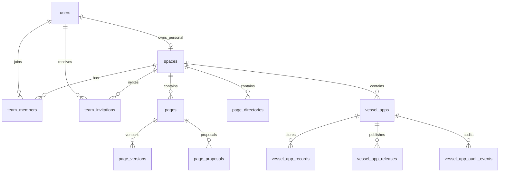

# Vessel 数据库 Schema

状态：身份与团队由 `0007_spaces_and_team_permissions` 实现；Pages/Apps 空间资源由 `0008_space_resources` 实现；App 设置、发布版本和审计事件由 `0010_app_management_publishing` 实现。以迁移和模型为最终执行依据。日期：2026-10-15。

## 1. 数据库边界

Vessel 使用独立 PostgreSQL 数据库。主键使用 UUID 字符串（当前 Pages 基线为 `varchar(36)`）；时间均为 UTC `timestamptz`。用户、空间、成员和邀请在同一数据库事务中维护。对象内容将由后续文件增量存入私有 OSS/S3；数据库只记录对象元数据。客户端给出的角色、用户 ID 和空间 ID 不能替代服务端查询得到的身份与权限。

迁移 `0001` 至 `0006` 来自 Baizhi Pages，创建账号与 Page 基线表；`0007` 增加空间与团队；`0008` 为 Pages/目录增加 `space_id` 并建立 Vessel Apps 表。`0008` 明确要求 Page 与目录为空，不执行历史数据回填。迁入的 Page Agent/提案表仍存在于基线 schema，但其路由在 Vessel 默认应用中不暴露；新 Page Agent 另行设计。

## 2. 身份与团队表

| 表 | 关键列 | 约束与用途 |
| --- | --- | --- |
| `users`（现有） | `user_id` PK、`email`、`name`、`status`、`roles`、`created_at` | 规范化邮箱唯一；`status=active/disabled`。`roles` 仅表示服务级管理员等全局身份，不决定团队权限。 |
| `user_credentials`（现有） | `user_id` PK/FK、`password_hash`、`updated_at` | Argon2id 哈希；删除用户级联删除凭据。 |
| `refresh_sessions`（现有） | `session_id` PK、`user_id` FK、`token_hash`、`expires_at`、`revoked_at` | 只存 Refresh Token 哈希，支持轮换与单会话撤销；有效访问 Token 每次仍查询用户状态。 |
| `spaces`（`0007`） | `space_id` PK、`kind`、`name`、`owner_user_id`、`created_by_user_id`、`status`、`created_at`、`updated_at` | `kind=personal/team`。个人空间必须有 `owner_user_id`，团队空间不得有；一个用户最多一个个人空间。团队的创建者仅作审计，不赋予永久权限。 |
| `team_members`（`0007`） | (`space_id`, `user_id`) PK、`role`、`status`、`joined_at`、`updated_at` | `space_id` 必须指向团队空间；`role=owner/admin/editor/viewer`；`status=active/removed`。至少一名有效 Owner 由事务中的业务约束保证。 |
| `team_invitations`（`0007`） | `invitation_id` PK、`space_id`、`invitee_user_id`、`invited_by_user_id`、`role`、`status`、`expires_at`、`created_at`、`responded_at` | 目标必须是已有 Vessel 用户；`status=pending/accepted/revoked/expired`。同一团队与用户最多一个 pending 邀请；接受时在同一事务中写成员并关闭邀请。 |

### 2.1 索引与外键

- `spaces.owner_user_id` 外键 `users.user_id`，仅个人空间非空；按 `owner_user_id, kind` 查个人空间，个人空间使用部分唯一索引。
- `team_members.space_id` 外键 `spaces.space_id`，`user_id` 外键 `users.user_id ON DELETE RESTRICT`；`(user_id,status)` 索引用于当前用户的团队列表。硬删除成员账号由数据库拒绝；账号停用须经服务流程核验 Owner 不变量。
- `team_invitations.space_id`、`invitee_user_id`、`invited_by_user_id` 都有外键；`(invitee_user_id,status,expires_at)` 支持待处理列表；`(space_id,invitee_user_id)` 上的 pending 部分唯一索引防止并发重复邀请。
- `pages`、`page_directories`、`vessel_apps` 带 `space_id` 并建立空间列表索引。记录通过 `app_id` 连接已判权 App，列表查询始终限定 App 和表。

团队空间类型由 API 在插入成员/邀请前核验；当前外键只保证 `space_id` 存在，数据库没有跨表检查 `spaces.kind=team`。所有团队写入须通过该服务层，不能绕过 API 直接写表。

### 2.2 新增表完整列定义

| 表 | 列与类型（`?` 表示可空） |
| --- | --- |
| `spaces` | `space_id varchar(36) PK`, `kind varchar(16)`, `name varchar(120)`, `owner_user_id varchar(36)? FK users`, `created_by_user_id varchar(36)? FK users`, `status varchar(16)`, `created_at timestamptz`, `updated_at timestamptz` |
| `team_members` | `space_id varchar(36) PK/FK spaces`, `user_id varchar(36) PK/FK users`, `role varchar(16)`, `status varchar(16)`, `joined_at timestamptz`, `updated_at timestamptz` |
| `team_invitations` | `invitation_id varchar(36) PK`, `space_id varchar(36) FK spaces`, `invitee_user_id varchar(36) FK users`, `invited_by_user_id varchar(36) FK users`, `role varchar(16)`, `status varchar(16)`, `expires_at timestamptz`, `created_at timestamptz`, `responded_at timestamptz?` |

### 2.3 状态与权限不变量

1. 注册/受控创建用户与个人空间在同一事务中完成；`0007` 回填已有用户的个人空间。重复请求不会生成第二个个人空间。
2. 团队创建时同时插入 `spaces(kind=team)` 和创建者的 `team_members(role=owner,status=active)`。
3. Owner/Admin 可邀请和管理成员；Admin 不能更改或移除 Owner。Editor 可读写资源，Viewer 只读。个人空间只有本人有 Owner 能力。
4. 邀请只能由目标账号自行接受；过期、撤销或目标账号停用时不能接受。移除成员后旧访问 Token 仍需在每次请求中通过数据库成员检查。
5. 降级或移除最后一位有效且账号状态为 active 的 Owner 必须拒绝。写操作与成员变更在 PostgreSQL 中锁定同一团队行，使撤权与写入按提交顺序生效。当前尚无停用账号 API；未来实现时也须在同一事务中保护 Owner 不变量。
6. 非成员查询团队和团队资源返回 404；有效成员缺少写/管理能力返回 403。所有列表都在 SQL 查询中限定可见空间。

## 3. 继承的 Pages 表字段

下列 Page 基线字段来自 `0001`–`0006`；`0008` 在 Page 与目录上增加非空 `space_id`。`pages.document_json`、版本和历史 Agent 相关 JSON 在 PostgreSQL 使用 JSONB；`users.roles` 使用 SQLAlchemy JSON。

| 表 | 列与类型（`?` 表示可空） |
| --- | --- |
| `users` | `user_id varchar(36) PK`, `email varchar(320) UNIQUE`, `name varchar(120)`, `status varchar(16)`, `roles json`, `created_at timestamptz` |
| `user_credentials` | `user_id varchar(36) PK/FK users`, `password_hash varchar(512)`, `updated_at timestamptz` |
| `refresh_sessions` | `session_id varchar(36) PK`, `user_id varchar(36) FK users`, `token_hash varchar(64) UNIQUE`, `created_at timestamptz`, `expires_at timestamptz`, `revoked_at timestamptz?` |
| `page_directories` | `directory_id varchar(36) PK`, `space_id varchar(36) FK spaces`, `owner_user_id varchar(36) FK users`, `name varchar(120)`, `status varchar(16)`, `created_at timestamptz`, `updated_at timestamptz` |
| `pages` | `page_id varchar(36) PK`, `space_id varchar(36) FK spaces`, `owner_user_id varchar(36) FK users`, `directory_id varchar(36)? FK page_directories`, `title varchar(256)`, `document_json jsonb`, `markdown text`, `revision integer`, `agent_thread_id varchar(128)?`, `status varchar(16)`, `created_at timestamptz`, `updated_at timestamptz` |
| `page_versions` | `version_id varchar(36) PK`, `page_id varchar(36) FK pages`, `revision integer`, `title varchar(256)`, `document_json jsonb`, `markdown text`, `source varchar(16)`, `actor_user_id varchar(36)?`, `run_id varchar(128)?`, `created_at timestamptz`；`(page_id,revision)` 唯一 |
| `page_proposals` | `proposal_id varchar(36) PK`, `page_id varchar(36) FK pages`, `owner_user_id varchar(36) FK users`, `base_revision integer`, `run_id varchar(128)`, `allow_full_rewrite boolean`, `status varchar(16)`, `operations jsonb`, `applied_operations jsonb`, `preview_title varchar(256)`, `preview_document jsonb`, `preview_markdown text`, `summary text?`, `failure_code varchar(64)?`, `accepted_revision integer?`, `acceptance_idempotency_key varchar(128)?`, `created_at timestamptz`, `updated_at timestamptz`；`(page_id,run_id)` 唯一 |
| `page_capabilities` | `capability_id varchar(36) PK`, `jti varchar(36) UNIQUE`, `owner_user_id varchar(36) FK users`, `page_id varchar(36) FK pages`, `run_id varchar(128)`, `scope varchar(128)`, `selection_json jsonb?`, `expires_at timestamptz`, `revoked_at timestamptz?`, `created_at timestamptz` |
| `page_assets` | `asset_id varchar(36) PK`, `owner_user_id varchar(36) FK users`, `page_id varchar(36) FK pages`, `object_key varchar(160) UNIQUE`, `content_type varchar(32)`, `size_bytes integer`, `sha256 varchar(64)`, `created_at timestamptz` |
| `page_agent_events` | `sequence_id integer PK`, `event_id varchar(36) UNIQUE`, `correlation_id varchar(128)`, `page_id varchar(36) FK pages`, `proposal_id varchar(36) FK page_proposals`, `run_id varchar(128)`, `event_type varchar(64)`, `payload jsonb`, `created_at timestamptz` |

## 4. Pages/Apps 空间资源（`0008`）

`0008` 在空 Page/目录表上加入非空 `space_id` 外键。`owner_user_id` 保留为创建者记录；读写依据资源所属空间及当前成员角色。Page、目录与 Page 图片的创建者外键改为 `ON DELETE RESTRICT`，防止账号硬删除时级联删除团队内容；当前没有账号硬删除 API。Page 必须引用同一空间内的目录。数据库外键只保证目录存在，跨空间一致性由 API 校验。团队成员撤销与资源写入锁定同一 `spaces` 行。

| 表 | 列与索引 |
| --- | --- |
| `vessel_apps` | `app_id varchar(36) PK`, `space_id varchar(36) FK spaces`, `name varchar(120)`, `description varchar(2000)`, `manifest_json jsonb`, `manifest_version integer`, `settings_version integer`, `status varchar(16)`, `created_by/updated_by/archived_by varchar(36) FK users`, `archived_at timestamptz?`, `created_at/updated_at timestamptz`; 索引 `(space_id,status)` |
| `vessel_app_records` | `record_id varchar(36) PK`, `app_id varchar(36) FK vessel_apps`, `table_name varchar(63)`, `values_json jsonb`, `row_version integer`, `created_by/updated_by varchar(36) FK users`, `deleted_at timestamptz?`, `created_at/updated_at timestamptz`; 索引 `(app_id,table_name,deleted_at,created_at,record_id)` |
| `vessel_app_releases` | `release_id varchar(36) PK`, `app_id varchar(36) FK vessel_apps`, `version integer`, `manifest_version integer`, `status varchar(32)`, `entry_file varchar(512)?`, `object_prefix/draft_object_key varchar(512) UNIQUE`, `file_count integer?`, `total_size_bytes bigint?`, `checksum_sha256 varchar(64)?`, `validation_error_code varchar(128)?`, `created_by/published_by varchar(36) FK users`, `created_at/published_at timestamptz?`, `is_current boolean`; `(app_id,version)` 唯一，且每个 App 最多一个 current 的 published release |
| `vessel_app_audit_events` | `event_id varchar(36) PK`, `app_id varchar(36) FK vessel_apps`, `release_id varchar(36)? FK vessel_app_releases`, `actor_user_id varchar(36) FK users`, `action varchar(64)`, `details_json jsonb`, `created_at timestamptz`; 索引 `(app_id,created_at,event_id)` |

Manifest 字段值以 Baizhi Apps 的标识符、类型和规范化规则为起点，使用当前 Manifest 做白名单验证；Vessel 首版将记录存于 JSONB，不创建每个 App 的物理业务表。该选择使新增表/可空字段与 Manifest 版本在单事务提交。大规模表格、专用索引与跨表关系需重新评估物理表方案。团队角色管整张 App，不沿用 Baizhi 的逐行 `owner_id/permission`。

当前账号 API 使用 `vessel-api` Token audience 和 `vessel_refresh` Cookie；环境变量仍采用 `PAGES_*` 前缀。邀请仅指向已存在且 active 的用户；受控终端命令可创建管理员或普通用户。邮箱验证、自助重置、正式生产账号开通 API 与审计表尚未实现，生产环境默认关闭自助注册。

通用文件、统一目录与 OSS/S3 对象键尚未在本增量创建；后续迁移会分别冻结 DDL。

## 5. 迁移与验收

迁移顺序：`0001`–`0006` 基线 → `0007` 个人/团队空间 → `0008` Pages/Apps 资源 → `0009` 文件元数据 → `0010` App 设置、发布版本和审计。Vessel 本增量按全新数据库部署；`0008` 检查 Page 与目录为空，非空则失败，不回填或重新归属历史 Page。生产恢复依靠数据库备份。

验收覆盖：新用户只有一个个人空间；创建团队后自动成为 Owner；邀请、接受、角色变更和撤权；最后 Owner 保护；非成员不可枚举；Page/Apps 资源的角色读写与跨空间隔离；隔离 PostgreSQL 上的真实 HTTP 用户路径。专项与核心测试合计不超过 100 例。

身份团队增量的历史验收记录为 90 个 API 用例通过；本轮 Pages/Apps 增量的实际测试命令、用例数与 E2E 结果以交付记录为准。`0008` 已在全新隔离 PostgreSQL 数据库上升级；旧数据迁移不在本轮范围。

完整产品关系与后续文件/表格/Page 设计见 [技术设计](technical-design.md)。
