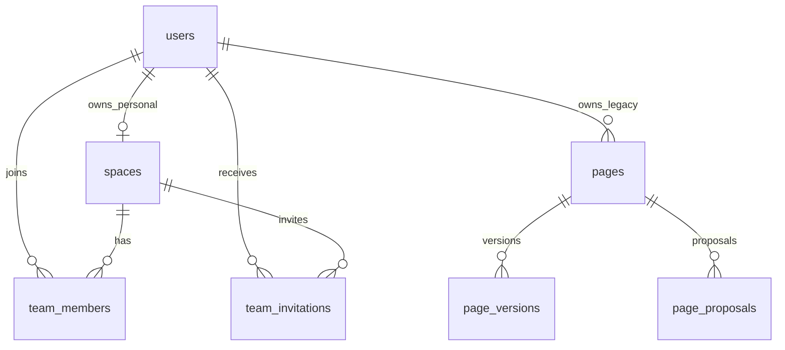

# Vessel 数据库 Schema

状态：身份与团队增量已由 Alembic `0007_spaces_and_team_permissions` 实现；以迁移和模型为最终执行依据。日期：2026-10-14。

## 1. 数据库边界

Vessel 使用独立 PostgreSQL 数据库。主键使用 UUID 字符串（当前 Pages 基线为 `varchar(36)`）；时间均为 UTC `timestamptz`。用户、空间、成员和邀请在同一数据库事务中维护。对象内容将由后续文件增量存入私有 OSS/S3；数据库只记录对象元数据。客户端给出的角色、用户 ID 和空间 ID 不能替代服务端查询得到的身份与权限。

现有迁移 `0001` 至 `0006` 来自 Baizhi Pages，已创建 `users`、`user_credentials`、`refresh_sessions`、`page_directories`、`pages`、`page_versions`、`page_proposals`、`page_capabilities`、`page_assets`、`page_agent_events`。这些表目前按 `owner_user_id` 归属个人。新迁移从 `0007` 开始，保留既有 Page 数据和修订链。

## 2. 身份与团队表

| 表 | 关键列 | 约束与用途 |
| --- | --- | --- |
| `users`（现有） | `user_id` PK、`email`、`name`、`status`、`roles`、`created_at` | 规范化邮箱唯一；`status=active/disabled`。`roles` 仅表示服务级管理员等全局身份，不决定团队权限。 |
| `user_credentials`（现有） | `user_id` PK/FK、`password_hash`、`updated_at` | Argon2id 哈希；删除用户级联删除凭据。 |
| `refresh_sessions`（现有） | `session_id` PK、`user_id` FK、`token_hash`、`expires_at`、`revoked_at` | 只存 Refresh Token 哈希，支持轮换与单会话撤销；有效访问 Token 每次仍查询用户状态。 |
| `spaces`（`0007`） | `space_id` PK、`kind`、`name`、`owner_user_id`、`created_by_user_id`、`status`、`created_at`、`updated_at` | `kind=personal/team`。个人空间必须有 `owner_user_id`，团队空间不得有；一个用户最多一个个人空间。团队的创建者仅作审计，不赋予永久权限。 |
| `team_members`（`0007`） | (`space_id`, `user_id`) PK、`role`、`status`、`joined_at`、`updated_at` | `space_id` 必须指向团队空间；`role=owner/admin/editor/viewer`；`status=active/removed`。至少一名有效 Owner 由事务中的业务约束保证。 |
| `team_invitations`（`0007`） | `invitation_id` PK、`space_id`、`invitee_user_id`、`invited_by_user_id`、`role`、`status`、`expires_at`、`created_at`、`responded_at` | 目标必须是已有 Vessel 用户；`status=pending/accepted/revoked/expired`。同一团队与用户最多一个 pending 邀请；接受时在同一事务中写成员并关闭邀请。 |

### 2.1 索引与外键

- `spaces.owner_user_id` 外键 `users.user_id`，仅个人空间非空；按 `owner_user_id, kind` 查个人空间，个人空间使用部分唯一索引。
- `team_members.space_id` 外键 `spaces.space_id`，`user_id` 外键 `users.user_id ON DELETE RESTRICT`；`(user_id,status)` 索引用于当前用户的团队列表。硬删除成员账号由数据库拒绝；账号停用须经服务流程核验 Owner 不变量。
- `team_invitations.space_id`、`invitee_user_id`、`invited_by_user_id` 都有外键；`(invitee_user_id,status,expires_at)` 支持待处理列表；`(space_id,invitee_user_id)` 上的 pending 部分唯一索引防止并发重复邀请。
- 团队资源的后续数据表必须带 `space_id` 并建立 `(space_id, status, ...)` 查询索引，防止先全局查询再靠客户端过滤。

团队空间类型由 API 在插入成员/邀请前核验；当前外键只保证 `space_id` 存在，数据库没有跨表检查 `spaces.kind=team`。所有团队写入须通过该服务层，不能绕过 API 直接写表。

### 2.2 新增表完整列定义

| 表 | 列与类型（`?` 表示可空） |
| --- | --- |
| `spaces` | `space_id varchar(36) PK`, `kind varchar(16)`, `name varchar(120)`, `owner_user_id varchar(36)? FK users`, `created_by_user_id varchar(36)? FK users`, `status varchar(16)`, `created_at timestamptz`, `updated_at timestamptz` |
| `team_members` | `space_id varchar(36) PK/FK spaces`, `user_id varchar(36) PK/FK users`, `role varchar(16)`, `status varchar(16)`, `joined_at timestamptz`, `updated_at timestamptz` |
| `team_invitations` | `invitation_id varchar(36) PK`, `space_id varchar(36) FK spaces`, `invitee_user_id varchar(36) FK users`, `invited_by_user_id varchar(36) FK users`, `role varchar(16)`, `status varchar(16)`, `expires_at timestamptz`, `created_at timestamptz`, `responded_at timestamptz?` |

### 2.3 状态与权限不变量

1. 注册/受控创建用户与个人空间在同一事务中完成；`0007` 回填已有用户的个人空间。重复请求不会生成第二个个人空间。
2. 团队创建时同时插入 `spaces(kind=team)` 和创建者的 `team_members(role=owner,status=active)`。
3. Owner/Admin 可邀请和管理成员；Admin 不能更改或移除 Owner。Editor 可读写资源，Viewer 只读。个人空间只有本人有 Owner 能力。
4. 邀请只能由目标账号自行接受；过期、撤销或目标账号停用时不能接受。移除成员后旧访问 Token 仍需在每次请求中通过数据库成员检查。
5. 降级或移除最后一位有效且账号状态为 active 的 Owner 必须拒绝。写操作与成员变更在 PostgreSQL 中锁定同一团队行，使撤权与写入按提交顺序生效。当前尚无停用账号 API；未来实现时也须在同一事务中保护 Owner 不变量。
6. 非成员查询团队和团队资源返回 404；有效成员缺少写/管理能力返回 403。所有列表都在 SQL 查询中限定可见空间。

## 3. 继承的 Pages 表字段

下列字段来自 `0001`–`0006`。`pages.document_json`、版本、提案、Page 能力和 Agent 事件中的内容 JSON 在 PostgreSQL 使用 JSONB；`users.roles` 使用 SQLAlchemy JSON。它们尚未有 `space_id`。

| 表 | 列与类型（`?` 表示可空） |
| --- | --- |
| `users` | `user_id varchar(36) PK`, `email varchar(320) UNIQUE`, `name varchar(120)`, `status varchar(16)`, `roles json`, `created_at timestamptz` |
| `user_credentials` | `user_id varchar(36) PK/FK users`, `password_hash varchar(512)`, `updated_at timestamptz` |
| `refresh_sessions` | `session_id varchar(36) PK`, `user_id varchar(36) FK users`, `token_hash varchar(64) UNIQUE`, `created_at timestamptz`, `expires_at timestamptz`, `revoked_at timestamptz?` |
| `page_directories` | `directory_id varchar(36) PK`, `owner_user_id varchar(36) FK users`, `name varchar(120)`, `status varchar(16)`, `created_at timestamptz`, `updated_at timestamptz` |
| `pages` | `page_id varchar(36) PK`, `owner_user_id varchar(36) FK users`, `directory_id varchar(36)? FK page_directories`, `title varchar(256)`, `document_json jsonb`, `markdown text`, `revision integer`, `agent_thread_id varchar(128)?`, `status varchar(16)`, `created_at timestamptz`, `updated_at timestamptz` |
| `page_versions` | `version_id varchar(36) PK`, `page_id varchar(36) FK pages`, `revision integer`, `title varchar(256)`, `document_json jsonb`, `markdown text`, `source varchar(16)`, `actor_user_id varchar(36)?`, `run_id varchar(128)?`, `created_at timestamptz`；`(page_id,revision)` 唯一 |
| `page_proposals` | `proposal_id varchar(36) PK`, `page_id varchar(36) FK pages`, `owner_user_id varchar(36) FK users`, `base_revision integer`, `run_id varchar(128)`, `allow_full_rewrite boolean`, `status varchar(16)`, `operations jsonb`, `applied_operations jsonb`, `preview_title varchar(256)`, `preview_document jsonb`, `preview_markdown text`, `summary text?`, `failure_code varchar(64)?`, `accepted_revision integer?`, `acceptance_idempotency_key varchar(128)?`, `created_at timestamptz`, `updated_at timestamptz`；`(page_id,run_id)` 唯一 |
| `page_capabilities` | `capability_id varchar(36) PK`, `jti varchar(36) UNIQUE`, `owner_user_id varchar(36) FK users`, `page_id varchar(36) FK pages`, `run_id varchar(128)`, `scope varchar(128)`, `selection_json jsonb?`, `expires_at timestamptz`, `revoked_at timestamptz?`, `created_at timestamptz` |
| `page_assets` | `asset_id varchar(36) PK`, `owner_user_id varchar(36) FK users`, `page_id varchar(36) FK pages`, `object_key varchar(160) UNIQUE`, `content_type varchar(32)`, `size_bytes integer`, `sha256 varchar(64)`, `created_at timestamptz` |
| `page_agent_events` | `sequence_id integer PK`, `event_id varchar(36) UNIQUE`, `correlation_id varchar(128)`, `page_id varchar(36) FK pages`, `proposal_id varchar(36) FK page_proposals`, `run_id varchar(128)`, `event_type varchar(64)`, `payload jsonb`, `created_at timestamptz` |

## 4. 与 Pages 基线的迁移关系

`0007` 不修改 Page 原有主键、`owner_user_id` 或历史表。`pages` 与 `page_directories` 仍是个人资源；它们在后续 Page 空间化迁移中增加 `space_id`，并由用户的个人空间回填。团队 Page、文件和表格 API 只有在各自域接入统一授权后开放。团队成员关系不能直接绕过当前个人 Page 的 Owner 校验。

当前账号 API 使用 `vessel-api` Token audience 和 `vessel_refresh` Cookie；环境变量仍采用 `PAGES_*` 前缀。邀请仅指向已存在且 active 的用户；受控终端命令可创建管理员或普通用户。邮箱验证、自助重置、正式生产账号开通 API 与审计表尚未实现，生产环境默认关闭自助注册。

后续资源表的预定最小外键形状：`items(item_id,space_id,kind,parent_folder_id,status,...)`；`files(item_id,...)`、`tables(item_id,...)`、`pages(item_id/space_id,...)`。这些表及 OSS/S3 对象键尚未在本增量创建，具体 DDL 在对应增量冻结。

## 5. 迁移与验收

迁移顺序：现有 `0001`–`0006` → `0007` 建团队表和索引 → 回填个人空间 → 应用服务切换用户创建事务。迁移可在已有 Pages 基线数据上执行，回滚 `0007` 会删除空间/成员/邀请数据，不能作为生产数据恢复方式。生产恢复依靠数据库备份。

验收至少覆盖：旧用户个人空间回填；新用户只有一个个人空间；创建团队后自动成为 Owner；邀请、接受、角色变更和撤权；最后 Owner 保护；非成员不可枚举；隔离 PostgreSQL 上的真实 HTTP 用户路径。专项与核心测试合计不超过 100 例。

本次验证：首批 5 条团队专项测试先因 API 缺失失败；新增撤销邀请、团队邀请列表和停用 Owner 回归测试也先失败。现有与新增 API 测试共 90 例，`pytest tests -q -p no:cacheprovider` 结果为 90 passed。隔离 PostgreSQL 从 `0006` 升级到 `0007` 后，旧用户个人空间计数为 1；Vessel 自有数据库脚本在全新隔离库迁移到 `0007`，真实 HTTP 脚本验证团队邀请、接受、角色变更、撤权、撤销邀请与非成员拒绝，以及默认禁止注册时本地普通账号开通、登录和个人空间。测试进程与数据库已停止。

完整产品关系与后续文件/表格/Page 设计见 [技术设计](technical-design.md)。
