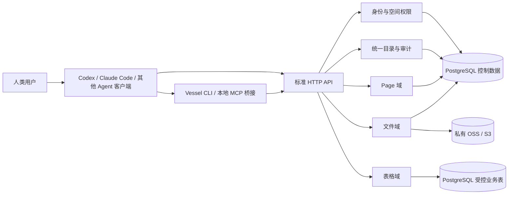

# Vessel: Agent 原生个人与团队存储服务技术设计

状态：总体设计稿；Pages API 基线与用户、团队、权限增量已实现，文件/表格/团队 Page 待实施

日期：2026-10-14

项目：Vessel（独立 Git 仓库、独立账号与独立服务）

目标读者：产品负责人、后端工程、Agent 客户端集成、运维与安全评审

## 1. 已确认的产品决定

1. Vessel 是供人类用户在 Codex、Claude Code、WorkBuddy 等 Agent 客户端中使用的持久存储服务。
2. 同时支持个人空间和团队空间；团队有多位成员。团队空间内的文件、表格、Page 对有效成员默认可见，读写由成员角色决定。
3. 文件内容存放在私有 OSS/S3 对象存储，提供类似 Google Drive 的文件管理能力。
4. 表格参考 Baizhi Apps 的受控 Schema 与数据 API；Page 参考 Baizhi Pages 的分块文档能力。
5. 产品自身只提供 API，不建设业务 Web UI。
6. Vessel 拥有独立账号系统，不依赖 Baizhi Agent Platform 的用户、Session 或数据库。

本文将尚未逐项确认的工程选择标为“建议”。它们构成可实施的首版契约，评审时可更改。

## 2. 范围与交付分期

Vessel 是一个产品，但按四个可单独验收的增量实施：

| 增量 | 交付物 | 可验收的用户路径 |
| --- | --- | --- |
| A：身份与空间 | 独立账号、Session、个人空间、团队、成员、角色、统一资源目录、审计 | 两人进入同一团队，第三人被拒绝 |
| B：文件 | OSS/S3 适配、文件夹、上传/下载、版本、移动、重命名、回收站 | Agent 上传文件，另一成员下载并查看版本 |
| C：表格 | 受控字段定义、Schema 变更、记录 CRUD、筛选和批量导入 | Agent 建表并从文件导入记录 |
| D：Page 与 Agent 入口 | 分块 Page、修订、引用、CLI/Skill、MCP 适配 | Agent 根据文件和表格写 Page，另一成员读取和编辑 |

每一增量必须有真实 HTTP E2E；完整产品的最终 E2E 串起四个增量。CLI/MCP 是 API 客户端，不持有业务数据库权限。首版不做 Web 编辑器、实时协同、公开分享链接、匿名访问、任意 SQL、任意代码执行、向量检索、自动 AI 解析流水线或跨团队共享。

## 3. 总体架构



Vessel 使用独立 Git 仓库与独立部署单元。FastAPI/Pydantic、SQLAlchemy/Alembic、PostgreSQL、对象存储适配器可沿用熟悉的技术栈；Vessel 不直连 Apps 或 Pages 生产数据库。模块边界是 `identity`、`spaces`、`items`、`files`、`tables`、`pages`、`audit` 和传输适配层。HTTP、CLI、MCP 调用同一应用服务与授权函数。

每个请求的可信上下文由服务端构造：`principal=(user_id, session_id, scopes)`，资源所属空间从数据库读取。客户端不能提交 `actor_user_id`、`team_role` 或 `workspace_id` 来覆盖授权判定；请求路径中的 `space_id` 只是目标，不是权限证明。

### 3.1 主要实体关系

```text
User ──1:1── Personal Space
User ──N:M── Team ──1:1── Team Space
Space ──1:N── Item (Folder | File | Table | Page)
File Item ──1:N── File Version ──1:1── Private Object
Table Item ──1:N── Schema Version ──1:N── Record
Page Item ──1:N── Page Version ──1:N── Block
Page Block ──0:N── Resource Reference (same Space)
```

`space_id` 是权限与配额边界，`item_id` 是跨域统一标识。删除团队或账号不能级联立刻擦除对象：需先冻结空间、保留审计，再执行明确的保留期与清理流程。

## 4. 身份、登录和团队权限

### 4.1 独立账号

建议首版使用 Vessel 本地账号：规范化邮箱唯一、Argon2id 密码哈希、短期签名访问 Token、可轮换的 Refresh Session。Token 的 `issuer` 和 `audience=vessel-api` 独立于 Baizhi。服务器保存 Refresh Token 的哈希，支持单设备退出、全部设备退出和账号停用。`vessel auth login` 在本机隐藏式提示密码，将会话放入操作系统凭据库；密码和 Token 不进入 Agent 对话、配置文件或日志。CLI 支持显式环境 `--env`，不将测试与生产凭据混用。

建议首版由服务器本地的 `vessel-admin bootstrap` 引导首个账号。配置邮件服务后，用户可通过 API/CLI 注册、接收一次性邮箱验证码、验证邮箱并重置密码；团队 Owner/Admin 向已验证的 Vessel 用户发出邀请，用户通过 API/CLI 接受后才成为有效成员。没有邮件服务时禁用公开注册和自助重置，由管理员在受控终端创建账号或重置凭据；团队邀请可通过已登录的 CLI 查询和接受，不把邀请码冒充为邮箱所有权证明。账号链接依据稳定 `user_id`，不依据邮箱字符串自动合并身份。OIDC 可作为后续登录方式，映射键为 `(issuer, subject)`，不以相同邮箱自动绑定已有账号。

当前实现使用现有的本地邮箱/密码登录与受配置控制的注册，团队邀请目标为已存在的 active 用户 ID。邮箱验证、重置邮件、普通用户的生产开通流程、CLI 凭据库集成和 OIDC 仍待独立增量；生产默认关闭公开注册。

HTTP API 使用 Bearer Access Token；本地 MCP 桥接从凭据库获得会话，远程 MCP 若提供则使用同一 Vessel 用户身份与独立 audience。对象存储凭据、数据库密码和签名私钥只存在服务端。

### 4.2 空间与角色

每个用户自动拥有一个 `personal` 空间；团队创建一个 `team` 空间。`team_invitations` 记录目标已验证用户、发起人、角色、到期时间和接受状态；团队成员关系是 `(team_id, user_id, role, status)`。接受邀请和建立成员关系在同一事务中完成。首版角色：

| 角色 | 浏览/下载/查询 | 创建与修改内容 | 回收站恢复 | 管理成员与空间 | 永久删除 |
| --- | --- | --- | --- | --- | --- |
| Owner | 是 | 是 | 是 | 是 | 是 |
| Admin | 是 | 是 | 是 | 是，不能移除最后一位 Owner | 是 |
| Editor | 是 | 是 | 是 | 否 | 否 |
| Viewer | 是 | 否 | 否 | 否 | 否 |

个人空间仅本人拥有 Owner 权限。团队资源由空间持有，创建者记录为审计信息，不形成额外的默认私有权限。首版没有单文件、单 Page、单表格或单记录 ACL；这与已确认的“团队成员默认可见”一致。团队成员被移除或停用后，新 API 请求立即失权。已签发的短期对象下载 URL 可能在剩余有效期内继续可用，建议 URL 有效期不超过 60 秒；若需要严格即时撤销，应使用 API 代理下载。

授权顺序固定为：验证会话 → 读取目标资源及空间 → 检查当前成员状态和操作能力 → 执行业务校验 → 在事务中写入并审计。写操作在同一事务中锁住或重新核验成员关系，使移除成员与写入形成明确顺序；移除提交之后不能再接受该成员的新写入。列表、搜索、版本、导出和错误消息遵循相同可见性；跨空间目标返回 404，避免资源枚举。

## 5. 统一目录与资源标识

`items` 是统一目录索引，字段包括 `item_id`、`space_id`、`parent_folder_id`、`kind=folder|file|table|page`、`name`、`normalized_name`、`status`、`created_by`、`updated_by`、时间戳和版本。不同资源域以同一个 `item_id` 连接自己的数据表。所有文件、表格和 Page 都可以放进文件夹；根目录是 `parent_folder_id=null`。

建议同一文件夹中的有效项目名称经过 Unicode 规范化和大小写折叠后唯一；禁止空名、路径分隔符和控制字符，限制 UTF-8 字节长度；冲突返回 `ITEM_NAME_CONFLICT`。资源 ID 不随重命名或移动变化。客户端显示路径，API 和跨资源引用始终使用 ID。移动时服务端检查同空间、目标是文件夹、无目录环、名称不冲突，并在事务中锁定相关节点。首版不支持跨空间移动；可用显式复制流程后续实现。

回收站以 `trashed_at` 和 `trashed_by` 实现。删除文件夹时整棵子树进入回收站；恢复前检测原父目录和名称是否仍可用，冲突时要求显式指定新位置或名称。永久清理由 Owner/Admin 请求，先记录审计，再异步清理对象；保留期和配额由部署配置设定。

## 6. 文件域

### 6.1 元数据与对象

`files` 保存当前版本 ID、声明 MIME、大小、SHA-256、状态；`file_versions` 保存每版不可变的对象键、上传人、大小、校验和及创建时间。对象键由服务端随机生成，与用户路径和原文件名无关。Bucket 必须私有，默认启用服务端加密、传输 TLS、生命周期与备份策略。对象内容不进入 PostgreSQL。

对象存储接口建议为 `create_upload`、`complete_upload`、`abort_upload`、`head`、`sign_download`、`delete_object`；实现 S3 和 OSS 两个适配器。不能假设 S3 multipart ETag 等于文件 SHA-256。完成上传后必须通过提供商校验和或服务端流式复验确认大小与 SHA-256，才可将版本标为 `ready`。校验失败的对象留在隔离状态，后台清理。

### 6.2 上传与下载协议

1. `POST /v1/spaces/{space_id}/files/uploads`：传入目标文件夹、名称、长度、SHA-256、MIME、`mode=create|new_version` 和幂等键；服务端建立待上传记录，并给出单段或分段的短期上传指令。
2. 客户端把字节直传私有 OSS/S3。URL 仅允许目标对象与所需方法，过期后必须重新申请；Vessel API 不返回长期对象存储凭据。
3. `POST /v1/file-uploads/{upload_id}/complete`：提交分段回执；服务端完成对象并进入 `verifying`。若校验可同步完成则返回 `ready`，否则返回 202 与状态 URL。`GET /v1/file-uploads/{upload_id}` 返回 `pending|uploading|verifying|ready|failed|expired`。校验成功才原子创建或切换当前文件版本；重复完成返回相同结果。
4. `GET /v1/files/{item_id}/download`：重新判权后返回不超过 60 秒的私有下载 URL、版本、长度与校验和。小型文本文件可由 CLI 下载后在本地解析；API 不把任意二进制内容塞入模型上下文。

另有目录列表、元数据读取、重命名、移动、版本列表/恢复、回收站/恢复和按名称及元数据搜索。上传协议支持取消、过期清理、部分失败重试和大小/配额限制。首版内容检索限文件名、类型和元数据；PDF、Office 等正文提取与全文索引是独立后续增量，不能把“存储成功”误报为“内容可搜索”。

## 7. 表格域

### 7.1 Schema 与物理存储

每个表格资源持有版本化 Manifest：字段名、类型、可空、默认值、索引和允许的操作。首版类型建议为 `text`、`integer`、`numeric`、`boolean`、`timestamp`、`uuid`、`json`；禁用原始 SQL 和客户端自定义物理表名。系统字段由服务端维护：`id`、`created_at`、`updated_at`、`created_by`、`updated_by`、`row_version`、`deleted_at`。因团队空间默认共享，Vessel 不沿用 Apps 的逐行 `owner_id/permission` 语义。

建议 PostgreSQL 控制表记录 Manifest，业务数据位于专用 `vessel_data` schema，每个表格有服务端生成的物理表名 `t_{table_id_hex}`；物理名称只由服务端的不可变 UUID 派生。Runtime DB role 只有受控 DML 权限；Migrator role 才能执行 DDL。字段标识、类型和值均经白名单验证；查询构造器参数化业务值。Manifest 的版本与 DDL 应在同一个数据库事务中推进，失败后不暴露半应用状态。

Schema 修改分两步：`POST /v1/tables/{id}/schema-proposals` 返回差异、兼容性和目标版本；`POST /v1/tables/{id}/schema-proposals/{proposal_id}/apply` 带预期版本与幂等键。首版支持新增可空字段，以及有数据库默认值的非空字段与安全索引；删除字段、改类型、重命名及数据回填另行设计。每次变更写审计与 Schema 历史。

### 7.2 记录 API

支持 create/get/query/update/trash/restore、批量 create 与导出。查询只允许声明过的字段、有限运算符、排序和游标分页，默认最多 100 条、上限 200 条；绝不暴露 raw SQL。更新要求 `expected_row_version`；冲突返回 409 和当前版本。批量写入有最大行数与字节数，事务语义明确为整批成功或整批失败。较大 CSV/JSONL 从已上传的文件版本发起 `prepare_import`，生成字段映射、错误和重复项预览；`commit_import` 校验文件及 Manifest 版本后幂等写入。文件内容必须来自同一空间中授权可读的对象，不能传服务器本地路径。

## 8. Page 域

`pages` 保存标题、规范化分块 JSON、确定性的 Markdown 表示、当前修订号与状态；`page_versions` 保存不可变快照、作者、时间、来源及可选 Agent 客户端请求 ID。借鉴 Pages 的顶层稳定 `block_id`。标题块定义章节边界：一个 heading 到下一个同级或更高级 heading 为一个 section；section ID 就是 heading 的 block ID。因而 Agent 能按 Page、section 或 block 读取，不必每次读取整篇。

首版保留段落、标题、列表、引用、代码、表格、图片和安全链接等受支持的节点；文档 `schema_version` 明确标记。文档中的文件或表格引用使用受控的 `resource_ref` 节点，目标为同空间的稳定资源 ID，表格记录可附行 ID。写入时验证目标存在且可读；读取时再次判权；删除目标后渲染为可辨认的失效引用，不悄悄改写历史版本。Markdown 是可导出的文本表示，分块 JSON 是权威格式。

Page 写入接受 `expected_revision`、`idempotency_key` 和有界操作数组：设标题、替换块、替换块内范围、在块后插入、移动块、删除块。范围替换还带预期旧文本或哈希。服务端先验证全部操作，再在事务中推进修订号与版本；冲突返回 `PAGE_REVISION_CONFLICT`，客户端应重读后重做。为适配无 UI 的 Agent 工作流，首版有 `preview` 端点返回差异，但正常写入通过授权的提交 API 完成，不依赖 Pages 现有 Web 编辑器的提案接受流程。全文替换仅用于新建 Page 或显式完整重写请求。

## 9. HTTP API 概览

统一前缀 `/v1`，JSON 返回稳定 `id`、`version/revision`、`request_id` 和错误 `code`；列表使用游标。业务资源的变更请求接受 `Idempotency-Key`，相同主体、操作、目标和请求体重放返回首个结果，键相同但内容不同返回 409。登录、Refresh 和密码流程使用自己的防重放规则，不存入业务幂等回执。

| 资源 | 主要端点 |
| --- | --- |
| 身份 | `POST /auth/login`、`/auth/refresh`、`/auth/logout`、`GET /auth/me`、注册/验证/重置 |
| 空间 | `GET /spaces`、`POST /teams`、`POST /teams/{id}/invitations`、`POST /team-invitations/{id}/accept`、`GET/PATCH/DELETE /teams/{id}/members` |
| 目录 | `GET/POST /spaces/{id}/items`、`PATCH /items/{id}`、`POST /items/{id}/trash`、`/restore` |
| 文件 | `POST /spaces/{id}/files/uploads`、`POST /file-uploads/{id}/complete`、`GET /files/{id}/download`、`GET /files/{id}/versions` |
| 表格 | `POST /spaces/{id}/tables`、`GET /tables/{id}/schema`、`POST /tables/{id}/schema-proposals`、`POST /tables/{id}/records/query`、记录 CRUD 与导入 |
| Page | `POST /spaces/{id}/pages`、`GET /pages/{id}`、`GET /pages/{id}/sections/{block_id}`、`POST /pages/{id}/operations/preview`、`/commit`、版本与 Markdown 导出 |
| 审计 | `GET /spaces/{id}/audit`，仅 Owner/Admin |

各增量实施前冻结该增量的 Pydantic 请求/响应 Schema 与 OpenAPI 契约。`401` 表示未认证，`403` 表示空间内已知资源但角色不足，`404` 表示不存在或不可见，`409` 表示版本/名称/幂等冲突，`413` 表示超额，`422` 表示结构或类型错误。日志保留 `request_id`、主体 ID、空间 ID、资源 ID 和错误码，不默认记录正文、密码或 Token。

### 9.1 请求与响应示例

邀请只接受目标已验证用户 ID、角色和团队 ID；请求者身份与现有角色来自登录会话及数据库：

```http
POST /v1/teams/team_123/invitations
Authorization: Bearer <access-token>
Idempotency-Key: invite-user-b-20261014
Content-Type: application/json

{"invitee_user_id":"user_b","role":"editor"}
```

文件上传意图使用同一空间的文件夹 ID；响应中的上传 URL 是短期能力，客户端不得持久化：

```json
{
  "parent_folder_id": "folder_123",
  "name": "research.csv",
  "size_bytes": 185234,
  "sha256": "<64-hex-digits>",
  "content_type": "text/csv",
  "mode": "create"
}
```

Page 块操作必须绑定读取时的修订号，并以稳定 block ID 定位。提交成功后返回新的修订号和版本 ID；同一幂等键重放不再生成版本：

```json
{
  "expected_revision": 7,
  "operations": [
    {
      "operation_id": "insert-summary-01",
      "type": "insert_blocks_after",
      "after_block_id": "block_intro",
      "blocks": [
        {
          "type": "paragraph",
          "attrs": {"block_id": "block_summary"},
          "content": [{"type": "text", "text": "已整理 32 条记录。"}]
        }
      ]
    }
  ]
}
```

错误体形状统一为 `{"error":{"code":"PAGE_REVISION_CONFLICT","message":"Page changed","request_id":"req_..."}}`。业务错误不得在 `message` 中泄露不可见资源的名称、存在性或正文。

## 10. Agent 客户端接入

建议先发布跨平台的 `vessel` CLI 与简短 Skill。CLI 使用 HTTPS API 和系统凭据库，提供 `auth`、`spaces`、`files`、`tables`、`pages` 命令；`--json` 输出稳定机器可读结果。每次操作显式选择命名环境；大文件走本地路径上传或下载，正文不经模型参数。删除、永久清理和 Schema apply 在 CLI 展示目标与差异，并要求交互式确认或明确 `--confirm`。

为支持 MCP 客户端，可提供本地 stdio MCP 桥接：它从 Vessel CLI 的凭据库读取会话，工具调用转发到相同 HTTP API；不提供本地数据库或 OSS 密钥。工具分组按空间与资源动态发现，至少有 list/search/get、文件上传/下载、表格 Schema/记录和 Page 区块操作。MCP 工具标记读写效果，遵循宿主客户端审批机制；服务端始终独立执行身份、成员与版本校验。WorkBuddy 的具体 CLI/MCP 支持方式在集成时实测，不能仅因协议存在就宣称兼容。

Vessel 不运行 Agent 模型，不保存 Agent 客户端的会话，也不代替人类用户决定任务。Agent 在当前用户授权下操作，并通过审计中的 `client_name` 与 `request_id` 标明来源。

## 11. 数据库与事务边界

控制面建议表：`users`、`user_credentials`、`refresh_sessions`、`teams`、`team_invitations`、`team_memberships`、`spaces`、`items`、`files`、`file_versions`、`file_uploads`、`tables`、`table_schema_versions`、`table_schema_proposals`、`pages`、`page_versions`、`idempotency_receipts`、`audit_events` 和 `outbox_events`。外键均包含或验证空间归属；核心列表索引以 `(space_id, parent_folder_id, status, normalized_name)` 为起点。

PostgreSQL 是元数据与 Page 的权威库。对象存储和数据库不能共享事务：上传采取“待上传 → 校验 → ready”的状态机，失败通过幂等重试与过期清理收敛；删除对象由数据库事务写 outbox 后异步执行，可重放且不能误删仍有引用的版本。表格 Schema DDL 与 Manifest 使用同一个 PostgreSQL 事务。Page 修改、版本、幂等回执和审计在一个事务提交。团队成员移除与权限判定不能依赖长期缓存。

## 12. 安全、限额与运行

- 每次对象 URL 签发前按当前用户和空间重新授权；私有 Bucket 禁止公开 ACL。下载 URL 很短，上传意图绑定长度、类型、目标与期限。
- 所有文本和文档节点做大小、深度、节点类型与 URL 协议限制；不执行文件、Page 代码块或表格内容。Markdown/HTML 导出时转义不可信内容。
- API 按账号和 IP 限速登录、注册、上传意图与查询；空间配额分别记录对象字节、文件数、表格行数、Page 数、最大请求体和批量操作数。
- 备份 PostgreSQL 与对象存储版本；记录恢复点和演练步骤。密钥由部署环境注入并支持轮换，不进入仓库。
- `/healthz` 只说明进程存活；`/readyz` 检查数据库与必要配置。对象存储故障时文件上传/下载返回可区分错误，已持久化的 Page/表格读写可继续服务。
- 审计记录身份、资源、操作、结果、前后版本与关联请求 ID；默认不记录内容或凭据。Owner/Admin 可按空间查询，平台运维访问另有明确流程。

## 13. 验收与测试

按工作区 `AGENTS.md` 的开发规则，每个增量先跑直接对应的专项测试，再跑受影响核心链路；大改动两者合计不超过 100 个测试用例，最后执行至少一条真实 E2E。纯设计文档只检查结构、链接、格式和差异。

完整 E2E 使用隔离 PostgreSQL、测试 OSS/S3 兼容端点和真实 Vessel HTTP 进程：用户 A 登录并建团队 → 邀请 B 为 Editor、C 为 Viewer → B/C 接受邀请 → A 通过 CLI 上传文件并完成校验 → B 下载并创建表格、导入记录 → B 创建带文件与表格引用的 Page → A 读取并以预期修订号编辑 → C 可读但写入被拒绝 → 非成员 D 不能枚举资源 → B 被移除后 API 立即失权。另验证上传重试、Page 修订冲突、Schema 版本冲突和对象清理重试。E2E 未实际跑通前不得宣称产品实现完成。

## 14. 与现有代码的复用边界

| 参考代码 | 可借鉴 | Vessel 必须改变 |
| --- | --- | --- |
| `src/baizhi_agent_runtime/apps/manifest.py`、`data_store.py`、`service.py` | 字段白名单、受控 DDL/CRUD、迁移提案、幂等与审计 | 移除 App/H5/Agent Runtime 绑定，改为团队空间权限；不照搬逐行 public/private |
| `tools/baizhi-apps-cli` | 独立 CLI、命名环境、系统凭据库、稳定 JSON | 更换为 Vessel 身份与资源 API，支持文件二进制传输 |
| Baizhi Pages 的 `document/codec.py`、`pages/router.py`、`page_version.py` | 分块验证、稳定 ID、Markdown、修订与版本 | 增加 team space、section 读取与资源引用；首版 API 写入不依赖 Web 提案 |
| Baizhi Pages 的 `assets/storage.py` | 路径/对象键安全、原子写与校验意识 | 通用文件改用私有 OSS/S3、分段上传与版本，不复用仅限图片的本地存储 |

实现时可以移植经验证的纯领域函数并保留许可与来源说明，避免 Vessel 在运行时依赖两个既有服务的内部模块。跨项目行为通过 Vessel 自己的契约测试验证。

## 15. 评审时需要确认的建议

以下不是先前已确认的产品决定；本设计给出默认推荐，批准后成为首版范围：

1. **账号开通**：本地邮箱/密码加邮箱验证；生产默认邀请加入团队，未验证邮箱不能获得团队权限。
2. **资源粒度**：首版只按空间角色共享，不做单项私有、外部分享或行级 ACL。
3. **目录**：统一文件夹可包含文件、表格和 Page；同一文件夹名称唯一。
4. **文件搜索**：首版查名称/元数据；正文索引另做增量。
5. **Agent 写入**：授权后可直接提交版本化变更；客户端展示预览并按自身审批机制放行。Vessel 服务器负责权限、冲突、幂等和审计。
6. **首个生产对象存储**：S3 与 OSS 都有适配器契约；先选一个真实提供商完成端到端发布，另一个以兼容性测试与独立验收交付。

用户已指定先开发账号、团队与团队权限；该增量的数据库约束见 [db-schema.md](db-schema.md)。B/C/D 仍按独立增量实施。部署环境、域名、对象存储提供商和商业配额在相应增量实施前确定；本设计和后续代码均以 Vessel 独立仓库为归属。
